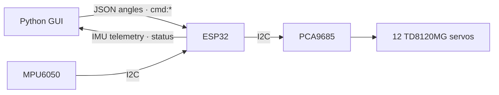
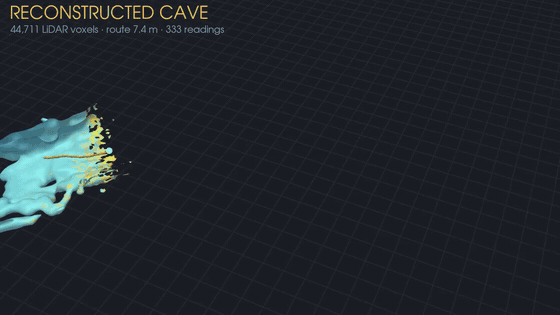
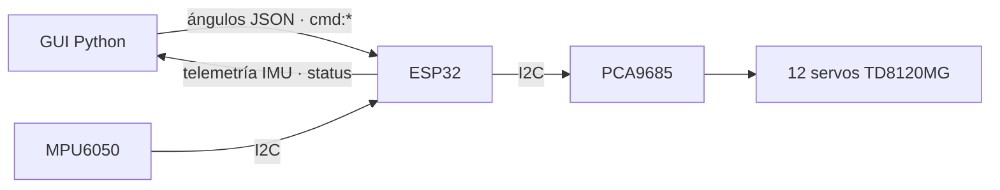

<p align="center">
  
</p>

<h1 align="center">Spot Micro Twins</h1>

<p align="center">
  <a href="#english"><b>English</b></a> · <a href="#español"><b>Español</b></a>
</p>

<p align="center">
  <br>
  <sub>Physical prototype of the quadruped robot based on the open-source repository
  <a href="https://gitlab.com/public-open-source/spotmicroai/3dprinting">SpotMicroAI (3D Printing)</a>.</sub>
</p>

---

# English

<p align="right"><a href="#español">Leer en español ↓</a></p>

<p align="center"><em>“The loyalty of a dog, the precision of a robot.”</em></p>

## Description

- Zoomorphic robot that mimics the locomotion of a four-legged mammal.
- Yellow finish for teaching demonstrations.
- MPU6050 gyroscope for stability on uneven terrain.
- Durable, high-quality 3D printing.
- Rubber caps on the feet for better traction.

## Technical specifications

| | |
|---|---|
| **Speed** | 10 m/h, constant (intentionally low: it gives the LiDAR time to map the cave optimally) |
| **Force** | 40 kg |
| **Structure** | 3D printed |
| **Capability** | Climbs stairs and moves over uneven terrain |
| **Features** | Highly adaptable |
| **Surfaces** | Optimal for complex, uneven surfaces |

## Mechanical design

<p align="center">
  
</p>

- 4 articulated legs, 3 degrees of freedom per leg (**12 DoF**).
- Structural parts printed in **PETG/PLA**.
- **TD8120MG 20 kg·cm metal-gear servos** for the main joints.
- Geometry inspired by the morphology of real quadrupeds.
- Rubber caps on the feet for better grip.

## Electronics

- **ESP32** as the main controller (processing + WiFi/Bluetooth).
- **16-channel PCA9685** for precise servo PWM.
- **MPU6050** (gyroscope + accelerometer) for stability and balance.
- Expansion board to keep the signals organized.
- 12 V switching power supply as the main power source.



| Connection | Detail |
|---|---|
| PCA9685 | I2C, address **0x42**, channels 0–11 = 4 legs × 3 joints |
| MPU6050 | I2C, address 0x68 (SDA 21, SCL 22) |
| Status LEDs | WiFi 16 · WebSocket 17 · sending 18 · receiving 27 · PCA 26 |

All pins and constants live in [`firmware/spotmicro_esp32/config.h`](firmware/spotmicro_esp32/config.h).

## Electrical specifications

| Component | V min | V max | V nominal | Current | Power |
|---|---|---|---|---|---|
| TD8120MG servo (20 kg) | 4.8 V | 7.4 V | 6.4 V | 1–2 A (3 A peak) | 6.4–12.8 W |
| PCA9685 | 2.3 V | 5.5 V | 5 V | 10–30 mA | < 0.2 W |
| Expansion board | 4.8 V | 5.5 V | 5 V | 0.5 A max | 2.5 W |
| ESP32 | 3.0 V | 3.6 V | 3.3 V | 80–240 mA | 0.8 W |
| MPU6050 | 2.3 V | 3.4 V | 3.3 V | 3–5 mA | 0.015 W |
| Power supply | 12 V | 12 V | 12 V | 30 A | 360 W |

## Applications

- Teaching and educational demonstrations.
- Entertainment and hobby robotics.
- Research on quadruped locomotion.
- Testing stability algorithms.
- Developing robotic control systems.

## Results

- Stable locomotion on flat surfaces at a constant 10 m/h. The speed is intentionally low
  so the LiDAR has time to map the cave optimally.
- Payload of up to 2 kg while staying stable.
- Fast servo response with precise angles.
- Stable wireless link up to 15 meters away.
- Can clear obstacles up to 5 cm high.
- Stability on uneven terrain thanks to the MPU6050.

---

## Code

### Repository layout

| Folder | Contents |
|---|---|
| `firmware/spotmicro_esp32/` | **Current firmware (V6)**: modular sketch, builds with PlatformIO or Arduino IDE |
| `firmware/legacy/` | Historical versions V1–V5 (WiFi credentials removed) |
| `desktop/spotmicro_gui.py` | Control GUI: inverse kinematics, PID, joystick, routines and gaits |
| `desktop/kinematics.py` | Headless IK and calibration (used by the GUI, the viewers and external controllers) |
| `desktop/gait.py` | Gaits with a live command `set_command(vx, vy, turn)` |
| `desktop/spot_walk.py` | Keyboard-driven gait viewer |
| `desktop/notebooks/Kinematicsv1.ipynb` | Notebook with the full evolution of the GUI |
| `calibration/offset-default.json` | Servo offsets used by the GUI |
| `docs/` | Technical documentation, poster and images |

### Firmware: build and upload

1. Copy `firmware/spotmicro_esp32/secrets.example.h` to `secrets.h` and fill in your WiFi (`secrets.h` is in `.gitignore`).
2. **PlatformIO** (recommended, installs the libraries for you):
   ```bash
   cd firmware
   pio run -t upload
   pio device monitor
   ```
   `pio run -e esp32dev-debug -t upload` enables per-packet logs.
3. **Arduino IDE**: open `firmware/spotmicro_esp32/spotmicro_esp32.ino` and install
   ArduinoWebsockets (gilmaimon), **ArduinoJson 7.x**, Adafruit MPU6050 and Adafruit PWM Servo Driver.

The serial monitor prints the IP. It also answers at `ws://spotmicro.local:81` (mDNS).

### Desktop GUI

On Windows, run `setup_env.bat` once and open **`iniciar_interfaz.bat`**.
This is the original notebook interface: 3D skeleton, per-leg sliders,
body position and rotation, calibration, joystick, routines and the
inverse and differential kinematics tabs. Sending to the ESP32 starts disabled.

You can also start it from a terminal:

```bash
cd desktop
pip install -r requirements.txt
python spotmicro_gui.py
```

Set `ESP32_IP` at the top of the script to the ESP32's IP (or `spotmicro.local`).

The GUI validates all 12 angles before every send, including the per-servo
calibration limits, in both the inverse and the differential controls.
Invalid values block the whole packet; they are not turned into 180°.
IMU confirmations are shown when the ESP32's reply arrives.

### 3D viewer

This extra app plays the dance with the CAD model; to drive the
skeleton with sliders, use the desktop GUI described above.

```bash
python desktop/spot_viewer.py
python desktop/spot_viewer.py --single
```

Articulated CAD model with fill lighting, contact shadows and uniform
scale on all three axes. Drag to rotate and use the wheel to zoom.
The buttons reset the initial view or switch to side and top views;
the skeleton, the floor and the triangle mesh can be toggled separately.


### Live-command gait

`gait.py` takes forward, lateral and turn commands in [-1, 1] at any moment, so the
direction can change while walking (GUI sliders, keyboard or an external controller):

```python
from kinematics import Kinematics
from gait import GaitManager

gait = GaitManager(Kinematics())
gait.set_gait("trotting")
gait.set_command(0.8, 0.0, -0.3)   # walk forward turning right
feet = gait.step(0.02)             # 4 feet (x, y, z) for the IK
```

```bash
python desktop/spot_walk.py   # W/S forward · A/D sideways · Q/E turn · 1/2/3 gait
python desktop/gait.py --check
```

### Fly brain

The Spot can be driven by the **whole *Drosophila* brain** (FlyWire connectome,
138,639 neurons) simulated on the GPU, reproducing the published model by
Shiu et al. (r = 0.999 neuron by neuron). It explores a **real LiDAR-scanned cave**
(Grotte de la Sourde, scaled to a mine gallery): it follows the trail of a gas leak
with the fly's pursuit circuit, steers around heat sources and flees threats with the
Giant Fiber. It carries a **Spot Arm–style arm** with the **360° LiDAR on its head**,
which looks around and rebuilds the cave in 3D as it moves. Full explanation in
[`desktop/fly_brain/README.md`](desktop/fly_brain/README.md) (v2; the previous version is in
[`README_v1.md`](desktop/fly_brain/README_v1.md)).


<p align="center">
  <a href="docs/assets/spot-micro-cueva.mp4">
    
  </a><br>
  <sub><b>Cave rebuilt by the LiDAR (13 s)</b> · click for the high-quality video</sub>
</p>

```bash
cd desktop
fly_brain\.venv\Scripts\python spot_brain.py
```

### Hardware-free checks

```bash
python -m unittest discover -s desktop/tests -v
python desktop/spot_dance.py --check
python desktop/gait.py --check
```

These tests cover angle packets, calibration limits, IMU replies and the dance
kinematics; they do not replace physical validation on the robot.

### Original ESP32 code

The original integrated sketch is complete in
[`firmware/legacy/v5_integrated/v5_integrated.ino`](firmware/legacy/v5_integrated/v5_integrated.ino),
including its `loop()`, and uses the `TU_SSID` and `TU_PASSWORD` placeholders.
The recommended firmware is still [`firmware/spotmicro_esp32`](firmware/spotmicro_esp32):
credentials are set only in `secrets.h`, which is excluded from Git.

### WebSocket protocol (port 81)

| Message from the PC | ESP32 reply |
|---|---|
| `[a0, …, a11]` (12 angles, 0–180°) | — (moves the servos) |
| `[[a,b,c], [a,b,c], [a,b,c], [a,b,c]]` (per leg) | — |
| `{"command":"get_mpu_data"}` or `cmd:get_mpu_data` | telemetry (below) |
| `cmd:start_mpu_stream` / `cmd:stop_mpu_stream` | `{"status":"MPU stream started/stopped"}` and telemetry at 10 Hz |
| `cmd:calibrate_imu` | `{"status":"IMU calibrated"}` (robot still and level, ~1 s) |
| `cmd:reset_imu` | `{"status":"IMU reset"}` |
| `cmd:get_offsets` | `{"status":"offsets_data","accel_offsets":[…],"gyro_offsets":[…]}` |
| `cmd:set_offsets:ax,ay,az,gx,gy,gz` | `{"status":"Offsets updated"}` |
| `cmd:ping` | — (fail-safe heartbeat) |
| anything invalid | `{"status":"error","error":"…"}` |

**Command-loss fail-safe:** if the ESP32 goes 1 s without receiving any message
(GUI closed, WiFi down or a hung socket), the robot holds still in the last pose it
received, with the servos holding torque, and reports it on the serial monitor. When the
link comes back it continues with the next angle packet. The GUI sends `cmd:ping` every
200 ms while sending to the ESP32 is enabled, so a still pose does not trigger it. A custom
controller must send angles or `cmd:ping` at least once per second (`FAILSAFE_TIMEOUT_MS`
in `config.h`).

```json
{"sensor":"mpu6050","accel":{"x":0,"y":0,"z":0},"gyro":{"x":0,"y":0,"z":0},
 "orientation":{"roll":0,"pitch":0,"yaw":0},"temp":25.1,"calibrated":true}
```

### V6: changes from V5

Same protocol as V5 plus `cmd:ping` for the fail-safe.

**Latency / performance**
- `server.accept()` blocked the loop until a client arrived; now it is only called when `server.poll()` reports a pending connection.
- Removed the ~15 `Serial.print` calls per angle packet (at 115200 baud they blocked for several ms). They are still available with `SPOT_DEBUG=1`.
- No more ack for every angle packet. The GUI does not use it and, if nobody read the socket, the TCP buffer filled up and blocked the ESP32 (`ACK_ANGLE_PACKETS` in `config.h`).
- `WiFi.setSleep(false)` removes the modem-sleep latency.
- I2C goes from 100 kHz to 400 kHz, and only channels whose pulse changed are written.
- The loop goes from `delay(10)` to `delay(1)`, and JSON is serialized into a stack buffer instead of a `String`.

**Fixes**
- In the roll/pitch complementary filter, V5 integrated the gyroscope in rad/s together with angles in degrees, so the gyro barely counted. The filter now really fuses both and runs at 100 Hz.
- Angle packets are fully validated before moving: in V5 a non-numeric value became 0° and moved the servo.
- If the MPU6050 does not respond, the robot keeps working without the IMU (V5 hung in `while(1)`).
- `set_offsets` with incomplete values is rejected instead of applying zeros.
- A new client replaces the previous one, useful when the GUI reconnects while an old socket is half open.
- Fail-safe: after 1 s without messages the robot holds still in the last pose and reports it on the serial monitor.

**Organization**
- Credentials out of the code (`secrets.h`), `servos` / `imu` / `comms` / `leds` modules, `platformio.ini` with pinned versions and a GitHub CI that builds every push.

---

## Credits

<table>
<tr>
<td>

**Authors:** Profundización II (day program)<br>
**Organization:** Universitaria Agustiniana<br>
**Supervising professor:** Raúl Alejandro Barbosa Rodriguez<br>
**Base repository:** [SpotMicroAI / 3D Printing](https://gitlab.com/public-open-source/spotmicroai/3dprinting)<br>
**Main components:** ESP32, PCA9685, MPU6050, 20 kg servos, 3D-printed structure

</td>
<td align="center">
  <br>
  <sub>Scan to see the project</sub>
</td>
</tr>
</table>

📄 [Project poster](docs/poster/index.html) · 📘 [Full technical documentation](docs/spotmicrov3_code_documentation_v1.0.0.md)

<p align="right"><a href="#english">Back to top ↑</a> · <a href="#español">Leer en español ↓</a></p>

---

# Español

<p align="right"><a href="#english">Read in English ↑</a></p>

<p align="center">
  
</p>

<h2 align="center">Spot Micro Twins</h2>

<p align="center">
  <br>
  <sub>Prototipo físico del robot cuadrúpedo basado en el repositorio open-source
  <a href="https://gitlab.com/public-open-source/spotmicroai/3dprinting">SpotMicroAI (3D Printing)</a>.</sub>
</p>

<p align="center"><em>“La lealtad de un perro, la precisión de un robot.”</em></p>

## Descripción

- Robot zoomorfo que simula el comportamiento motriz de un animal cuadrúpedo mamífero.
- Color amarillo para demostraciones didácticas.
- Giroscopio MPU6050 para estabilidad en terreno irregular.
- Impresión 3D duradera de alta calidad.
- Tapones de goma en las bases para mejor tracción.

## Especificaciones técnicas

| | |
|---|---|
| **Velocidad** | 10 m/h constantes (baja a propósito: da tiempo al LiDAR para mapear la cueva de forma óptima) |
| **Fuerza** | 40 kg |
| **Estructura** | Impresión 3D |
| **Capacidad** | Subir escaleras y moverse en terrenos irregulares |
| **Características** | Gran capacidad de adaptación |
| **Superficies** | Óptimo para superficies complejas e irregulares |

## Arquitectura mecánica

<p align="center">
  
</p>

- 4 patas articuladas, 3 grados de libertad por pata (**12 DoF**).
- Partes estructurales impresas en **PETG/PLA**.
- **Servomotores metálicos TD8120MG de 20 kg·cm** para las articulaciones principales.
- Geometría inspirada en la morfología de cuadrúpedos reales.
- Tapones de goma en las bases para mejor adherencia.

## Electrónica

- **ESP32** como controlador principal (procesamiento + WiFi/Bluetooth).
- **PCA9685 de 16 canales** para generar PWM preciso a los servos.
- **MPU6050** (giroscopio + acelerómetro) para estabilidad y equilibrio.
- Placa de expansión para ordenar las señales.
- Fuente conmutada de 12 V para la alimentación principal.



| Conexión | Detalle |
|---|---|
| PCA9685 | I2C, dirección **0x42**, canales 0–11 = 4 patas × 3 articulaciones |
| MPU6050 | I2C, dirección 0x68 (SDA 21, SCL 22) |
| LEDs de estado | WiFi 16 · WebSocket 17 · envío 18 · recepción 27 · PCA 26 |

Todos los pines y constantes están en [`firmware/spotmicro_esp32/config.h`](firmware/spotmicro_esp32/config.h).

## Especificaciones eléctricas

| Componente | V mín | V máx | V nominal | Corriente | Potencia |
|---|---|---|---|---|---|
| Servo TD8120MG (20 kg) | 4.8 V | 7.4 V | 6.4 V | 1–2 A (pico 3 A) | 6.4–12.8 W |
| PCA9685 | 2.3 V | 5.5 V | 5 V | 10–30 mA | < 0.2 W |
| Placa expansión | 4.8 V | 5.5 V | 5 V | 0.5 A máx | 2.5 W |
| ESP32 | 3.0 V | 3.6 V | 3.3 V | 80–240 mA | 0.8 W |
| MPU6050 | 2.3 V | 3.4 V | 3.3 V | 3–5 mA | 0.015 W |
| Fuente | 12 V | 12 V | 12 V | 30 A | 360 W |

## Aplicaciones

- Demostraciones didácticas y educativas.
- Entretenimiento y robótica hobby.
- Investigación en locomoción cuadrúpeda.
- Pruebas de algoritmos de estabilidad.
- Desarrollo de sistemas de control robótico.

## Resultados obtenidos

- Locomoción estable en superficies planas a velocidad constante de 10 m/h. Es una velocidad
  intencionalmente baja para que el LiDAR tenga tiempo de mapear la cueva de forma óptima.
- Capacidad de carga de hasta 2 kg manteniendo la estabilidad.
- Respuesta rápida de los servomotores con ángulos precisos.
- Comunicación inalámbrica estable hasta 15 metros de distancia.
- Capacidad de sortear obstáculos de hasta 5 cm de altura.
- Estabilidad en terrenos irregulares gracias al MPU6050.

---

## Código

### Estructura del repositorio

| Carpeta | Contenido |
|---|---|
| `firmware/spotmicro_esp32/` | **Firmware actual (V6)**: sketch modular, compila con PlatformIO o Arduino IDE |
| `firmware/legacy/` | Versiones históricas V1–V5 (credenciales WiFi eliminadas) |
| `desktop/spotmicro_gui.py` | GUI de control: cinemática inversa, PID, joystick, rutinas y gaits |
| `desktop/kinematics.py` | IK y calibración sin interfaz (la usan GUI, visores y controladores externos) |
| `desktop/gait.py` | Marchas con comando en vivo `set_command(vx, vy, giro)` |
| `desktop/spot_walk.py` | Visor de marcha manejado con el teclado |
| `desktop/notebooks/Kinematicsv1.ipynb` | Notebook con la evolución completa de la GUI |
| `calibration/offset-default.json` | Offsets de los servos que usa la GUI |
| `docs/` | Documentación técnica, póster e imágenes |

### Firmware: compilar y subir

1. Copia `firmware/spotmicro_esp32/secrets.example.h` a `secrets.h` y pon tu WiFi (`secrets.h` está en `.gitignore`).
2. **PlatformIO** (recomendado, instala las librerías solo):
   ```bash
   cd firmware
   pio run -t upload
   pio device monitor
   ```
   `pio run -e esp32dev-debug -t upload` activa logs por paquete.
3. **Arduino IDE**: abre `firmware/spotmicro_esp32/spotmicro_esp32.ino` e instala
   ArduinoWebsockets (gilmaimon), **ArduinoJson 7.x**, Adafruit MPU6050 y Adafruit PWM Servo Driver.

El monitor serie muestra la IP. También responde como `ws://spotmicro.local:81` (mDNS).

### GUI de escritorio

En Windows, ejecuta `setup_env.bat` una vez y abre **`iniciar_interfaz.bat`**.
Esta es la interfaz original del notebook: esqueleto 3D, sliders por pata,
posición y rotación del cuerpo, calibración, joystick, rutinas y las pestañas
de cinemática inversa y diferencial. El envío al ESP32 empieza desactivado.

También puedes iniciarla desde una terminal:

```bash
cd desktop
pip install -r requirements.txt
python spotmicro_gui.py
```

Cambia `ESP32_IP` al inicio del script por la IP del ESP32 (o `spotmicro.local`).

La GUI valida los 12 ángulos antes de cada envío, incluyendo los límites por servo
de la calibración, tanto en los controles inversos como en los diferenciales.
Los valores inválidos bloquean el paquete completo; no se convierten en 180°.
Las confirmaciones del IMU se muestran al recibir la respuesta del ESP32.

### Visor 3D

Esta aplicación adicional reproduce el baile con el modelo CAD; para manejar
el esqueleto con sliders usa la GUI de escritorio descrita arriba.

```bash
python desktop/spot_viewer.py
python desktop/spot_viewer.py --single
```

Modelo CAD articulado con iluminación de relleno, sombras de apoyo y escala
uniforme en los tres ejes. Arrastra para girar y usa la rueda para acercar.
Los botones permiten volver a la vista inicial o elegir lateral y superior;
puedes activar el esqueleto, el suelo y la malla de triángulos por separado.


### Marcha con comando en vivo

`gait.py` recibe en cada momento avance, lateral y giro en [-1, 1], así que la
dirección se puede cambiar mientras camina (sliders de la GUI, teclado o un
controlador externo):

```python
from kinematics import Kinematics
from gait import GaitManager

gait = GaitManager(Kinematics())
gait.set_gait("trotting")
gait.set_command(0.8, 0.0, -0.3)   # avanza girando a la derecha
feet = gait.step(0.02)             # 4 pies (x, y, z) para la IK
```

```bash
python desktop/spot_walk.py   # W/S avanzar · A/D lateral · Q/E girar · 1/2/3 marcha
python desktop/gait.py --check
```

### Cerebro de mosca

El Spot puede manejarse con el **cerebro completo de *Drosophila*** (conectoma
FlyWire, 138.639 neuronas) simulado en la GPU, reproduciendo el modelo publicado de
Shiu et al. (r = 0,999 neurona a neurona). Explora una **cueva real escaneada con
LiDAR** (Grotte de la Sourde, a escala de galería de mina): sigue el rastro de una
fuga de gas con el circuito de persecución de la mosca, rodea las fuentes de calor y
huye de las amenazas con la Giant Fiber. Lleva un **brazo al estilo del Spot Arm**
con el **LiDAR 360° en la cabeza**, que mira alrededor y reconstruye la cueva en 3D
mientras avanza. Explicación completa en
[`desktop/fly_brain/README.md`](desktop/fly_brain/README.md) (v2; la versión anterior está en
[`README_v1.md`](desktop/fly_brain/README_v1.md)).


<p align="center">
  <a href="docs/assets/spot-micro-cueva.mp4">
    
  </a><br>
  <sub><b>Cueva reconstruida con el LiDAR (13 s)</b> · haz clic para el video en alta calidad</sub>
</p>

```bash
cd desktop
fly_brain\.venv\Scripts\python spot_brain.py
```

### Comprobaciones sin hardware

```bash
python -m unittest discover -s desktop/tests -v
python desktop/spot_dance.py --check
python desktop/gait.py --check
```

Estas pruebas comprueban los envíos de ángulos, límites de calibración, respuestas
del IMU y la cinemática del baile; no sustituyen la validación física del robot.

### Código ESP32 original

El sketch integrado original está completo en
[`firmware/legacy/v5_integrated/v5_integrated.ino`](firmware/legacy/v5_integrated/v5_integrated.ino),
incluido su `loop()`, y usa los marcadores `TU_SSID` y `TU_PASSWORD`.
El firmware recomendado sigue siendo [`firmware/spotmicro_esp32`](firmware/spotmicro_esp32):
las credenciales se configuran únicamente en `secrets.h`, excluido de Git.

### Protocolo WebSocket (puerto 81)

| Mensaje del PC | Respuesta del ESP32 |
|---|---|
| `[a0, …, a11]` (12 ángulos, 0–180°) | — (mueve los servos) |
| `[[a,b,c], [a,b,c], [a,b,c], [a,b,c]]` (por pata) | — |
| `{"command":"get_mpu_data"}` o `cmd:get_mpu_data` | telemetría (abajo) |
| `cmd:start_mpu_stream` / `cmd:stop_mpu_stream` | `{"status":"MPU stream started/stopped"}` y telemetría a 10 Hz |
| `cmd:calibrate_imu` | `{"status":"IMU calibrated"}` (robot quieto y plano, ~1 s) |
| `cmd:reset_imu` | `{"status":"IMU reset"}` |
| `cmd:get_offsets` | `{"status":"offsets_data","accel_offsets":[…],"gyro_offsets":[…]}` |
| `cmd:set_offsets:ax,ay,az,gx,gy,gz` | `{"status":"Offsets updated"}` |
| `cmd:ping` | — (heartbeat del fail-safe) |
| cualquier cosa inválida | `{"status":"error","error":"…"}` |

**Fail-safe por pérdida de comandos:** si el ESP32 pasa 1 s sin recibir ningún mensaje
(GUI cerrada, WiFi caído o socket colgado), el robot se queda estático en la última pose
recibida, con los servos haciendo fuerza, y lo indica en el monitor serie. Al volver la
comunicación sigue con el siguiente paquete de ángulos. La GUI envía `cmd:ping` cada
200 ms mientras el envío al ESP32 está activo, así que una pose quieta no lo dispara. Un
controlador propio debe enviar ángulos o `cmd:ping` al menos cada segundo
(`FAILSAFE_TIMEOUT_MS` en `config.h`).

```json
{"sensor":"mpu6050","accel":{"x":0,"y":0,"z":0},"gyro":{"x":0,"y":0,"z":0},
 "orientation":{"roll":0,"pitch":0,"yaw":0},"temp":25.1,"calibrated":true}
```

### V6: cambios respecto a V5

Mismo protocolo que V5 más `cmd:ping` para el fail-safe.

**Latencia / rendimiento**
- `server.accept()` bloqueaba el loop hasta que llegara un cliente; ahora solo se llama cuando `server.poll()` indica una conexión pendiente.
- Se quitaron los ~15 `Serial.print` por paquete de ángulos (a 115200 baud bloqueaban varios ms). Quedan disponibles con `SPOT_DEBUG=1`.
- Ya no se envía un ack por cada paquete de ángulos. La GUI no lo usa y, si nadie leía el socket, el buffer TCP se llenaba y bloqueaba el ESP32 (`ACK_ANGLE_PACKETS` en `config.h`).
- `WiFi.setSleep(false)` elimina la latencia del modem-sleep.
- El I2C pasa de 100 kHz a 400 kHz, y solo se escriben los canales cuyo pulso cambió.
- El loop pasa de `delay(10)` a `delay(1)`, y los JSON se serializan en un buffer de stack en lugar de `String`.

**Correcciones**
- En el filtro complementario de roll/pitch, V5 integraba el giroscopio en rad/s junto con ángulos en grados, así que el giro casi no contaba. Ahora el filtro fusiona de verdad y corre a 100 Hz.
- Los paquetes de ángulos se validan completos antes de mover: en V5 un valor no numérico se convertía en 0° y movía el servo.
- Si el MPU6050 no responde, el robot sigue funcionando sin IMU (V5 se quedaba en `while(1)`).
- `set_offsets` con valores incompletos se rechaza en vez de aplicar ceros.
- Un cliente nuevo reemplaza al anterior, útil cuando la GUI se reconecta con un socket viejo medio abierto.
- Fail-safe: tras 1 s sin mensajes el robot se queda estático en la última pose y lo avisa por el monitor serie.

**Organización**
- Credenciales fuera del código (`secrets.h`), módulos `servos` / `imu` / `comms` / `leds`, `platformio.ini` con versiones fijadas y CI de GitHub que compila cada push.

---

## Créditos

<table>
<tr>
<td>

**Autores:** Profundización II diurno<br>
**Organización:** Universitaria Agustiniana<br>
**Docente encargado:** Raúl Alejandro Barbosa Rodriguez<br>
**Repositorio base:** [SpotMicroAI / 3D Printing](https://gitlab.com/public-open-source/spotmicroai/3dprinting)<br>
**Componentes principales:** ESP32, PCA9685, MPU6050, servos 20 kg, estructura 3D

</td>
<td align="center">
  <br>
  <sub>Escanea para ver el proyecto</sub>
</td>
</tr>
</table>

📄 [Póster del proyecto](docs/poster/index.html) · 📘 [Documentación técnica completa](docs/spotmicrov3_code_documentation_v1.0.0.md)

<p align="right"><a href="#english">Read in English ↑</a></p>
