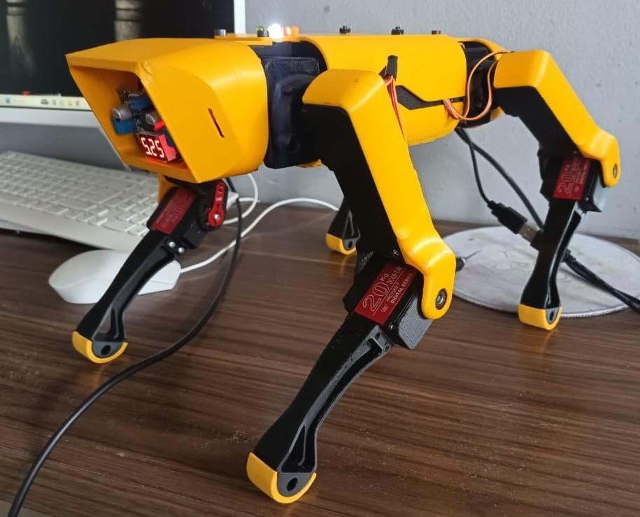
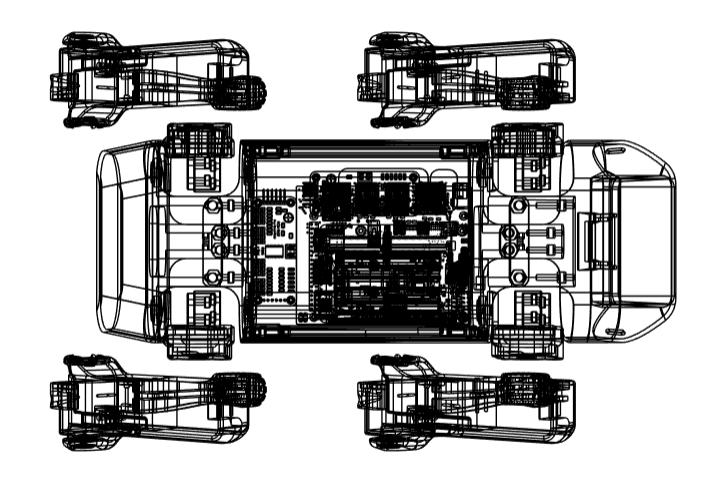
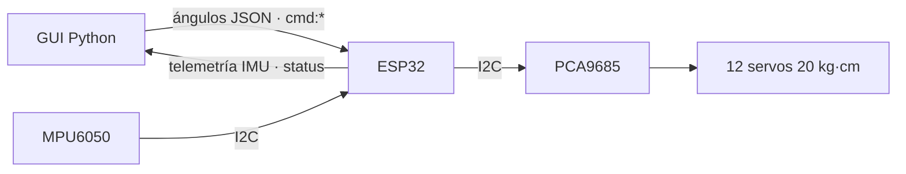
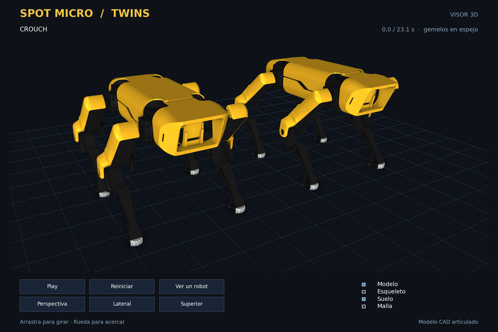
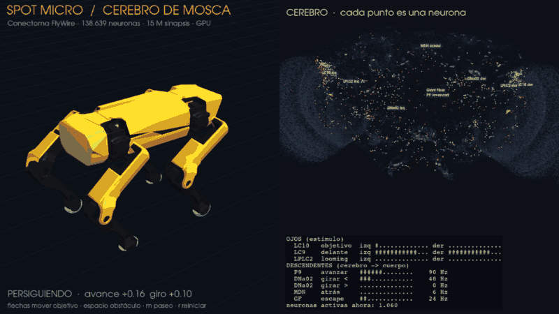

<p align="center">
  
</p>

<h1 align="center">Spot Micro Twins</h1>

<p align="center"><em>“La lealtad de un perro, la precisión de un robot.”</em></p>

<p align="center">
  <br>
  <sub>Prototipo físico del robot cuadrúpedo basado en el repositorio open-source
  <a href="https://gitlab.com/public-open-source/spotmicroai/3dprinting">SpotMicroAI (3D Printing)</a>.</sub>
</p>

---

## Descripción

- Robot zoomorfo que simula el comportamiento motriz de un animal cuadrúpedo mamífero.
- Color amarillo para demostraciones didácticas.
- Giroscopio MPU6050 para estabilidad en terreno irregular.
- Impresión 3D duradera de alta calidad.
- Tapones de goma en las bases para mejor tracción.

## Especificaciones técnicas

| | |
|---|---|
| **Velocidad** | 10 m/h constantes |
| **Fuerza** | 40 kg |
| **Estructura** | Impresión 3D |
| **Capacidad** | Subir escaleras y moverse en terrenos irregulares |
| **Características** | Alta velocidad y gran capacidad de adaptación |
| **Superficies** | Óptimo para superficies complejas e irregulares |

## Arquitectura mecánica

<p align="center">
  
</p>

- 4 patas articuladas, 3 grados de libertad por pata (**12 DoF**).
- Partes estructurales impresas en **PETG/PLA**.
- **Servomotores de 20 kg·cm** para las articulaciones principales.
- Geometría inspirada en la morfología de cuadrúpedos reales.
- Tapones de goma en las bases para mejor adherencia.

## Electrónica

- **ESP32** como controlador principal (procesamiento + WiFi/Bluetooth).
- **PCA9685 de 16 canales** para generar PWM preciso a los servos.
- **MPU6050** (giroscopio + acelerómetro) para estabilidad y equilibrio.
- Placa de expansión para ordenar las señales.
- Fuente conmutada de 12 V para la alimentación principal.



| Conexión | Detalle |
|---|---|
| PCA9685 | I2C, dirección **0x42**, canales 0–11 = 4 patas × 3 articulaciones |
| MPU6050 | I2C, dirección 0x68 (SDA 21, SCL 22) |
| LEDs de estado | WiFi 16 · WebSocket 17 · envío 18 · recepción 27 · PCA 26 |

Todos los pines y constantes están en [`firmware/spotmicro_esp32/config.h`](firmware/spotmicro_esp32/config.h).

## Especificaciones eléctricas

| Componente | V mín | V máx | V nominal | Corriente | Potencia |
|---|---|---|---|---|---|
| Servo 20 kg | 4.8 V | 7.4 V | 6.4 V | 1–2 A (pico 3 A) | 12–18 W |
| PCA9685 | 2.3 V | 5.5 V | 5 V | 10–30 mA | < 0.2 W |
| Placa expansión | 4.8 V | 5.5 V | 5 V | 0.5 A máx | 2.5 W |
| ESP32 | 3.0 V | 3.6 V | 3.3 V | 80–240 mA | 0.8 W |
| MPU6050 | 2.3 V | 3.4 V | 3.3 V | 3–5 mA | 0.015 W |
| Fuente | 12 V | 12 V | 12 V | 30 A | 360 W |

## Aplicaciones

- Demostraciones didácticas y educativas.
- Entretenimiento y robótica hobby.
- Investigación en locomoción cuadrúpeda.
- Pruebas de algoritmos de estabilidad.
- Desarrollo de sistemas de control robótico.

## Resultados obtenidos

- Locomoción estable en superficies planas a velocidad constante de 10 m/h.
- Capacidad de carga de hasta 2 kg manteniendo la estabilidad.
- Respuesta rápida de los servomotores con ángulos precisos.
- Comunicación inalámbrica estable hasta 15 metros de distancia.
- Capacidad de sortear obstáculos de hasta 5 cm de altura.
- Estabilidad en terrenos irregulares gracias al MPU6050.

---

## Código

### Estructura del repositorio

| Carpeta | Contenido |
|---|---|
| `firmware/spotmicro_esp32/` | **Firmware actual (V6)**: sketch modular, compila con PlatformIO o Arduino IDE |
| `firmware/legacy/` | Versiones históricas V1–V5 (credenciales WiFi eliminadas) |
| `desktop/spotmicro_gui.py` | GUI de control: cinemática inversa, PID, joystick, rutinas y gaits |
| `desktop/kinematics.py` | IK y calibración sin interfaz (la usan GUI, visores y controladores externos) |
| `desktop/gait.py` | Marchas con comando en vivo `set_command(vx, vy, giro)` |
| `desktop/spot_walk.py` | Visor de marcha manejado con el teclado |
| `desktop/notebooks/Kinematicsv1.ipynb` | Notebook con la evolución completa de la GUI |
| `calibration/offset-default.json` | Offsets de los servos que usa la GUI |
| `docs/` | Documentación técnica, póster e imágenes |

### Firmware: compilar y subir

1. Copia `firmware/spotmicro_esp32/secrets.example.h` a `secrets.h` y pon tu WiFi (`secrets.h` está en `.gitignore`).
2. **PlatformIO** (recomendado, instala las librerías solo):
   ```bash
   cd firmware
   pio run -t upload
   pio device monitor
   ```
   `pio run -e esp32dev-debug -t upload` activa logs por paquete.
3. **Arduino IDE**: abre `firmware/spotmicro_esp32/spotmicro_esp32.ino` e instala
   ArduinoWebsockets (gilmaimon), **ArduinoJson 7.x**, Adafruit MPU6050 y Adafruit PWM Servo Driver.

El monitor serie muestra la IP. También responde como `ws://spotmicro.local:81` (mDNS).

### GUI de escritorio

En Windows, ejecuta `setup_env.bat` una vez y abre **`iniciar_interfaz.bat`**.
Esta es la interfaz original del notebook: esqueleto 3D, sliders por pata,
posición y rotación del cuerpo, calibración, joystick, rutinas y las pestañas
de cinemática inversa y diferencial. El envío al ESP32 empieza desactivado.

También puedes iniciarla desde una terminal:

```bash
cd desktop
pip install -r requirements.txt
python spotmicro_gui.py
```

Cambia `ESP32_IP` al inicio del script por la IP del ESP32 (o `spotmicro.local`).

La GUI valida los 12 ángulos antes de cada envío, incluyendo los límites por servo
de la calibración, tanto en los controles inversos como en los diferenciales.
Los valores inválidos bloquean el paquete completo; no se convierten en 180°.
Las confirmaciones del IMU se muestran al recibir la respuesta del ESP32.

### Visor 3D

Esta aplicación adicional reproduce el baile con el modelo CAD; para manejar
el esqueleto con sliders usa la GUI de escritorio descrita arriba.

```bash
python desktop/spot_viewer.py
python desktop/spot_viewer.py --single
```

Modelo CAD articulado con iluminación de relleno, sombras de apoyo y escala
uniforme en los tres ejes. Arrastra para girar y usa la rueda para acercar.
Los botones permiten volver a la vista inicial o elegir lateral y superior;
puedes activar el esqueleto, el suelo y la malla de triángulos por separado.



### Marcha con comando en vivo

`gait.py` recibe en cada momento avance, lateral y giro en [-1, 1], así que la
dirección se puede cambiar mientras camina (sliders de la GUI, teclado o un
controlador externo):

```python
from kinematics import Kinematics
from gait import GaitManager

gait = GaitManager(Kinematics())
gait.set_gait("trotting")
gait.set_command(0.8, 0.0, -0.3)   # avanza girando a la derecha
feet = gait.step(0.02)             # 4 pies (x, y, z) para la IK
```

```bash
python desktop/spot_walk.py   # W/S avanzar · A/D lateral · Q/E girar · 1/2/3 marcha
python desktop/gait.py --check
```

### Cerebro de mosca

El Spot puede manejarse con el cerebro completo de *Drosophila* (conectoma FlyWire,
138.639 neuronas) simulado en la GPU. En una cueva simulada sigue el rastro de una
fuga de gas con el circuito de persecución de la mosca (LC10 → DNa02), rodea una
fuente de calor y huye de las amenazas con la Giant Fiber, mientras un LiDAR 3D
reconstruye la cueva. Tiene un botón de terreno escarpado. El simulador reproduce
el modelo publicado de Shiu et al. (r = 0,999 neurona a neurona). Detalles en
[`desktop/fly_brain/`](desktop/fly_brain/README.md).



```bash
cd desktop
fly_brain\.venv\Scripts\python spot_brain.py
```

### Comprobaciones sin hardware

```bash
python -m unittest discover -s desktop/tests -v
python desktop/spot_dance.py --check
python desktop/gait.py --check
```

Estas pruebas comprueban los envíos de ángulos, límites de calibración, respuestas
del IMU y la cinemática del baile; no sustituyen la validación física del robot.

### Código ESP32 original

El sketch integrado original está completo en
[`firmware/legacy/v5_integrated/v5_integrated.ino`](firmware/legacy/v5_integrated/v5_integrated.ino),
incluido su `loop()`, y usa los marcadores `TU_SSID` y `TU_PASSWORD`.
El firmware recomendado sigue siendo [`firmware/spotmicro_esp32`](firmware/spotmicro_esp32):
las credenciales se configuran únicamente en `secrets.h`, excluido de Git.

### Protocolo WebSocket (puerto 81)

| Mensaje del PC | Respuesta del ESP32 |
|---|---|
| `[a0, …, a11]` (12 ángulos, 0–180°) | — (mueve los servos) |
| `[[a,b,c], [a,b,c], [a,b,c], [a,b,c]]` (por pata) | — |
| `{"command":"get_mpu_data"}` o `cmd:get_mpu_data` | telemetría (abajo) |
| `cmd:start_mpu_stream` / `cmd:stop_mpu_stream` | `{"status":"MPU stream started/stopped"}` y telemetría a 10 Hz |
| `cmd:calibrate_imu` | `{"status":"IMU calibrated"}` (robot quieto y plano, ~1 s) |
| `cmd:reset_imu` | `{"status":"IMU reset"}` |
| `cmd:get_offsets` | `{"status":"offsets_data","accel_offsets":[…],"gyro_offsets":[…]}` |
| `cmd:set_offsets:ax,ay,az,gx,gy,gz` | `{"status":"Offsets updated"}` |
| cualquier cosa inválida | `{"status":"error","error":"…"}` |

```json
{"sensor":"mpu6050","accel":{"x":0,"y":0,"z":0},"gyro":{"x":0,"y":0,"z":0},
 "orientation":{"roll":0,"pitch":0,"yaw":0},"temp":25.1,"calibrated":true}
```

### V6: cambios respecto a V5

Mismo protocolo que V5, así que la GUI funciona sin cambios.

**Latencia / rendimiento**
- `server.accept()` bloqueaba el loop hasta que llegara un cliente; ahora solo se llama cuando `server.poll()` indica una conexión pendiente.
- Se quitaron los ~15 `Serial.print` por paquete de ángulos (a 115200 baud bloqueaban varios ms). Quedan disponibles con `SPOT_DEBUG=1`.
- Ya no se envía un ack por cada paquete de ángulos. La GUI no lo usa y, si nadie leía el socket, el buffer TCP se llenaba y bloqueaba el ESP32 (`ACK_ANGLE_PACKETS` en `config.h`).
- `WiFi.setSleep(false)` elimina la latencia del modem-sleep.
- El I2C pasa de 100 kHz a 400 kHz, y solo se escriben los canales cuyo pulso cambió.
- El loop pasa de `delay(10)` a `delay(1)`, y los JSON se serializan en un buffer de stack en lugar de `String`.

**Correcciones**
- En el filtro complementario de roll/pitch, V5 integraba el giroscopio en rad/s junto con ángulos en grados, así que el giro casi no contaba. Ahora el filtro fusiona de verdad y corre a 100 Hz.
- Los paquetes de ángulos se validan completos antes de mover: en V5 un valor no numérico se convertía en 0° y movía el servo.
- Si el MPU6050 no responde, el robot sigue funcionando sin IMU (V5 se quedaba en `while(1)`).
- `set_offsets` con valores incompletos se rechaza en vez de aplicar ceros.
- Un cliente nuevo reemplaza al anterior, útil cuando la GUI se reconecta con un socket viejo medio abierto.

**Organización**
- Credenciales fuera del código (`secrets.h`), módulos `servos` / `imu` / `comms` / `leds`, `platformio.ini` con versiones fijadas y CI de GitHub que compila cada push.

### Pendiente

- Fail-safe: postura segura si no llegan comandos en N ms.
- Guardar offsets del IMU en NVS (`Preferences`) para no recalibrar en cada arranque.
- Terminar de separar la GUI en módulos (ya están `kinematics.py` y `gait.py`; falta `gui.py`, comunicación…).

---

## Créditos

<table>
<tr>
<td>

**Autores:** Profundización II diurno<br>
**Organización:** Universitaria Agustiniana<br>
**Docente encargado:** Raúl Alejandro Barbosa Rodriguez<br>
**Repositorio base:** [SpotMicroAI / 3D Printing](https://gitlab.com/public-open-source/spotmicroai/3dprinting)<br>
**Componentes principales:** ESP32, PCA9685, MPU6050, servos 20 kg, estructura 3D

</td>
<td align="center">
  <br>
  <sub>Escanea para ver el proyecto</sub>
</td>
</tr>
</table>

📄 [Póster del proyecto](docs/poster/index.html) · 📘 [Documentación técnica completa](docs/spotmicrov3_code_documentation_v1.0.0.md)
