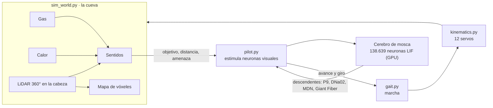

# Spot Micro con cerebro de mosca

El Spot Micro explora una cueva real manejado por el **cerebro completo de una
mosca** (*Drosophila*, conectoma FlyWire v783: 138.639 neuronas y 15 millones de
conexiones) simulado en la GPU. Busca una fuga de gas, rodea las fuentes de
calor, huye de lo que se le acerca y, con un LiDAR montado en la cabeza de su
brazo, reconstruye la cueva en 3D mientras avanza.


La mosca **decide** (avanzar, girar, huir, retroceder) y `gait.py` hace de médula
espinal: convierte esas decisiones en pasos de las cuatro patas.

---

## Índice

1. [Cómo funciona](#cómo-funciona)
2. [Instalación](#instalación)
3. [Uso](#uso)
4. [La interfaz](#la-interfaz)
5. [El cerebro](#el-cerebro)
6. [El robot y su brazo](#el-robot-y-su-brazo)
7. [El LiDAR](#el-lidar)
8. [La cueva](#la-cueva)
9. [La misión](#la-misión)
10. [El mapa y el explorador de la cueva](#el-mapa-y-el-explorador-de-la-cueva)
11. [Rendimiento](#rendimiento)
12. [El simulador y su validación](#el-simulador-y-su-validación)
13. [Pruebas](#pruebas)
14. [Archivos](#archivos)
15. [Datos y licencias](#datos-y-licencias)
16. [Limitaciones conocidas](#limitaciones-conocidas)

---

## Cómo funciona



En cada paso (1/24 s):

1. **Mundo:** el robot se mueve, el LiDAR dispara desde la cabeza del brazo y los
   sensores miden gas y temperatura (`sim_world.py`).
2. **Sentidos → cerebro:** `pilot.py` traduce lo que percibe el robot en
   estímulos a neuronas visuales concretas de la mosca y corre el cerebro esos
   milisegundos.
3. **Cerebro → cuerpo:** lee las neuronas descendentes (las que bajan del cerebro
   al cuerpo) y las convierte en avance y giro.
4. **Marcha:** `gait.py` genera los pasos con ese comando y `kinematics.py`
   calcula los 12 ángulos de los servos.

---

## Instalación

Usa su propio entorno virtual, separado del de la GUI:

```bash
cd desktop/fly_brain
python -m venv .venv
.venv\Scripts\pip install -r requirements.txt
.venv\Scripts\pip install "cupy-cuda12x[ctk]"   # opcional: GPU NVIDIA (trae CUDA, sin toolkit)
.venv\Scripts\python download_data.py           # conectoma y anotaciones (~130 MB)
.venv\Scripts\python download_skeletons.py      # opcional: forma de cada neurona (~1 h, reanudable)
```

- Si hay GPU CUDA se usa sola; `--device cpu` fuerza la CPU.
- La cueva real se descarga sola la primera vez que se abre el visor.
- En Windows conviene que Python use la GPU NVIDIA para OpenGL (Configuración →
  Pantalla → Gráficos): con la integrada el visor va a menos de la mitad de fps.

---

## Uso

Desde `desktop/`:

```bash
fly_brain\.venv\Scripts\python spot_brain.py                         # el visor
fly_brain\.venv\Scripts\python spot_brain.py --cueva generada        # galería sintética de 16 m
fly_brain\.venv\Scripts\python spot_brain.py --record spot.mp4 --seconds 30 --speed 1   # vídeo
fly_brain\.venv\Scripts\python cave_explorer.py scans\cueva_AAAAMMDD_HHMMSS.vtp           # una cueva guardada
```

Teclas del visor:

| Tecla | Acción |
|---|---|
| `1` `2` `3` | Pestañas de la derecha |
| `t` | Terreno escarpado |
| `espacio` | Lanza un obstáculo hacia el robot (prueba la huida) |
| `r` | Reinicia el robot |
| ratón | Girar el cerebro (o cualquier panel 3D) |

---

## La interfaz

Toda la interfaz está en inglés.

- **Izquierda, grande:** el robot en la cueva, con el estado de la misión
  (*EXPLORING THE CAVE*, *FOLLOWING THE GAS*, *AVOIDING HEAT*, *LEAK FOUND*,
  *ESCAPE!*) y dos botones: **Stop scan and build the 3D cave** y **Rough terrain**.
- **Derecha:** dos pantallas a la vez, en tres pestañas:

| Pestaña | Arriba | Abajo |
|---|---|---|
| **1 · Brain · LiDAR map** | el cerebro de la mosca en 3D | el mapa LiDAR reconstruido |
| **2 · Eyes · Descending** | estímulo de cada tipo de neurona visual (Hz) | neuronas descendentes (Hz) |
| **3 · History · Sensors** | últimos 8 s de avance, giro, P9 y Giant Fiber | gas (ppm) y temperatura (°C) |

Solo se dibujan las pantallas visibles; las gráficas siguen acumulando datos
aunque su pestaña esté cerrada.

---

## El cerebro

- **Forma real de cada neurona.** Con `download_skeletons.py` se dibujan los
  esqueletos de FlyWire (8,1 millones de segmentos). Sin ellos, una nube de puntos
  con la posición de cada neurona.
- **Colores como las renderizaciones de FlyWire.** Un color por tipo celular:
  cian, turquesa y amarillo en los lóbulos ópticos; violeta, magenta y azul en el
  cerebro central. Fondo azul noche.
- **Vista frontal fija** que llena la pantalla. Solo gira si se arrastra con el
  ratón.
- **La actividad va dentro del cerebro.** Las neuronas que disparan se iluminan en
  naranja con toda su morfología, en una capa encima que comparte la cámara (así
  se ven aunque haya otras neuronas delante). Se dibujan las más activas hasta un
  tope de segmentos: unas pocas neuronas de campo amplio cubrirían el cerebro
  entero.
- **Sinapsis.** De cada neurona que dispara salen líneas a sus tres dianas más
  fuertes del conectoma (naranja excitatoria, azul inhibitoria), desde el centro
  de su morfología y no desde el soma, que está en la corteza.

---

## El robot y su brazo

### El cuerpo

El modelo es el CAD completo del Spot Micro (699.000 triángulos) articulado con la
cinemática inversa de `kinematics.py`.

- **Sombreado sin facetas.** El CAD tiene triángulos muy largos y finos en los
  redondeos. Con la media simple de normales de VTK tiraban de las caras planas y
  se veían bandas en forma de triángulo. Las normales se ponderan por el ángulo de
  cada triángulo en el vértice, y las aristas vivas (más de 30°) se mantienen.
- **No atraviesa el suelo.** La cinemática coloca en el suelo el *centro* del pie
  redondeado; la suela queda 17 mm más abajo. Pies y cuerpo suben `FOOT_SOLE` para
  que apoye la suela. Medido en 960 fotogramas: el punto más bajo del robot queda
  a 0,6 mm sobre el suelo en plano y como mucho 1,3 mm por debajo en terreno
  escarpado (un pie en pendiente).

### El brazo (`spot_arm.py`)

Un brazo al estilo del **Spot Arm de Boston Dynamics**, con sus proporciones reales
escaladas ×0,28 (el Spot Micro mide unas 0,28 veces el Spot):

| Tramo | Spot Arm | Aquí |
|---|---|---|
| Brazo (hombro → codo) | 338,5 mm | 95 mm |
| Antebrazo (codo → muñeca) | 403,3 mm | 113 mm |
| Muñeca | 117,45 mm | 33 mm |
| Pinza | 124,82 mm | 56 mm (×1,6, como se ve en las fotos) |

- **Piezas:**
  - **Placa:** apoyada encima del bloque central del lomo, la parte más gruesa. Va
    fija a la carcasa y no la atraviesa.
  - **Torreta:** gira encima de la placa.
  - **Hombro y brazo:** el hombro tiene dos tambores negros estriados; el brazo es
    negro, aplanado, con una franja amarilla.
  - **Codo y antebrazo:** el codo es negro, con su tramo doblado; el antebrazo es
    amarillo, ancho, con bandas negras, ranuras y aleta.
  - **Muñeca y cabeza:** la muñeca tiene anillos estriados. La cabeza es una pinza
    alargada en forma de pico: mandíbula superior en ángulo, inferior plana,
    bisagra y cámara.
- **Mismo plástico que el cuerpo:** el amarillo `#e6ac20`, el negro `#181818` y
  el gris `#737373` del CAD, con el mismo material.
- **Articulaciones:** guiñada de la torreta, hombro, codo y muñeca. La postura es
  la de las fotos: brazo casi vertical, antebrazo hacia delante y la cabeza
  nivelada (muñeca = −(hombro + codo)).
- **La cabeza mira alrededor:** la torreta barre ±65° cada 9 s y la muñeca añade un
  leve cabeceo.

---

## El LiDAR

- **Montado en la cabeza del brazo**, a unos 0,33 m del suelo. Dispara
  **exactamente desde la cabeza tal como se dibuja**. En cada paso se calcula la
  pose real del robot (pies sobre el terreno, cuerpo inclinado y brazo), y de ahí
  sale el origen de los rayos. Diferencia medida entre el origen del barrido y la
  cabeza dibujada: 1,1 mm de mediana, como mucho 7 mm (el paso de retraso de la
  marcha).
- **Barrido de 360°:** 96 azimuts × 18 elevaciones de −84° a +90°, así que ve
  suelo, paredes y techo. Alcance de 6 m, con trazado de rayos en numba sobre una
  rejilla de la cueva.
- **Para qué sirve:**
  - **Navegación:** el anillo horizontal mide la distancia libre delante y a los
    lados, y las paredes cercanas desvían al robot hacia el lado despejado.
  - **Mapa:** cada barrido se acumula en un mapa de vóxeles.
  - **Visor:** los impactos del barrido actual se ven como puntos cian.
- **La cueva aparece con el LiDAR:** paredes y techo empiezan a oscuras y se
  descubren donde los tocan los rayos, con un destello cian que se apaga hasta el
  color de la roca. El suelo está desde el principio y no cambia mientras el
  robot avanza.

---

## La cueva

Por defecto es una **cueva real**: la galería de entrada de la **Grotte de la
Sourde**, escaneada con LiDAR por el proyecto KarstConduitCatalogue (Racine et al.
2025, ERC Karst). `caves/real_cave.py` descarga la nube de puntos de su visor
Potree la primera vez.

- **Escala 2:1, galería de mina.** A tamaño real la galería mide apenas 1,3 m de
  alto. Duplicada es una galería por la que pasan personas: unos 2,7 m de alto y
  entre 1,2 y 1,8 m de ancho.
- **Suelo, techo y ruta desde el escaneo.** Las normales de los puntos separan el
  suelo del techo. De ahí salen la zona transitable (techo alto y pendiente suave)
  y la ruta, el camino más ancho de un extremo al otro (Dijkstra ponderado por la
  anchura).
- **Suelo continuo.** La altura del suelo se interpola (bilineal) entre celdas, así
  que el suelo que pisan los pies y el que se dibuja coinciden. Antes iba en
  escalones de 20 cm.
- **Textura:**
  - **Paredes:** luminosidad real del escáner sobre un tono de caliza, con grano de
    roca.
  - **Suelo:** una textura procedural sin costuras de 1024 px (sedimento, grava con
    volumen, grietas y manchas de humedad), con la iluminación sacada de un mapa de
    alturas.
- **Terreno escarpado** (botón o `t`): suma ondulaciones al suelo. Cada pie apoya a
  la altura real y el cuerpo se inclina (cabeceo y alabeo).
- **Cueva generada** (`--cueva generada`): galería sintética de 16 m con roca
  rugosa (ruido 3D), útil para pruebas.

---

## La misión

| Situación | Qué hace el robot |
|---|---|
| Nada detectado | Explora: avanza por la galería esquivando paredes |
| Gas ≥ 20 ppm | Sigue el gradiente: dos "antenas" virtuales comparan izquierda y derecha |
| Gas ≥ 450 ppm | **Fuga localizada**: se para a distancia segura y la marca en el mapa |
| Calor ≥ 28 °C | Rodea la fuente por el lado contrario (giro máximo a 42 °C) |
| Calor ≥ 48 °C u obstáculo | La Giant Fiber se dispara: **huye** hacia atrás |

En la galería de mina la fuga está a 14 m de la entrada. Sin gráficos, el cerebro
completo la encuentra en unos 52 s, en terreno plano y escarpado, sin chocar con
las paredes.

### Por qué el gas y el calor entran por circuitos visuales

En este modelo las vías olfativa y térmica no sirven para orientarse:

- **Se disparan por todo el cerebro:** estimular 13 neuronas de calor a 5 Hz ya
  desata unas 150.000 espigas, y con las olfativas pasa lo mismo a cualquier
  intensidad.
- **No dan dirección:** la salida es siempre la misma (DNa02 izquierda), venga el
  estímulo de un lado o del otro. El lóbulo antenal es muy recurrente y el modelo
  no tiene adaptación.

Por eso se usa **sustitución sensorial**:

- **Gas:** el gradiente entra como un "objetivo" por LC10 y LC9, el circuito de
  persecución.
- **Calor fuerte:** entra como algo que se acerca (*looming*) por LPLC2 y LC4, el
  circuito de amenaza.

Ambos circuitos están validados en el modelo.

### El piloto (`pilot.py`)

| Percepción | Neuronas estimuladas | Descendentes que se leen | Comando |
|---|---|---|---|
| Objetivo a un lado | LC10 de ese lado | DNa02 izq./dcha. | Girar hacia él |
| Objetivo delante | LC9 + LC31a | DNp09 (P9) | Avanzar |
| Algo se acerca | LPLC2 + LC4 | Giant Fiber, MDN | Escape: retroceder |

El conectoma no es simétrico, así que `calibrate()` mide al arrancar la respuesta
máxima de cada lado y normaliza. Una salida suavizada (150 ms) evita tirones en
los servos.

---

## El mapa y el explorador de la cueva

- **Mapa en vivo (pestaña 1):**
  - **Construcción:** los vóxeles del LiDAR forman una rejilla de ocupación, que se
    suaviza y de la que se extrae la superficie (*flying edges* + Taubin).
  - **Aspecto:** se colorea por altura y se dibuja sin techo para ver la galería,
    con la ruta, el robot, la fuga y el calor marcados.
  - **Sin parones:** la reconstrucción corre **en otro proceso**; antes congelaba
    el fotograma cada 1,5 s.
- **Stop scan and build the 3D cave:** para al robot, reconstruye la cueva entera
  y la abre en `cave_explorer.py`:
  - **Capas:** **Rock / Gas / Temperature**. El gas y la temperatura de cada punto
    de la roca salen de las mediciones reales de los sensores a lo largo de la ruta
    (media ponderada por distancia, hasta 1,1 m); donde no se midió queda en gris.
  - **Corte del techo:** un deslizador corta el techo para ver dentro, hasta la
    altura total de la cueva.
  - **Closed cave:** muestra la cueva cerrada entera, con el techo escaneado.
  - **Se guarda** en `desktop/scans/` como `.vtp` (todas las capas), `.json`
    (registro de sensores) y `.ply` con colores (Blender, MeshLab).

---

## Rendimiento

En una RTX 4060 Laptop con un i7-12650H:

| | |
|---|---|
| Cerebro en GPU (dt 0,1 ms) | **8,3× tiempo real** |
| Cerebro en CPU (dt 0,1 ms) | 0,29× |
| Fotograma del visor | ~28 ms de mediana; el más lento, 48 ms |

Optimizaciones del visor:

- **Mallas en sitio:** las mallas que cambian (actividad, sinapsis, escaneo, rastro)
  se actualizan sin recrear actores.
- **Mapa en otro proceso:** la reconstrucción del mapa ya no bloquea el bucle.
- **Solo lo visible:** solo se dibujan las pestañas que están abiertas.
- **Suavizado y sombras:** FXAA para los bordes y oclusión ambiental (SSAO) para
  las sombras de contacto del robot.

---

## El simulador y su validación

Reproduce el `model.py` original de Shiu et al. (Brian2): las mismas ecuaciones y
parámetros, integración exacta y el mismo orden por paso (integrar → umbral →
sinapsis → reset). Está reescrito para avanzar a trozos desde el bucle del robot y
para usar la GPU, con dos implementaciones con la misma API:

- **`lif_gpu.py` (CuPy, CUDA):**
  - **Paralelismo:** un hilo por neurona; las espigas se apuntan con `atomicAdd`.
  - **Lanzamiento:** bloques de 100 pasos grabados como CUDA Graph, porque lanzar
    cada kernel desde Python costaba más que el cálculo.
- **`lif.py` (numba, CPU):** un bucle sin ramas para que vectorice.

```python
from connectome import Connectome
from lif import Params, make_brain

c = Connectome.load()
brain = make_brain(c, Params(dt=0.1))     # GPU si hay CUDA, si no CPU
brain.stimulate((c.find('LPLC2'), 150))    # 150 Hz, como la optogenética del artículo
counts = brain.run(100)                    # espigas por neurona en 100 ms
print(brain.rate(counts, 100, c.find('DNp01')))
```

`validate_brian2.py` corre el mismo experimento con el código original y con el
nuestro, y compara neurona a neurona (looming: LPLC2 + LC4, 150 Hz, 1 s):

| | Original (Brian2, 8 ensayos) | Nuestro (GPU, 30 ensayos) |
|---|---|---|
| Tiempo | 740 s | 3,6 s |
| Correlación neurona a neurona | — | **r = 0,999**, pendiente 1,003 |
| Giant Fiber (DNp01 dcha.) | 195,6 Hz | 193 Hz |

Dos detalles de Brian2 que hubo que igualar:

- **Entrada durante el refractario:** Brian2 la descarta; acumularla daba un 40 %
  más de actividad.
- **Duración del refractario:** congela 21 pasos, no 22.

### Qué responde a qué

Barrido de los 673 tipos sensoriales y visuales por lado (150 Hz, 300 ms):

| Estímulo | Descendente | Conducta |
|---|---|---|
| LPLC2, LC4, LC6 | DNp01 (Giant Fiber), 110–170 Hz | Escape ante algo que se acerca |
| LPLC2 + LC4 de un lado | DNp02/04/11 del mismo lado | Respuesta lateralizada |
| LC10a/c-2/d de un lado | DNa02 del mismo lado, 77–133 Hz | Perseguir un objeto |
| LC9, LC31a | DNp09 (P9), 50–92 Hz | Caminar hacia delante |
| LPC1, LC9, LC6 | MDN, 15–32 Hz | Caminar hacia atrás |

```bash
python probe.py LPLC2 LC4            # looming en ambos ojos -> Giant Fiber
python probe.py LC10a --side left    # objeto a la izquierda -> DNa02 izquierda
python probe.py --scan               # todos los tipos sensoriales -> data/scan.csv
python validate_brian2.py            # comparar con el modelo original
```

---

## Pruebas

```bash
cd desktop/fly_brain
.venv\Scripts\python -m unittest discover -s tests -v     # 27: simulador (CPU y GPU) y mundo
cd ..
fly_brain\.venv\Scripts\python -m unittest discover -s tests -v   # 17: cinemática y marcha
```

Cubren:

- **Simulador:** el LIF en CPU y GPU, con la misma dinámica que Brian2.
- **Cueva:** geometría, LiDAR, mapa sin duplicados, gas, calor y esquivar paredes.
- **Terreno y cueva real:** la suela apoya en el suelo en plano y escarpado; en la
  cueva real, la ruta, el LiDAR y el gas.

---

## Archivos

| Archivo | Qué hace |
|---|---|
| `fly_brain/connectome.py` | Carga el conectoma y busca neuronas por tipo y lado |
| `fly_brain/lif.py`, `lif_gpu.py` | El simulador LIF (CPU y GPU) |
| `fly_brain/pilot.py` | Sentidos → neuronas → descendentes → comando de marcha |
| `fly_brain/probe.py`, `validate_brian2.py` | Exploración y validación del modelo |
| `fly_brain/download_*.py` | Descarga de datos y esqueletos |
| `sim_world.py` | La cueva, el terreno, los sensores, el LiDAR y el mapa (sin gráficos) |
| `caves/real_cave.py` | Descarga y lectura de la cueva real (Potree) |
| `spot_brain.py` | El visor: robot, cerebro, mapa, gráficas y grabación de vídeo |
| `spot_arm.py` | El brazo con cabeza y LiDAR |
| `cave_explorer.py` | Reconstrucción de la cueva y el explorador |
| `gait.py`, `kinematics.py` | Marcha y cinemática inversa del Spot Micro |

---

## Datos y licencias

| Dato | Fuente | Licencia |
|---|---|---|
| Conectoma (`Connectivity_783.parquet`) | Shiu et al. 2024, [philshiu/Drosophila_brain_model](https://github.com/philshiu/Drosophila_brain_model) | MIT |
| Anotaciones (`neuron_annotations.tsv`) | Schlegel et al. 2024, [flyconnectome/flywire_annotations](https://github.com/flyconnectome/flywire_annotations) | CC BY 4.0 |
| Esqueletos de las neuronas | FlyWire 783, grupo de Jefferis (MRC LMB) | CC BY 4.0 |
| Cueva real | KarstConduitCatalogue, Racine et al. 2025, [doi:10.60544/7rk6-rn14](https://doi.org/10.60544/7rk6-rn14) | **CC BY-NC 4.0** (no comercial) |

- **Las dos bases:** FlyWire, de Dorkenwald et al. 2024 (*Nature* 634), y el
  modelo LIF, de Shiu et al. 2024 (*Nature*).
- **Fuera del repositorio:** los datos se descargan aparte y no se suben. El crédito
  de la cueva real se muestra en el visor.

---

## Limitaciones conocidas

- **Olfato y calor:** el olfato y la termosensación de la mosca no sirven tal cual
  en este modelo (ver la misión); mejorar el lóbulo antenal (inhibición,
  adaptación) permitiría usarlos.
- **Brazo:** el brazo no manipula objetos. Sus articulaciones solo orientan la
  cabeza y el LiDAR.
- **Choques:** el suelo y las paredes se respetan, pero el brazo no comprueba
  choques con el techo (en la galería de mina sobra altura).
- **Suavizado:** el visor usa FXAA; el supersampling duplicaba los textos de la
  interfaz en VTK y se descartó.
