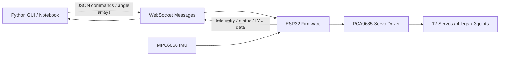

# SpotMicroV3 Code Documentation
**Document Version:** 1.0.0  
**Prepared on:** 2026-03-27  
**Language:** English  
**Scope:** ESP32 firmware revisions, kinematics notebook evolution, and calibration assets included in `spotmicrov3.zip`

---

## 1. Developer Onboarding, Repository Layout, and Deployment Manual

This section is written as a **technical project manual** for other developers. The goal is not only to upload the code to GitHub, but to make the repository understandable, reproducible, and deployable by someone who did not participate in the original development.

> [!IMPORTANT]
> The repository must be documented so another programmer can clone it, understand the architecture, identify the active firmware revision, reproduce the local environment, and deploy the ESP32 code without depending on verbal explanations.

### 1.1 Objective of the Repository

This repository contains three technical layers:

1. **ESP32 firmware** for servo control, IMU acquisition, networking, and integrated robot-side behavior.
2. **Desktop-side kinematics and control experiments** developed in Python through a Jupyter notebook.
3. **Calibration assets** used to preserve robot-specific offsets and alignment values.

The repository must therefore be organized so that each layer can be understood independently and also as part of the complete system.

---

### 1.2 Repository Structure for Other Developers

The project should not be kept as a flat folder or as an extracted ZIP dump. It should be split by responsibility so another developer can immediately see:

- where the production firmware lives,
- where historical revisions live,
- where the Python-side experimentation lives,
- where calibration data lives,
- and where the technical documentation lives.

The repository should follow this structure:

```text
spotmicrov3/
├── README.md
├── LICENSE
├── .gitignore
├── docs/
│   ├── architecture/
│   ├── firmware/
│   ├── desktop/
│   ├── calibration/
│   └── spotmicrov3_code_documentation_v1.0.0.md
├── firmware/
│   ├── v1_base_servo_streaming/
│   │   └── Esp32_code.ino
│   ├── v2_network_revision/
│   │   └── ESP32_CODEV2.ino
│   ├── v3_imu_telemetry/
│   │   └── ESP32_CODEV3.ino
│   ├── v4_servo_imu_integration/
│   │   └── ESP32_CODEV4.ino
│   └── v5_mature_integrated_firmware/
│       └── ESP32_CODEV5.ino
├── desktop/
│   └── notebooks/
│       └── Kinematicsv1.ipynb
├── calibration/
│   └── offset-default.json
└── assets/
    └── diagrams/
```

> [!TIP]
> The `v5_mature_integrated_firmware` folder should be treated as the current reference implementation unless a newer validated revision is introduced.

---

### 1.3 What Each Top-Level Folder Means

#### `firmware/`
This folder contains the robot-side embedded code. One directory is kept per revision so developers can inspect the project evolution without losing the historical implementation context.

#### `desktop/`
This folder contains the Python-side notebook used for kinematics, interface experimentation, gait exploration, plotting, and control-side reasoning.

#### `calibration/`
This folder contains robot-specific configuration values such as servo offsets. These files are critical for repeatable motion and should be treated as configuration, not as source code.

#### `docs/`
This folder contains the technical documentation, architecture notes, interface contracts, and future refactor guidance.

#### `assets/`
This folder stores diagrams, images, protocol charts, and documentation visuals.

---

### 1.4 Repository Breakdown in GitHub

The project should be published as a **developer-facing repository**, not as a storage backup. That means GitHub must answer these questions quickly:

- What is this project?
- Which firmware revision should I deploy?
- Which files are experimental and which are stable?
- How do I flash the ESP32?
- How do I reproduce the Python-side environment?
- Where do I modify calibration values?
- What changed between versions?

To support that, I break the repository down into the following documentation layers:

1. **Root `README.md`**  
   Explains the project at a high level, setup prerequisites, repository map, and quick-start instructions.

2. **Firmware documentation**  
   Describes each `.ino` revision, supported commands, dependencies, risks, and deployment flow.

3. **Desktop-side documentation**  
   Explains the notebook purpose, expected Python stack, and how the notebook relates to the firmware.

4. **Calibration documentation**  
   Describes how offsets are stored, interpreted, backed up, and applied.

5. **Version documentation**  
   Tracks which revision is legacy, transitional, or current.

> [!NOTE]
> In GitHub, good structure reduces onboarding time. A programmer should be able to understand the project in minutes, not after reading the entire codebase line by line.

---

### 1.5 Step-by-Step: Project Preparation Before Uploading to GitHub

#### Step 1 — Create the repository root

```bash
mkdir spotmicrov3
cd spotmicrov3
```

#### Step 2 — Create the internal directory structure

```bash
mkdir firmware desktop calibration docs assets
mkdir firmware/v1_base_servo_streaming
mkdir firmware/v2_network_revision
mkdir firmware/v3_imu_telemetry
mkdir firmware/v4_servo_imu_integration
mkdir firmware/v5_mature_integrated_firmware
mkdir desktop/notebooks
mkdir docs/architecture docs/firmware docs/desktop docs/calibration
mkdir assets/diagrams
```

#### Step 3 — Move each source file into its logical location

The files should be placed as follows:

- `Esp32_code.ino` → `firmware/v1_base_servo_streaming/Esp32_code.ino`
- `ESP32_CODEV2.ino` → `firmware/v2_network_revision/ESP32_CODEV2.ino`
- `ESP32_CODEV3.ino` → `firmware/v3_imu_telemetry/ESP32_CODEV3.ino`
- `ESP32_CODEV4.ino` → `firmware/v4_servo_imu_integration/ESP32_CODEV4.ino`
- `ESP32_CODEV5.ino` → `firmware/v5_mature_integrated_firmware/ESP32_CODEV5.ino`
- `Kinematicsv1.ipynb` → `desktop/notebooks/Kinematicsv1.ipynb`
- `offset - default.json` → `calibration/offset-default.json`
- `spotmicrov3_code_documentation_v1.0.0.md` → `docs/spotmicrov3_code_documentation_v1.0.0.md`

#### Step 4 — Create the `.gitignore`

```gitignore
# Python
__pycache__/
*.pyc
.ipynb_checkpoints/
.venv/
venv/

# VS Code
.vscode/

# OS files
.DS_Store
Thumbs.db

# Secrets / local config
.env
secrets.h
wifi_config.h
credentials.h

# Build / temporary exports
build/
dist/
*.log
```

#### Step 5 — Create the root `README.md`

The root README is the first thing another programmer reads. It should cover:

- project purpose,
- repository map,
- active firmware version,
- hardware requirements,
- software prerequisites,
- quick flashing steps,
- Python environment setup,
- and documentation links.

---

### 1.6 Step-by-Step: Initialize Git and Publish the Repository

#### Step 1 — Initialize Git locally

```bash
git init
```

#### Step 2 — Stage the repository

```bash
git add .
```

#### Step 3 — Create the initial commit

```bash
git commit -m "Initial project import with versioned firmware, notebook, calibration, and docs"
```

#### Step 4 — Rename the main branch

```bash
git branch -M main
```

#### Step 5 — Create the remote repository in GitHub

A new GitHub repository named `spotmicrov3` should be created and its remote URL should be copied.

#### Step 6 — Connect the local repository to GitHub

```bash
git remote add origin https://github.com/<username>/spotmicrov3.git
```

#### Step 7 — Push the first version

```bash
git push -u origin main
```

> [!IMPORTANT]
> Unreviewed secrets, Wi-Fi credentials, tokens, or machine-specific configuration files must not be pushed. Anything sensitive must be excluded before the first public or shared push.

---

### 1.7 How I Work With the Repository in VS Code

#### Step 1 — Open the project folder

```bash
code .
```

#### Step 2 — Verify the project tree

Inside VS Code, I confirm that the repository is already separated into `firmware`, `desktop`, `calibration`, and `docs`.

#### Step 3 — Use Source Control for traceability

From the Source Control panel, I inspect modified files before every commit. This is especially important when editing firmware and calibration files, because both can change runtime behavior significantly.

#### Step 4 — Commit by logical unit

I do not mix unrelated changes in one commit. I commit using technical scope, for example:

```bash
git add firmware/v5_mature_integrated_firmware/ESP32_CODEV5.ino
git commit -m "Refactor IMU parsing and servo command handling in V5 firmware"
```

```bash
git add calibration/offset-default.json
git commit -m "Update default servo offsets after mechanical recalibration"
```

```bash
git add desktop/notebooks/Kinematicsv1.ipynb
git commit -m "Document gait experimentation and plotting updates in notebook"
```

> [!TIP]
> Commit messages should describe the engineering change, not only the file that changed.

---

### 1.8 Branching Strategy I Use for a Technical Robotics Project

I keep the branching model simple and readable.

#### `main`
This branch contains the most stable documented state of the repository.

#### `dev`
This branch contains validated integration work before promotion to `main`.

#### `feature/<name>`
These branches contain isolated work such as protocol changes, gait tests, calibration improvements, or refactors.

Example:

```bash
git checkout -b dev
git checkout -b feature/imu-parser-cleanup
git checkout -b feature/notebook-refactor
```

When the work is complete:

```bash
git checkout dev
git merge feature/imu-parser-cleanup
```

And later:

```bash
git checkout main
git merge dev
```

---

### 1.9 How I Version the Repository for Other Developers

I use tags to mark meaningful states that another programmer can deploy or review.

Example:

```bash
git tag -a v1.0.0 -m "Initial documented import of SpotMicroV3 project"
git push origin v1.0.0
```

I use new tags when one of the following occurs:

- a new firmware revision becomes the reference implementation,
- the communication protocol changes,
- calibration format changes,
- or the deployment/setup process changes significantly.

---

### 1.10 How Another Developer Understands and Deploys the Code

To make the repository usable by another programmer, I ensure the following workflow is possible.

#### A. Clone the repository

```bash
git clone https://github.com/<username>/spotmicrov3.git
cd spotmicrov3
```

#### B. Read the root README first

The README should tell the developer:

- which firmware revision to use,
- what hardware is expected,
- which Arduino libraries are required,
- whether the notebook is optional or mandatory,
- and where calibration files are located.

#### C. Open the active firmware revision

The developer opens:

```text
firmware/v5_mature_integrated_firmware/ESP32_CODEV5.ino
```

This should be the documented entry point for embedded deployment.

#### D. Install dependencies in the Arduino or PlatformIO environment

At minimum, the documentation should list the libraries required by the firmware. If a future refactor is done, I would also add a `platformio.ini` file so the environment becomes reproducible.

#### E. Configure board-specific values

This may include:

- Wi-Fi credentials,
- network endpoints,
- IMU configuration,
- servo pin mappings,
- and calibration offsets.

#### F. Flash the ESP32

The developer then compiles and uploads the active firmware revision to the target board.

#### G. Validate runtime behavior

After flashing, the developer should verify:

- serial output,
- network connectivity,
- servo response,
- IMU data formatting,
- and compatibility with the desktop-side workflow.

> [!WARNING]
> A deployable repository does not stop at “code uploaded successfully.” It also documents validation points so another engineer can confirm the system is behaving correctly after flashing.

---

### 1.11 Recommended Root README Contents

To make GitHub useful for onboarding, I structure the root `README.md` with these sections:

1. Project overview  
2. Hardware stack  
3. Software stack  
4. Repository structure  
5. Active firmware version  
6. Quick start  
7. Flashing instructions  
8. Python / notebook environment  
9. Calibration files  
10. Known limitations  
11. Version history  
12. Documentation index  

---

### 1.12 Recommended Future Improvements for Deployment Quality

To make this repository even easier for external developers to deploy, I would progressively add:

- a `requirements.txt` or `environment.yml` for Python,
- a `platformio.ini` for reproducible ESP32 builds,
- a `CHANGELOG.md`,
- a dedicated hardware pinout diagram,
- protocol examples for command and telemetry payloads,
- and sample calibration profiles for different robot builds.

> [!NOTE]
> The more explicit the repository is about setup, configuration, and runtime expectations, the less tribal knowledge is required to keep the project alive.

---
## 2. Executive Summary

This package contains the evolution of a quadruped robotics control stack built around:

- **ESP32** as the embedded controller and WebSocket endpoint
- **PCA9685** as the 12-channel servo PWM driver
- **MPU6050** as the inertial sensing unit
- **Python + Tkinter + Matplotlib** as the desktop-side kinematics, gait, and control interface
- **JSON/WebSocket messaging** as the communication bridge between GUI and robot firmware

The project shows a clear development progression:

1. **Initial servo streaming firmware**
2. **Networked servo control refinement**
3. **IMU-only telemetry and orientation handling**
4. **Integrated IMU + servo firmware**
5. **More mature integrated firmware with command parsing, LED diagnostics, and dual servo-array formats**
6. **A large notebook-based desktop control environment that evolves from inverse kinematics to PID, yaw stabilization, joystick control, layouts, routines, and gait management**

> [!IMPORTANT]
> This documentation intentionally **segments the code by subsystem and version**, so it can be used as:
> - technical handoff documentation,
> - maintenance documentation,
> - onboarding material,
> - or the basis for a future README / engineering wiki.

---

## 3. Package Contents

```text
spotmicrov3.zip
├── offset - default.json
├── Esp32_code/
│   ├── Esp32_code.ino
│   └── ESP32_CODEV2/
│       ├── ESP32_CODEV2.ino
│       ├── ESP32_CODEV3/
│       │   └── ESP32_CODEV3.ino
│       ├── ESP32_CODEV4/
│       │   └── ESP32_CODEV4.ino
│       └── ESP32_CODEV5/
│           └── ESP32_CODEV5.ino
└── Kinematicsv1.ipynb
```

---

## 4. Architecture Overview

## 3.1 High-Level System



## 3.2 Main Responsibilities by Layer

### Desktop Layer
- Runs kinematics, differential IK, PID logic, gait logic, joystick mapping, visualization, and routine execution
- Sends servo targets and IMU commands over WebSocket
- Reads IMU feedback to support stabilization and UI feedback

### Firmware Layer
- Accepts WebSocket clients
- Parses command strings and JSON payloads
- Drives servos through PCA9685
- Reads and filters IMU data from MPU6050
- Publishes telemetry and status messages
- Exposes visual diagnostics with LEDs

### Calibration Layer
- Stores offsets used to bias or normalize sensor values

> [!TIP]
> The project is already organized in a way that naturally supports a future refactor into:
> - `firmware/`
> - `desktop_app/`
> - `calibration/`
> - `docs/`

---

## 5. Version Timeline

| Version / File | Main Focus | Key Capability |
|---|---|---|
| `Esp32_code.ino` | Initial firmware | Receives a flat array of 12 angles and directly drives the PCA9685 |
| `ESP32_CODEV2.ino` | Network revision | Same main architecture with a different Wi-Fi configuration |
| `ESP32_CODEV3.ino` | IMU firmware | Adds MPU6050, complementary filter, auto-send telemetry, calibration, and activity LEDs |
| `ESP32_CODEV4.ino` | Sensor + actuator merge | Integrates PCA9685 servo control with IMU telemetry and richer servo configuration |
| `ESP32_CODEV5.ino` | Mature integrated firmware | Adds dual array formats, command routing, offset commands, robust LED diagnostics, better WebSocket handling |
| `Kinematicsv1.ipynb` | Desktop control environment | Full Python-based control GUI with IK, differential control, PID, yaw support, joystick, routines, and gaits |

---

## 6. Firmware Documentation

# 5.1 `Esp32_code.ino` — Initial Servo Streaming Firmware

## Purpose
This is the earliest servo-control firmware revision. It focuses on one task: receive **12 servo angles as a JSON array** and apply them to the PCA9685.

## Main Components
- Wi-Fi connection
- WebSocket server
- PCA9685 initialization
- `angleToPWM()` conversion
- Message callback with JSON parsing
- Direct servo updates

## Key Behavior
Expected payload structure:

```json
[90, 90, 90, 90, 90, 90, 90, 90, 90, 90, 90, 90]
```

## Functional Segmentation

### Network Setup
Responsible for joining the configured Wi-Fi network and exposing a WebSocket server.

### WebSocket Message Handling
Parses incoming text messages as JSON and validates:
- payload is a JSON array,
- payload length matches `NUM_SERVOS`.

### Servo Update Loop
For each element in the received array:
1. clamp angle to valid range,
2. convert to PWM pulse,
3. write to PCA9685 channel.

> [!NOTE]
> This version is intentionally simple and useful for bring-up, bench testing, or validating the communication link before adding sensing or advanced behavior.

## Strengths
- Small and readable
- Good for first hardware verification
- Easy to debug

## Limitations
- No IMU integration
- No command protocol
- No orientation telemetry
- No advanced connection supervision
- Flat array only

---

# 5.2 `ESP32_CODEV2.ino` — Network Revision of the Base Firmware

## Purpose
This version is architecturally almost identical to the initial firmware but uses a different Wi-Fi configuration and acts as an intermediate deployment variant.

## Differences vs. Initial File
- Different SSID/password
- Same base workflow:
  - WebSocket server
  - JSON array parsing
  - 12-servo mapping
  - PCA9685 angle-to-PWM control

## Why This Version Matters
Even though the logic is nearly unchanged, it shows a **real deployment iteration**:
- moving across test networks,
- verifying portability,
- preserving a stable minimal control baseline.

> [!WARNING]
> Hard-coded credentials are present in the source. In a production or shared repository, these should be moved to a configuration layer or excluded from version control.

---

# 5.3 `ESP32_CODEV3.ino` — IMU Telemetry and Orientation Firmware

## Purpose
This revision introduces the **MPU6050** and turns the ESP32 into a sensing node capable of:
- reading acceleration and angular velocity,
- estimating orientation,
- calibrating offsets,
- streaming telemetry,
- and showing communication state with LEDs.

## Main Subsystems
- Wi-Fi + WebSocket
- MPU6050 acquisition
- complementary filter
- yaw integration from gyroscope
- calibration offsets
- activity LEDs
- optional automatic telemetry streaming

## Core State Variables
This version introduces persistent state for:
- raw sensor events,
- roll / pitch / yaw,
- accelerometer offsets,
- gyroscope offsets,
- complementary filter state,
- auto-send status,
- LED activity timers,
- WebSocket connection checks.

## Major Functional Segments

### 1. Sensor Acquisition
Reads the IMU periodically using `mpu.getEvent(&a, &g, &temp)`.

### 2. Orientation Estimation
Uses:
- accelerometer-derived roll and pitch,
- gyroscope integration,
- complementary filter fusion,
- yaw integration from gyro Z.

### 3. Calibration
Collects multiple samples and averages them to estimate:
- accelerometer bias,
- gyroscope bias.

### 4. Telemetry Streaming
Packages sensor values and orientation into JSON and sends them over WebSocket.

### 5. LED Diagnostics
LEDs indicate:
- Wi-Fi state,
- WebSocket state,
- sending activity,
- receiving activity.

## Architectural Value
This version separates sensing concerns from actuator concerns and is useful for:
- IMU validation,
- desktop-side stabilization experiments,
- testing orientation logic independently of gait control.

> [!IMPORTANT]
> `yaw` is based on gyroscope integration, so it will drift over time unless an external absolute heading reference is introduced.

## Likely JSON Output Structure
Although the exact payload is built dynamically, its shape follows this pattern:

```json
{
  "sensor": "mpu6050",
  "accel": {"x": 0.0, "y": 0.0, "z": 0.0},
  "gyro": {"x": 0.0, "y": 0.0, "z": 0.0},
  "orientation": {"roll": 0.0, "pitch": 0.0, "yaw": 0.0},
  "temp": 0.0,
  "calibrated": true
}
```

---

# 5.4 `ESP32_CODEV4.ino` — Integrated IMU + Servo Firmware

## Purpose
This revision merges the two major hardware roles:
- **IMU processing**
- **servo actuation through PCA9685**

It is the first version where the firmware clearly starts behaving like a full quadruped controller endpoint.

## New Additions
- `Adafruit_PWMServoDriver` integration into the IMU-capable firmware
- richer servo structure via `ServoConfig`
- defined channel map for all 12 servos
- dedicated servo activity LED

## Servo Model
The firmware introduces a servo configuration structure:

```cpp
struct ServoConfig {
  int channel;
  int min_pulse;
  int max_pulse;
  float min_angle;
  float max_angle;
  float current_angle;
};
```

This is important because it signals a move away from a purely raw array implementation and toward a **configurable actuator abstraction**.

## Segmentation by Responsibility

### IMU Layer
Same conceptual role as V3:
- sensing,
- filtering,
- orientation estimation,
- calibration,
- telemetry.

### Actuation Layer
Adds:
- servo channel definitions,
- motion dispatching,
- angle tracking,
- better maintainability for 12 independent joints.

### Diagnostics Layer
Adds an LED dedicated to servo/PCA activity.

## Why V4 Is Important
V4 is the bridge between:
- **telemetry-only intelligence**
- and **closed robot control infrastructure**

It is the first version that strongly resembles a practical firmware foundation for the full robot.

---

# 5.5 `ESP32_CODEV5.ino` — Mature Integrated Firmware

## Purpose
This is the most complete firmware revision in the archive. It combines:
- servo control,
- IMU telemetry,
- calibration management,
- command routing,
- dual JSON angle formats,
- LED diagnostics,
- WebSocket supervision.

This is the best candidate for the **reference firmware version** in the package.

---

## 5.5.1 Firmware Responsibilities

### Communication
- Open a WebSocket server on port `81`
- Accept a client
- Poll incoming messages
- Detect disconnects
- Reply with status acknowledgements

### Motion
- Move one servo
- Move all 12 servos from a flat array
- Move all 12 servos from a nested 4x3 array

### Sensing
- Read the IMU periodically
- Estimate roll, pitch, and yaw
- Stream IMU data on demand or continuously

### Calibration
- Estimate offsets from samples
- reset orientation
- send offsets to the desktop side
- accept manual offsets

### Diagnostics
- Wi-Fi LED
- WebSocket LED
- sending activity LED
- receiving activity LED
- PCA activity LED

---

## 5.5.2 Functional Segmentation of `ESP32_CODEV5.ino`

### Section A — Includes and Global Configuration
Defines:
- libraries,
- Wi-Fi credentials,
- WebSocket server/client objects,
- IMU objects,
- servo constants,
- LED pins,
- timing intervals,
- calibration state.

### Section B — PCA9685 Helper Functions

#### `angleToPWM(float angle)`
Converts degrees into PCA9685 pulse units using a linear mapping between `SERVOMIN` and `SERVOMAX`.

#### `moveServo(int servo_index, float angle)`
Moves one servo and registers PCA activity for the LED subsystem.

#### `moveAllServosLinear(JsonArray angles_array)`
Accepts:

```json
[ang1, ang2, ang3, ..., ang12]
```

This is the most direct interface for desktop-side transmission.

#### `moveAllServosNested(JsonArray angles_array)`
Accepts:

```json
[
  [leg1_joint1, leg1_joint2, leg1_joint3],
  [leg2_joint1, leg2_joint2, leg2_joint3],
  [leg3_joint1, leg3_joint2, leg3_joint3],
  [leg4_joint1, leg4_joint2, leg4_joint3]
]
```

This is cleaner when the high-level controller thinks in **per-leg groups** instead of a single flattened vector.

> [!TIP]
> Supporting both formats is a strong design decision because it decouples the firmware from the internal data structure used by the desktop controller.

---

### Section C — MPU6050 Functions

#### `calculateOrientation()`
Computes:
- accelerometer-based roll and pitch,
- gyroscope-based integrated roll and pitch,
- complementary filter fusion,
- yaw integration.

#### `sendMPUData()`
Builds a telemetry JSON packet containing:
- accelerometer values,
- gyroscope values,
- orientation,
- temperature,
- calibration state.

#### `calibrateIMU()`
Samples the IMU repeatedly and computes average offsets.

#### `resetOrientation()`
Zeroes the software-side orientation state and restarts timing bases.

#### `sendOffsets()`
Sends the currently active accelerometer and gyroscope offsets.

---

### Section D — Command and JSON Processing

#### `setManualOffsets(String data)`
Parses a string-form command containing six comma-separated values:
- 3 accelerometer offsets
- 3 gyroscope offsets

#### `processCommand(String command)`
Routes string-based commands such as:
- `cmd:calibrate_imu`
- `cmd:reset_imu`
- `cmd:get_offsets`
- `cmd:set_offsets:...`
- `cmd:get_mpu_data`
- `cmd:start_mpu_stream`
- `cmd:stop_mpu_stream`

#### `processJSON(String jsonData)`
Routes JSON payloads and automatically detects whether the content is:
- a command object,
- a flat angle array,
- or a nested 4x3 angle array.

> [!IMPORTANT]
> This combination of `processCommand()` + `processJSON()` creates a simple but effective protocol with two lanes:
> 1. **string commands** for control semantics,
> 2. **JSON arrays/objects** for structured data exchange.

---

### Section E — WebSocket Layer

#### `isWebSocketConnected()`
Uses client availability and periodic ping logic to verify connection health.

#### `setupWebSocketHandlers()`
Defines:
- message callback,
- event callback,
- connection-open actions,
- connection-close actions,
- ping/pong logging.

This is the center of message intake and protocol dispatch.

---

### Section F — LED Diagnostic Layer

#### `updateLEDs()`
Updates all status and activity LEDs using timer-based blinking logic.

This gives the firmware a physical debugging interface, which is extremely useful when:
- no serial monitor is attached,
- the robot is powered but remote,
- or communication issues appear intermittent.

---

### Section G — `setup()`

`setup()` performs:
1. Serial initialization  
2. LED pin initialization  
3. MPU6050 startup and range configuration  
4. PCA9685 startup and PWM frequency setup  
5. Wi-Fi connection logic  
6. WebSocket server activation  

This function acts as the full hardware bring-up sequence.

---

### Section H — `loop()`

`loop()` performs:
- periodic Wi-Fi supervision,
- periodic WebSocket supervision,
- acceptance of new WebSocket clients,
- IMU reading,
- optional IMU auto-streaming,
- LED updates.

This is the runtime scheduler of the firmware.

---

## 5.5.3 Supported Firmware Commands

### String Commands
```text
cmd:calibrate_imu
cmd:reset_imu
cmd:get_offsets
cmd:set_offsets:<ax>,<ay>,<az>,<gx>,<gy>,<gz>
cmd:get_mpu_data
cmd:start_mpu_stream
cmd:stop_mpu_stream
```

### JSON Command Object
```json
{"command":"get_mpu_data"}
```

### Flat Servo Array
```json
[90,90,90,90,90,90,90,90,90,90,90,90]
```

### Nested Servo Array
```json
[
  [90,90,90],
  [90,90,90],
  [90,90,90],
  [90,90,90]
]
```

---

## 5.5.4 Suggested Internal Module Split for Future Refactor

A cleaner production structure for V5 would be:

```text
firmware/
├── main.ino
├── config.h
├── comms_ws.h
├── comms_ws.cpp
├── imu.h
├── imu.cpp
├── servos.h
├── servos.cpp
├── leds.h
├── leds.cpp
└── protocol.h
```

> [!TIP]
> The current V5 code is already segmented logically enough that this refactor would be straightforward.

---

## 5.5.5 Strengths of V5
- Clear subsystem separation
- Better protocol flexibility
- Better diagnostics
- Real-world maintainability improvements
- Suitable base for future stabilization and gait integration

## 5.5.6 Current Risks / Technical Debt
- Hard-coded Wi-Fi credentials
- Fixed IMU and servo parameters in source
- Single-file firmware structure
- No authentication on WebSocket channel
- Yaw drift due to gyro-only integration
- No persistent storage for calibration offsets inside firmware
- No watchdog or fail-safe pose timeout if communication stops

> [!WARNING]
> For a physical quadruped, a communication timeout safety routine is strongly recommended. Without it, stale commands may leave joints in an unsafe or mechanically stressful state.

---

## 6. Desktop-Side Notebook Documentation — `Kinematicsv1.ipynb`

## Purpose
This notebook is not a simple scratchpad. It behaves more like a **progressive desktop control platform** for the quadruped.

It combines:
- mathematics,
- inverse kinematics,
- visualization,
- GUI logic,
- communications,
- sensor consumption,
- PID stabilization,
- routines,
- joystick control,
- and gait management.

---

## 6.1 Evolution Stages Inside the Notebook

The notebook contains several progressive stages, marked by internal markdown cells:

1. **communication errors**
2. **PID CONTROL**
3. **PID WITH YAW**
4. **layout**
5. **joystick and movements**
6. **more routine modes**
7. **gait configuration**

These labels show a real development path:
- first communication reliability,
- then stabilization,
- then yaw-aware control,
- then interface layout,
- then manual motion input,
- then richer routine execution,
- then gait orchestration.

---

## 6.2 Main Software Building Blocks in the Latest Notebook State

The latest notebook state contains the following main classes:

| Class | Role |
|---|---|
| `MPU6050Handler` | Handles IMU requests, streaming, packet processing, and latest-value storage |
| `Kinematics` | Implements physical constraints, inverse kinematics, Jacobian, differential IK, and plotting |
| `GaitManager` | Manages gait type, gait cycle, neutral positions, and leg target generation |
| `RobotGUI` | Builds the Tkinter application and coordinates kinematics, routines, IMU controls, visualization, joystick logic, and gait controls |

It also includes shared WebSocket helpers such as:
- `connect_ws()`
- `disconnect_ws()`
- `send_angles()`
- `send_command()`

---

## 6.3 Notebook Functional Segmentation

### Segment A — Communication Layer
Handles:
- opening the WebSocket connection,
- reconnecting when needed,
- sending angle lists,
- sending command strings,
- measuring send latency.

### Segment B — Math Utilities
Includes utilities such as:
- rotation matrix construction,
- angle normalization,
- coordinate conversion helpers.

### Segment C — IMU Consumer Layer
`MPU6050Handler` manages:
- request/response sensor reads,
- streaming listener thread,
- packet parsing,
- latest value storage,
- thread-safe IMU access patterns.

### Segment D — Kinematics Engine
`Kinematics` handles:
- physical limits,
- inverse kinematics per leg,
- angle correction,
- Jacobian computation,
- differential IK,
- robot plotting.

This is the mathematical core of robot posture and motion generation.

### Segment E — Gait Engine
`GaitManager` handles:
- gait selection,
- gait loops,
- time-based leg position generation,
- neutral reference positions,
- runtime parameter updates.

### Segment F — GUI Layer
`RobotGUI` provides:
- tabs and controls,
- differential mode controls,
- inverse kinematics mode,
- WebSocket controls,
- MPU controls,
- PID controls,
- joystick controls,
- routine management,
- gait controls,
- real-time displays.

---

## 6.4 What the Notebook Is Doing Conceptually

The notebook acts as a **high-level quadruped motion workstation**:
- it computes target geometry,
- converts geometry into per-joint servo targets,
- sends those targets to the ESP32,
- optionally consumes IMU data for feedback,
- and gives the operator multiple ways to generate motion:
  - direct control,
  - differential control,
  - routine execution,
  - joystick movement,
  - gait generation.

> [!NOTE]
> Even though this code lives in a notebook, its size and structure indicate that it is functioning as an application prototype rather than a traditional exploratory notebook.

---

## 6.5 Notable Capabilities in the Latest Notebook Revision

Based on the latest code state, the desktop controller includes support for:

- shared WebSocket session management,
- explicit connect/disconnect controls,
- servo command transmission,
- command transmission to firmware,
- IMU listener thread,
- request-based IMU reads,
- inverse kinematics tab,
- differential kinematics tab,
- global speed control,
- PID enable/reset flow,
- yaw-aware evolution from prior versions,
- diagonal leg control,
- routine save/load/edit/execute flow,
- joystick visualization and mapping,
- gait selection and gait parameter control,
- plot/visual feedback.

---

## 6.6 Design Strengths of the Notebook

### Strong Points
- Rich experimental environment
- Good feature accumulation across revisions
- Clear progression from kinematics to full behavior control
- Supports both sensing and actuation workflows
- Can serve as the base for a future standalone Python application

### Risks
- Very large notebook cells
- Harder to version-control than a modular Python package
- UI logic, math logic, communication, and behavior logic are heavily co-located
- More difficult to test automatically

> [!TIP]
> A future migration from `.ipynb` to a Python application structure would significantly improve maintainability.

Suggested split:

```text
desktop_app/
├── main.py
├── websocket_client.py
├── imu_handler.py
├── kinematics.py
├── gait_manager.py
├── robot_gui.py
├── routines.py
├── plotting.py
└── config.py
```

---

## 7. Calibration Asset Documentation

# 7.1 `offset - default.json`

## Purpose
This file most likely stores default calibration or alignment offsets used by the robot.

## Why It Matters
Offsets are critical in a quadruped because they compensate for:
- servo horn mounting differences,
- mechanical asymmetries,
- neutral pose bias,
- or sensor correction baselines.

> [!IMPORTANT]
> This file should be treated as part of the robot’s configuration state, not merely as an accessory file.

## Recommended Use
- Keep one default baseline
- Save per-robot variants if the build changes
- Version offsets alongside mechanical changes

Suggested naming pattern:

```text
offsets/
├── offset_default.json
├── offset_bench_test_01.json
├── offset_after_reassembly.json
└── offset_robot_A.json
```

---

## 8. Communication Protocol Summary

## 8.1 Transport
- **Protocol:** WebSocket
- **Default port:** `81`

## 8.2 Payload Types
- plain string commands
- JSON object commands
- flat numeric angle arrays
- nested numeric angle arrays

## 8.3 Typical Data Flow

### Motion Command Flow
1. GUI computes servo targets
2. GUI serializes angle list
3. ESP32 receives JSON
4. Firmware detects payload format
5. PWM outputs are updated through PCA9685

### IMU Request Flow
1. GUI sends command
2. ESP32 reads MPU6050
3. Firmware computes orientation
4. Firmware serializes telemetry
5. GUI consumes packet and updates its state

---

## 9. Recommended Documentation Versioning Scheme

For future documentation updates, this scheme is recommended:

| Doc Version | Meaning |
|---|---|
| `1.0.0` | Initial complete documentation of current archive |
| `1.1.0` | Clarifications, diagrams, and examples added |
| `1.2.0` | New firmware or notebook module sections added |
| `2.0.0` | Major structural refactor reflected in docs |

---

## 10. Engineering Assessment

## Overall Assessment
This archive shows a meaningful and technically credible evolution from:
- direct servo control,
- to embedded sensing,
- to integrated mechatronic control,
- to a rich desktop motion-control environment.

The strongest engineering characteristics are:
- progressive feature growth,
- modular thinking even inside single files,
- protocol flexibility,
- clear experimentation toward closed-loop quadruped control.

## Most Mature Components
1. `ESP32_CODEV5.ino`
2. final sections of `Kinematicsv1.ipynb`

## Most Valuable Next Steps
1. Move credentials to configuration
2. Split firmware by subsystem
3. Convert notebook into Python modules
4. Persist IMU offsets safely
5. Add communication timeout safety pose
6. Add structured logging
7. Add test scenarios for IK and gait outputs

---

## 11. Maintainer Notes

### If You Want to Use This Package as a Baseline
Use:
- `ESP32_CODEV5.ino` as the firmware base
- the latest state in `Kinematicsv1.ipynb` as the desktop feature reference

### If You Want to Clean It for Portfolio or Publication
Do this first:
- remove or redact Wi-Fi credentials,
- rename files consistently,
- split notebook logic into modules,
- add a top-level README,
- document servo channel mapping and leg naming explicitly,
- include a hardware wiring diagram.

> [!WARNING]
> Before sharing publicly, remove private network credentials and any environment-specific IP addresses from the code.

---

## 12. Final File Classification

| File | Classification | Recommended Status |
|---|---|---|
| `Esp32_code.ino` | historical firmware baseline | archive / reference |
| `ESP32_CODEV2.ino` | deployment variant | archive / reference |
| `ESP32_CODEV3.ino` | IMU development milestone | archive / reference |
| `ESP32_CODEV4.ino` | integrated milestone | archive / reference |
| `ESP32_CODEV5.ino` | primary firmware candidate | active reference |
| `Kinematicsv1.ipynb` | desktop control prototype / application | active reference |
| `offset - default.json` | calibration/configuration asset | active support file |

---

## 13. Changelog for This Documentation

### `v1.0.0`
- Created a full English technical documentation file for the provided archive
- Segmented the project by subsystem and version
- Documented firmware evolution from V1 to V5
- Documented notebook evolution and latest software architecture
- Added callouts, risks, strengths, and refactor recommendations
- Added protocol summary and maintainability guidance
