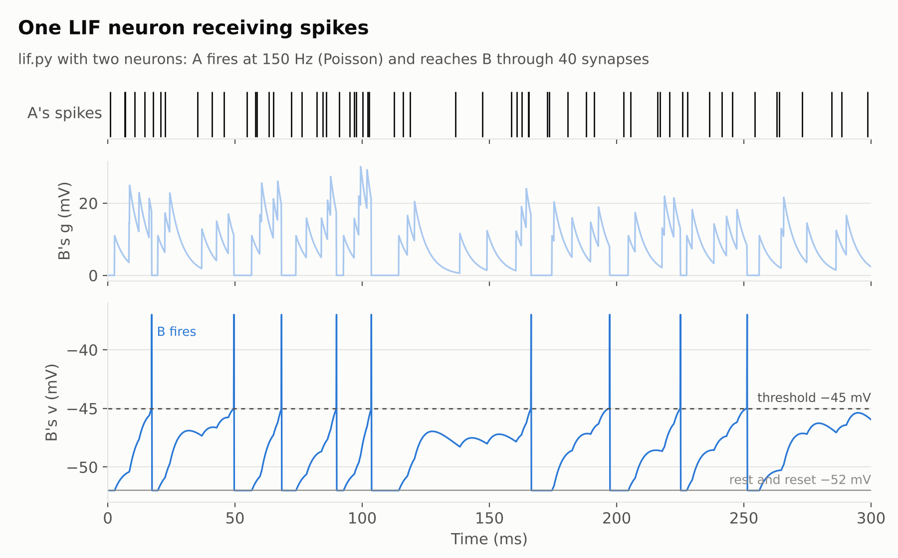
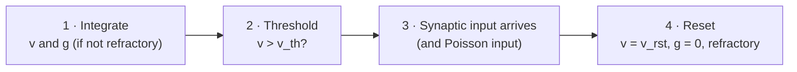

# 2 · The LIF model

> 🌐 **English** · [Español](../cerebro/02-modelo-lif.md)

[← The connectome](01-connectome.md) · [Index](README.md) · [Next: the CPU simulator →](03-cpu-simulator.md)

---

The connectome says **who talks to whom**. To make it "talk" we need a model of how
each neuron behaves. We use exactly the one from **Shiu et al. 2024** (*Nature*,
"A Drosophila computational brain model reveals sensorimotor processing"), which
showed that this very simple model, running on the real connectome, predicts
behaviours measured in living flies.

## LIF: *Leaky Integrate-and-Fire*

Each neuron is a leaky capacitor:

- It **integrates** the current arriving from other neurons.
- It **leaks** charge back towards rest.
- If the voltage crosses a threshold it **fires** a spike, resets, and stays
  **refractory** (deaf) for a couple of milliseconds.

### The equations

Two variables per neuron: membrane voltage **v** and synaptic conductance **g**
(the input that arrives and fades away).

```
dv/dt = (v₀ − v + g) / τ_mbr        (frozen during the refractory period)
dg/dt = −g / τ
```

and the discrete rules:

```
if v > v_th:   v ← v_rst,  g ← 0,  refractory for t_rfc
each presynaptic spike adds  w = (sign × n_synapses) × w_syn  to g,
after a delay t_dly
```



*The equations at work, with the same `lif.py` and two neurons. Each spike from A
reaches B 1.8 ms later and kicks `g` up (40 synapses × 0.275 mV = 11 mV); `g` decays
with τ = 5 ms and pushes `v` up. A single spike isn't enough to cover the 7 mV to
threshold: B fires when several arrive close together. After each spike `v` goes back
to −52 mV, `g` to 0, and both stay frozen for 2.2 ms. Regenerate with `python figures.py neuron`.*

### The parameters

All in [`lif.py` · `Params`](../../../desktop/fly_brain/lif.py), identical to the
original:

| Parameter | Value | Meaning |
|---|---|---|
| `v_0` | −52 mV | Resting potential |
| `v_rst` | −52 mV | Voltage after a spike |
| `v_th` | −45 mV | Firing threshold (7 mV above rest) |
| `t_mbr` | 20 ms | Membrane time constant |
| `tau` | 5 ms | Synaptic time constant |
| `t_rfc` | 2.2 ms | Refractory period |
| `t_dly` | 1.8 ms | Synaptic delay |
| `w_syn` | 0.275 mV | Weight of **one** synapse |
| `f_poi` | 250 | Poisson input factor (stimulation) |
| `dt` | 0.1 ms | Integration step |

**Numerical intuition:** since `τ` (5 ms) is much faster than `τ_mbr` (20 ms), the
peak of `v` is only ~0.16 × `g`. Climbing the 7 mV to threshold takes about 44 mV of
`g`, i.e. **~160 synapses active at once**. A neuron only fires when many inputs
coincide (a test checks this, `test_strong_synapse_relays_after_delay`).

---

## Exact integration

The naive way to take a step is Euler: `v += dt · dv/dt`. But the system is
**linear** between spikes, so it has an analytical solution. For a step `dt`:

```
v − v₀  ←  a_vv · (v − v₀)  +  a_vg · g
g       ←  a_gg · g

a_vv = exp(−dt / τ_mbr)
a_gg = exp(−dt / τ)
a_vg = τ / (τ − τ_mbr) · (a_gg − a_vv)
```

`exact_coefficients()` computes those three numbers **once**. After that, each step
of each neuron is **three multiplications and two additions**.

Advantages:

1. **It is what Brian2 does** with `method='linear'`, so the dynamics match the
   original exactly (see [validation](06-validation.md)).
2. **No integration error** in the continuous part: `dt` only affects when spikes
   are detected, not the accuracy of `v`.
3. **Stable for any `dt`**, which allows 0.5 ms on the CPU when speed matters (see
   [cutting the time](05-cutting-the-time.md#10-the-time-step-as-a-lever)).

---

## Stimulation: virtual optogenetics

In the paper, neurons are "switched on" as in an optogenetics experiment (light
activating channels in specific neurons). In the model:

- Each stimulated neuron receives **Poisson events** at the requested rate (e.g.
  150 Hz).
- Each event adds `w_syn × f_poi = 0.275 × 250 = 68.75 mV` straight to `v`: far above
  the 7 mV to threshold, so **every event produces a spike**.
- Stimulated neurons have **no refractory period**, so they fire at the requested
  rate.

In code, the event probability per step is:

```
p = rate_Hz × dt_ms × 1e-3        # 150 Hz at dt 0.1 ms → p = 0.015
```

---

## Order of operations within a step

It looks like a detail, but it changes the result. Brian2 does, every step:



Both our simulators follow **exactly** that order. Two consequences:

- Input arriving in the same step a neuron fires is **lost** to the reset.
- Because `g` is marked `(unless refractory)` in the original model, **input arriving
  while the neuron is refractory is discarded**. This was one of the two details
  that had to be found to match the original
  ([validation](06-validation.md#the-two-brian2-details)).

---

## The synaptic delay: a ring buffer

A spike emitted now must arrive `t_dly = 1.8 ms` later, i.e. **18 steps**. Instead of
an event queue, the simulator uses a `pending` matrix of
**18 rows × 138,639 columns**:

```
step s:  row = pending[s % 18]
         1) neuron i reads row[i] (what was emitted 18 steps ago) and zeroes it
         2) whoever fires now adds its weights into that SAME row
         → it is read again at step s + 18 = 1.8 ms later
```

Fixed memory (18 × 138,639 × 4 B ≈ **10 MB**), no growing lists, no event sorting,
and access is by direct index. Perfect for a GPU.

---

[← The connectome](01-connectome.md) · [Index](README.md) · [Next: the CPU simulator →](03-cpu-simulator.md)
