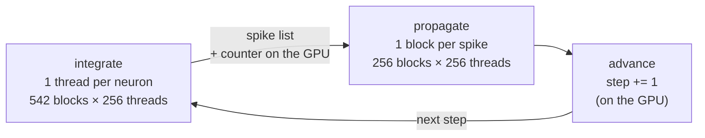

# 4 · The GPU simulator (`lif_gpu.py`)

> 🌐 **English** · [Español](../cerebro/04-simulador-gpu.md)

[← The CPU simulator](03-cpu-simulator.md) · [Index](README.md) · [Next: how we cut the time →](05-cutting-the-time.md)

---

[`lif_gpu.py`](../../../desktop/fly_brain/lif_gpu.py) is **the same model** as
`lif.py`, with the **same API** (`stimulate`, `run`, `rate`, `reset`, `t`), written
as CUDA kernels in C that CuPy compiles on the fly (`cp.RawModule`).

It installs with a single package, which brings CUDA from pip without installing
NVIDIA's toolkit:

```bash
pip install "cupy-cuda12x[ctk]"
```

---

## Overview

For every 0.1 ms step **three kernels** are launched, and the CPU **never waits** for
the GPU between them:



And 100 consecutive steps (300 launches) are recorded **once** as a **CUDA Graph**
and replayed with a single call.

---

## Kernel 1 · `integrate`

One thread per neuron (138,639 threads in blocks of 256 → 542 blocks).

```c
int i = blockIdx.x * blockDim.x + threadIdx.x;
float vi = v[i], gi = g[i];
short r = ref_left[i];
bool fired = false;
if (r > 0) {
    r -= 1;                                   // refractory: frozen, input discarded
} else {
    vi = v_0 + a_vv * (vi - v_0) + a_vg * gi; // exact solution
    gi *= a_gg;
    if (fabsf(gi) < eps) gi = 0.0f;
    fired = vi > v_th;
    gi += row[i];                             // synaptic input arriving now
}
row[i] = 0.0f;
if (p > 0 && uniform(seed ^ (step * n + i)) < p)
    vi += w_poi;                              // Poisson (optogenetics)
if (fired) {
    vi = v_rst; gi = 0; r = no_refractory[i] ? 0 : ref_steps;
    counts[i] += 1;
    spikes[atomicAdd(&n_spk[cur], 1)] = i;    // add myself to the spike list
}
```

Key points:

- **Coalesced reads and writes:** thread `i` touches `v[i]`, `g[i]`, `row[i]`…
  Consecutive threads read consecutive addresses, and the GPU serves them in a
  single memory transaction.
- **Spike compaction with `atomicAdd`:** each neuron that fires reserves a slot in
  `spikes[]` by atomically incrementing a counter. When the kernel finishes,
  `spikes[0 .. n_spk)` is the **compact list** of who fired, with no sorting and no
  extra pass.
- There is an `if (r > 0)` here, but on a GPU the cost is different from the CPU: the
  32 threads of a *warp* run both sides with masking, and both sides are so short it
  isn't worth rewriting.

### The random number generator: stateless

```c
__device__ float uniform(unsigned long long x) {   // splitmix64 → [0, 1)
    x += 0x9E3779B97F4A7C15ULL;
    x = (x ^ (x >> 30)) * 0xBF58476D1CE4E5B9ULL;
    x = (x ^ (x >> 27)) * 0x94D049BB133111EBULL;
    x ^= x >> 31;
    return (x >> 40) * (1.0f / 16777216.0f);
}
```

It is a **counter-based** generator: the random number for neuron `i` at step `s` is
a *hash* of `(seed, s, i)`. Advantages over cuRAND:

- **No state** to store per neuron (cuRAND needs ~48 B per thread and an expensive
  initialization kernel).
- **Reproducible:** same `(seed, step, neuron)` → same number, however it's launched.
- **CUDA Graph friendly:** the step is read from GPU memory, so the recorded graph
  generates different numbers on every replay.

---

## Kernel 2 · `propagate`

```c
int n = n_spk[step & 1];                          // how many spikes (read on the GPU)
for (int s = blockIdx.x; s < n; s += gridDim.x) { // each block takes spikes
    int pre = spikes[s];
    for (k = indptr[pre] + threadIdx.x; k < indptr[pre+1]; k += blockDim.x)
        atomicAdd(&row[indices[k]], data[k]);    // its 256 threads walk the column
}
```

- **One block per spike** (*grid-stride*: 256 blocks share out however many there
  are). The block's 256 threads walk **that neuron's CSC column**, which is
  contiguous in memory → coalesced reads of `indices` and `data`.
- Several neurons can hit the same target in the same step, hence the `atomicAdd` on
  `row`. Global-memory `float` atomics are fast on modern GPUs and, since the targets
  are widely spread, there is little contention.
- **Work only happens if there were spikes.** If nobody fires in a step, the kernel
  exits almost immediately.

### The double-counter trick

How does `propagate` know how many spikes there are **without asking the CPU**? It
reads `n_spk`, on the GPU. But someone has to reset it every step, and it can't be
the CPU (that would need a sync). Solution: **two alternating counters**.

```
even step:  integrate writes n_spk[0] and zeroes n_spk[1]
            propagate reads n_spk[0]
odd step:   integrate writes n_spk[1] and zeroes n_spk[0]
            propagate reads n_spk[1]
```

Thread 0 of `integrate` zeroes the counter for the **next** step, which the previous
`propagate` has already read. No race, no synchronization.

---

## Kernel 3 · `advance` and the step counter on the GPU

```c
extern "C" __global__ void advance(long long* step_dev) { *step_dev += 1; }
```

A single-thread kernel that adds 1. It looks silly, but it is what makes CUDA Graphs
possible: if the step number were passed as an argument from Python, it would be
**frozen** inside the recorded graph. Living in GPU memory, every replay of the graph
sees the right step (for the ring buffer, the double counter and the RNG).

---

## CUDA Graphs: 300 launches in one call

A 0.1 ms step costs **~12 µs** on the GPU. But launching a kernel from Python (CuPy)
has a fixed overhead from a few to tens of microseconds, **and there are three per
step**. Launching them one by one, the GPU spent most of its time **waiting for
Python to give it work**.

A **CUDA Graph** records a sequence of launches and then replays all of it with a
single call, with the driver submitting everything at once:

```python
self._stream.begin_capture()
for _ in range(GRAPH_STEPS):        # 100 steps = 300 kernels
    self._launch_step()
self._graph = self._stream.end_capture()
...
for _ in range(n_steps // 100):
    self._graph.launch(self._stream)   # 1 call = 10 ms of brain
for _ in range(n_steps % 100):
    self._launch_step()                # the remainder, one by one
```

- The graph is recorded **only once** (on the first `run()` of ≥ 100 steps) and reused
  forever, even after `reset()` or `stimulate()`, because those only change array
  **contents**, not addresses.
- A 40 ms frame = 400 steps = **4 graph replays**, instead of 1,200 launches.

---

## A single GPU → CPU transfer per frame

The whole state lives on the GPU and never moves. At the end of `run()` only one
thing is copied to the CPU: the **spike count per neuron** for that span
(138,639 × 4 B ≈ **0.55 MB**), which is what the pilot needs (to read the descending
neurons) and what the viewer needs (to light up active neurons).

```python
start = self.counts.copy()
... graphs ...
counts = cp.asnumpy(self.counts - start, stream=self._stream)
self._stream.synchronize()          # the ONLY wait in all of run()
```

`stimulate()` uses the **same stream** as the simulation, so a stimulus change is
queued behind pending steps, with no races.

---

## Performance

On an RTX 4060 Laptop, with *looming*:

| `dt` | Speed |
|---|---|
| 0.1 ms (original) | **8.3× real time** (1 s of fly in ~0.12 s) |
| 0.5 ms | 33× real time |

That is **~29 times faster than the CPU** at the same `dt`. Where each factor comes
from is broken down in [how we cut the time](05-cutting-the-time.md).

---

[← The CPU simulator](03-cpu-simulator.md) · [Index](README.md) · [Next: how we cut the time →](05-cutting-the-time.md)
