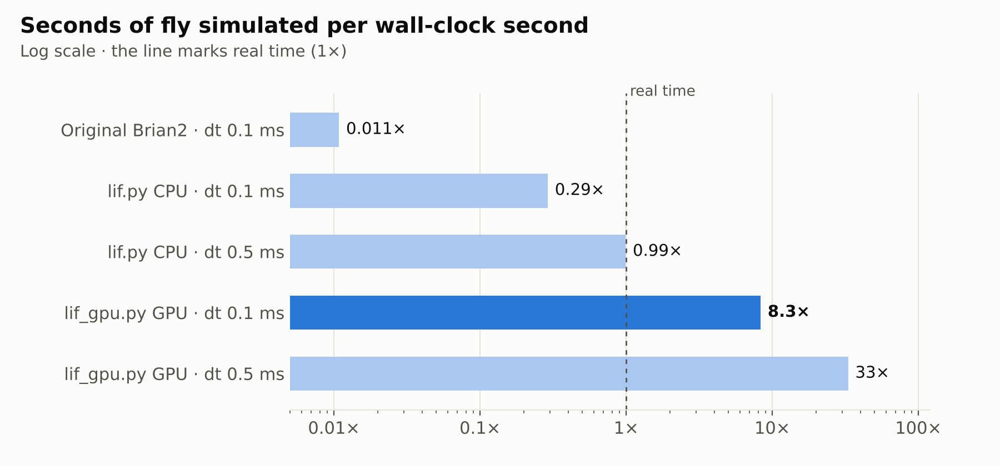
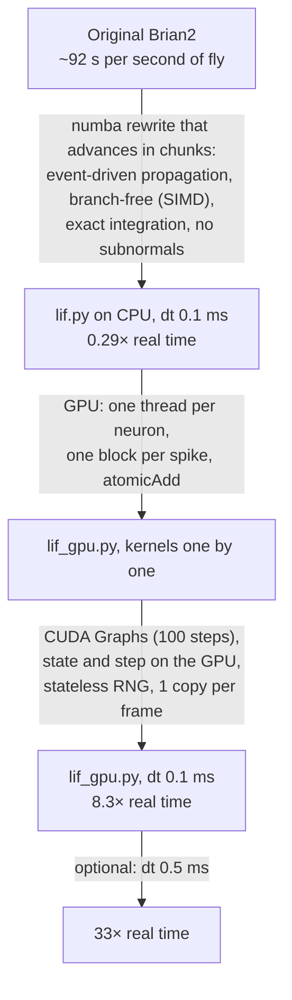

# 5 · How we cut the time

> 🌐 **English** · [Español](../cerebro/05-reduccion-del-tiempo.md)

[← The GPU simulator](04-gpu-simulator.md) · [Index](README.md) · [Next: validation →](06-validation.md)

---

This is the central page of the wiki. It explains **why the brain of an entire fly
can pilot a robot in real time** on a laptop, when the original model took minutes to
simulate one second.

## The starting point

The same experiment with the original code and with ours (`validate_brian2.py`:
*looming*, LPLC2 + LC4 at 150 Hz, 1 s of fly per trial):

| | Original (Brian2) | Ours (GPU) |
|---|---|---|
| Trials | 8 (in 8 parallel processes) | 30 (one after another) |
| Total time | **740 s** | **3.6 s** |
| Time per trial | ~92 s | **~0.12 s** |
| Result | — | r = 0.999 against the original |

In **useful work** (seconds of fly simulated per wall-clock second):

```
Brian2:   8 s of fly / 740 s   = 0.011 s/s
Ours:    30 s of fly / 3.6 s   = 8.3   s/s
                                 ─────────
                                 ~770× more throughput
```

> **Being honest about the number.** Brian2's 740 s include generating and compiling
> its C++ code and loading the connectome in each process, a fixed cost that would
> weigh less in longer experiments. Even so, for what the robot needs (advance 40 ms,
> 24 times per second, forever) the original model would be nowhere near enough, and
> ours has headroom to spare.

### The budget to meet

The viewer draws a frame every ~40 ms. In that time it has to:

1. move the world and fire the LiDAR,
2. **simulate 40 ms of brain = 400 steps × 138,639 neurons**,
3. compute the gait and kinematics,
4. draw the robot, the brain, the map and the charts.

For the brain not to eat the frame, those 400 steps had to fit in a few
milliseconds. Today they cost **~5 ms** (40 ms ÷ 8.3).

```
One ~40 ms frame
├── brain (GPU, 400 steps)    ███ ~5 ms
├── world + LiDAR + gait      ██
└── drawing                   ████████████████ (the rest)
```



Below are **all the optimizations**, from the one that saves the most to the least.

---

## 1. Event-driven propagation

**The single most important idea.** The textbook way to simulate a network is, every
step:

```
input = W · spikes          (matrix-vector product)
```

With a dense W that is 138,639² ≈ **19.2 billion** multiplications per step.
Impossible. With a sparse W, ~**15 million** per step (one per connection), still 150
billion per second of fly.

But most of those multiplications are **by zero**: in a 0.1 ms step only a tiny
fraction of neurons fire. So instead of walking all of W, **only the columns of the
neurons that just fired are walked**:

```python
for pre in neurons_that_fired:
    for k in range(indptr[pre], indptr[pre + 1]):
        input[indices[k]] += data[k]
```

The cost becomes **number of spikes × average connections per neuron**. Each neuron
has ~108 targets on average (15 M ÷ 138,639). An **illustrative** example (the real
numbers for the mission are measured by `python benchmark.py --only activity`):

| Per step | Full product | Event-driven (500 spikes) |
|---|---|---|
| Additions | ~15,000,000 | ~54,000 |
| | | **~280× less work** |

This relies on two earlier decisions:

- **CSC format** ([connectome](01-connectome.md#why-csc-and-not-csr)): each neuron's
  targets are contiguous in memory.
- **Compact spike list** on the GPU (`atomicAdd`,
  [kernel 1](04-gpu-simulator.md#kernel-1--integrate)): `propagate` knows exactly which
  columns to walk without scanning all 138,639 neurons.

---

## 2. The GPU: 138,639 neurons at once

Integrating each neuron is **independent** of the others within a step. It's the
perfect problem for a GPU:

- **One thread per neuron** → 138,639 threads in 542 blocks of 256.
- **One block per spike** in propagation, with its 256 threads walking the column.
- The RTX 4060 Laptop has **3,072 CUDA cores** versus the i7-12650H's 10 cores (16
  threads), and above all much higher memory bandwidth, which is what limits this
  kind of simulation.

Result: at the same 0.1 ms `dt`, **0.29× → 8.3× real time (~29×)**.

### The state (almost) fits in cache

| Data | Size |
|---|---|
| Per-neuron state (`v`, `g`, refractory, stimulus, counters…) | ~3 MB |
| Delay buffer (18 × 138,639 × 4 B) | ~10 MB |
| Weight matrix (only the columns that fire are read) | ~120 MB |

What is touched on **every** step (~13 MB) is comparable to the GPU's L2 cache, so a
good share of accesses never reach main memory. The big matrix is only read "in
pieces", column by column, when there are spikes.

---

## 3. CUDA Graphs: getting Python out of the way

First GPU version: correct, but disappointing. A step of computation costs ~12 µs on
the GPU, but launching each kernel from Python has a comparable or larger fixed
overhead, **and there are three kernels per step**. The GPU spent much of its time
idle, waiting for Python.

Solution: record **100 steps (300 kernels) as a CUDA Graph** and replay it with one
call. A 400-step frame is **4 calls** instead of **1,200**.

For the recorded graph to work, everything that changes from step to step has to live
**on the GPU**, not in arguments:

- The step number (`step_dev`) and an `advance` kernel that increments it.
- The spike count (`n_spk`), read by `propagate` from GPU memory.
- The random number generator, based on `(seed, step, neuron)`.

Details in [the GPU simulator](04-gpu-simulator.md#cuda-graphs-300-launches-in-one-call).

---

## 4. Branch-free loop (SIMD) on the CPU

In `lif.py` the integration has no per-neuron `if`: everything is computed and the
result is **selected**. That way LLVM (via numba) **vectorizes** the loop with SIMD
instructions.

| Version | Relative cost (development PC, as noted in the code) |
|---|---|
| With `if refractory: continue` | ~7× |
| **Branch-free** (`x = a if cond else b`) | **1×** |

Why such a gap? Which neurons are refractory is **random**, so the CPU's branch
predictor keeps missing (each miss costs ~15–20 cycles), and the branch also stops
the loop from using SIMD.

In the second phase (`if fired[pre]`) the branch **is** kept, because it is very
predictable: almost no neuron fires in a given step.

> **It depends on the machine.** On a server CPU, with `benchmark.py`'s "with `if`"
> variant, LLVM turned the branch into a select by itself and both versions took the
> same time. The branch-free version is never slower, so it's the safe bet;
> `python benchmark.py --only branches` measures the real difference on your CPU.

See [the CPU simulator](03-cpu-simulator.md#phase-1--_integrate-every-neuron-no-branches).

---

## 5. Exact integration: 3 multiplications per neuron

Instead of solving the differential equation with Euler or Runge-Kutta, its
**analytical solution** for a step `dt` is used, with three coefficients computed
once when the brain is built:

```
v − v₀ ← a_vv · (v − v₀) + a_vg · g
g      ← a_gg · g
```

- Fewer operations than any higher-order numerical integrator.
- **No integration error**, so `dt` doesn't need to shrink for accuracy.
- Stable for any `dt` (enables [lever 10](#10-the-time-step-as-a-lever)).

---

## 6. Avoiding subnormal numbers

`g` decays exponentially (`g ← 0.98 · g` every step). A neuron receiving nothing sees
its `g` shrink towards zero over thousands of steps until it reaches **subnormal**
numbers (below ~10⁻³⁸ in `float32`). On many CPUs, arithmetic on subnormals is **tens
of times slower** than on normal numbers, because it is handled in microcode.

Solution: if `|g| < 10⁻⁴ mV`, set it to 0 (`G_EPS`). That is negligible next to the
7 mV between rest and threshold, and removes the problem at the root. It is applied
on both CPU and GPU so they give the same result.

---

## 7. Compact memory and precomputation

Every byte not read is time saved (the simulation is memory-bound, not
compute-bound):

| Decision | Saving |
|---|---|
| `float32` instead of `float64` for `v`, `g`, weights | Half the traffic |
| `int16` for the refractory counter | ¼ of `int64` |
| `int32` for matrix indices | Half of `int64` (15 M indices) |
| Weights **premultiplied by `w_syn`** at load time | One fewer multiplication per delivered synapse |
| Coefficients `a_vv`, `a_vg`, `a_gg` precomputed | No `exp()` in the loop |
| Fixed ring buffer for the delay | No event queues, no `malloc`, no sorting |

---

## 8. A single data transfer per frame

The whole brain state **lives on the GPU** from startup. Each frame, only this crosses
the PCIe bus:

- **To the GPU:** the stimulation, and only when it changes (a few hundred indices).
- **To the CPU:** spikes per neuron for the span (~0.55 MB), with **a single
  synchronization** at the end of `run()`.

Copying the full state each time would cost more than simulating.

---

## 9. Fast startup: caches

- **Connectome cache** (`connectome_cache.npz`): the first load reads the parquet and
  builds the CSC matrix; later loads read three NumPy arrays directly.
- **Numba with `cache=True`**: machine code is saved to disk; no recompiling on every
  startup.
- **CUDA Graph recorded once** and reused after `reset()` and `stimulate()`.
- **`reset()` without rebuilding**: repeated experiments (calibration,
  `probe.py --scan`, validation) reuse the same object without re-uploading 120 MB of
  weights to the GPU.
- **Short calibration**: three 300 ms probes (~0.1 s of GPU) when the viewer starts.

---

## 10. The time step as a lever

`dt` is the big speed knob: with `dt = 0.5 ms` there are **5 times fewer steps**.

| | dt 0.1 ms | dt 0.5 ms | Difference in firing rates |
|---|---|---|---|
| GPU | 8.3× | **33×** | |
| CPU | 0.29× | **0.99×** | ~3 % |

Since integration is exact, a coarse `dt` only affects when spikes are detected and
the rounded delay/refractory period, not stability. Validation and the GPU pilot use
**0.1 ms** (maximum fidelity, and the GPU has headroom); `probe.py` and the CPU pilot
use 0.5 ms automatically to run in real time.

---

## 11. Not waiting on what you don't need (viewer)

The brain isn't the only thing in a frame. These viewer optimizations
([page 8](08-visualization.md)) keep the whole frame at ~28 ms median:

| Change | Measured effect |
|---|---|
| **Meshes updated in place** (no VTK actor recreation) | **11.6 → 41 fps** |
| **LiDAR map rebuilt in another process** | Removes a ~70 ms freeze every 1.5 s |
| **Only visible tabs are drawn** | Hidden charts only accumulate data |
| **Brain morphology fixed on the GPU**: only which segments light up changes | No geometry re-upload |
| **Cap of 15,000 segments / 600 active neurons** drawn | Bounded cost even if half the brain lights up |
| **Precomputed synaptic targets** (top 3, with numba) | Per frame it is just indexing |

---

## Summary: where each factor comes from



| Stage | Speed (s of fly / wall-clock s) |
|---|---|
| Original Brian2 (this experiment, everything included) | ~0.011 |
| `lif.py` CPU, dt 0.1 ms | 0.29 |
| `lif.py` CPU, dt 0.5 ms | 0.99 |
| `lif_gpu.py` GPU + CUDA Graphs, dt 0.1 ms | **8.3** |
| `lif_gpu.py` GPU + CUDA Graphs, dt 0.5 ms | 33 |

And most importantly: **none of these optimizations changes the model**. The
neuron-by-neuron validation against the original gives **r = 0.999** →
[next page](06-validation.md).

---

## What else could be done

Ideas that haven't been needed (the GPU is already 8 times ahead of real time), in
case more is wanted some day:

- **`float16` weights** or 24-bit indices: less traffic in propagation.
- **Reordering neurons** (e.g. by region or with Cuthill–McKee) so a column's targets
  sit closer in memory and the `atomicAdd`s hit the same cache lines.
- **Several trials at once** on the same GPU (*batching*) for sweeps like
  `probe.py --scan`.

---

## Measure it yourself

Everything on this page can be measured on your machine:

```bash
cd desktop/fly_brain
python benchmark.py --markdown          # speed, spikes/step, CUDA Graphs, branches
cd ..
fly_brain\.venv\Scripts\python spot_brain.py --profile   # cost of each frame phase
```

`benchmark.py` saves its results to `data/benchmark.json` and, with `--markdown`,
prints tables ready to paste here. `--synthetic` runs the same on a random network of
the same size, without downloading FlyWire (useful to test the script, not to get
brain figures).

---

[← The GPU simulator](04-gpu-simulator.md) · [Index](README.md) · [Next: validation →](06-validation.md)
