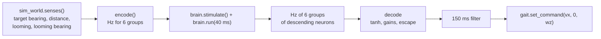
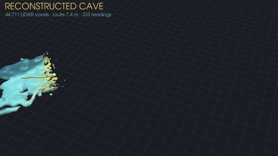

# 7 · The pilot: from sense to muscle

> 🌐 **English** · [Español](../cerebro/07-piloto.md)

[← Validation](06-validation.md) · [Index](README.md) · [Next: watching the brain live →](08-visualization.md)

---

[`pilot.py`](../../../desktop/fly_brain/pilot.py) is the bridge between the robot and
the fly. It has three jobs:

1. **Encode** what the robot perceives as stimuli to the fly's sensory neurons.
2. **Run the brain** for the duration of one frame.
3. **Decode** the descending neurons into a gait command (`vx`, `wz`).

> For now this drives the **simulated** Spot Micro in the cave viewer
> (`spot_brain.py`). The physical robot carries no mission sensors: see
> [from simulation to the real robot](10-from-simulation-to-the-real-robot.md).



---

## Why go in through the eyes

The natural choice would be to feed **gas** through the olfactory neurons and
**heat** through the thermosensory ones. That was tried, and in this model **it
doesn't work**:

- **They flood the brain.** Stimulating just 13 heat neurons at 5 Hz already sets off
  about **150,000 spikes**. The olfactory ones do the same at any intensity. The
  antennal lobe is highly recurrent and the LIF model has no adaptation or enough
  inhibition to rein it in.
- **They give no direction.** The output is always the same (left DNa02), whether the
  stimulus comes from the left or the right. You can't follow a gradient with that.

The **visual circuits**, on the other hand, are clean, lateralized and validated in
the model (see [the sweep](09-tools-and-glossary.md#the-673-type-sweep)). So the
pilot uses **sensory substitution**: the robot "shows" the fly each situation as the
visual scene the fly already knows how to interpret.

| What happens in the cave | How it is shown to the fly | Circuit |
|---|---|---|
| There is gas and it comes from one side | A small object on that side | Pursuit (LC10) |
| The path continues ahead | Something ahead | Forward walking (LC9, LC31a) |
| Strong heat or an approaching obstacle | Something growing fast (*looming*) | Threat (LPLC2, LC4) |

The world (`sim_world.senses()`) boils everything down to four numbers: the target
**bearing** (gas gradient, or the gallery if there is no gas, deflected by walls and
moderate heat), an equivalent **distance**, **looming** (0–1) and its **bearing**.

---

## Encoding: `encode()`

Six input groups, each with a rate between 0 and `MAX_HZ = 150` Hz (the paper's):

| Group | Neurons | When it lights up |
|---|---|---|
| `objetivo_izq` / `objetivo_der` (target left/right) | LC10a, LC10c-1, LC10c-2, LC10d on that side | Target on that side: `150 · salience · √max(0, ±sin bearing)` |
| `delante_izq` / `delante_der` (ahead left/right) | LC9 + LC31a | Target ahead: `150 · salience · cos² bearing` |
| `looming_izq` / `looming_der` | LPLC2 + LC4 | Something approaching, split by side |

**Salience** makes the target weigh more when close and fade on arrival, so the
robot doesn't crash into it:

```python
sal = clip((dist - 0.15) / 0.25, 0, 1) * clip(0.9 / dist, 0, 1)
```

---

## Running the brain: `step()`

```python
self.brain.stimulate(*[(self.inputs[k], hz) for k, hz in hz.items()])
counts = self.brain.run(ms)             # ms = real frame duration (~40)
```

The brain advances **exactly the frame's real duration** (clamped to 20–80 ms by the
viewer). That way the fly lives at the same pace as the robot: at 25 fps, each frame
is 40 ms of neural life (400 steps).

The state persists across frames: the fly doesn't "restart" its brain, only what it
sees changes.

> **Integration step depends on the hardware.** On the GPU the pilot uses
> `dt = 0.1 ms` (the paper's; the GPU runs 8× ahead of real time). On the CPU, 0.1 ms
> would run at 0.29×: each frame would take longer than the time it simulates, the
> viewer would hit the 80 ms cap and everything (world and brain, always in sync) would
> run in slow motion at ~3 fps. So, **without a GPU, `FlyPilot` uses `dt = 0.5 ms`
> automatically** (~1× for the brain, rates ~3 % different). It can be forced with
> `params=Params(dt=...)`.

---

## Decoding

Six groups of **descending neurons** are read and converted to rates (Hz):

| Group | Type | Becomes |
|---|---|---|
| `P9_izq`, `P9_der` | DNp09 | Forward |
| `DNa02_izq`, `DNa02_der` | DNa02 | Turn (left − right difference) |
| `MDN` | *Moonwalker* | Backward |
| `GF` | DNp01, Giant Fiber | Escape |

```python
forward  = tanh(1.5 * (P9_izq + P9_der) / 2 / gain['forward'])
backward = tanh(MDN / 30)
turn     = tanh(1.5 * (DNa02_izq / gain['turn_izq'] - DNa02_der / gain['turn_der']))
if GF > 80 Hz:  escape for 600 ms  →  vx = -1
```

- `tanh` bounds to [−1, 1] and saturates smoothly.
- **Escape:** if the Giant Fiber exceeds 80 Hz, the robot backs off at full speed for
  600 ms, like the fly's escape jump.

### Calibration: the brain isn't symmetric

The real connectome **is not symmetric**. For example, stimulating left LC10a drives
left DNa02 to **130 Hz**, but the right side only to **77 Hz**. Uncorrected, the robot
would always turn more to one side.

At startup, `calibrate()` measures each side's maximum response (300 ms of stimulus
at 150 Hz) and stores the **gains** used for normalization:

```
Brain on GPU · calibration {'turn_izq': 130, 'turn_der': 77, 'forward': ...}
```

### Smoothing

The brain is noisy (inputs are Poisson). So the servos don't jerk, the command goes
through a first-order filter with a **150 ms** time constant:

```python
a = 1 - exp(-ms / 150)
vx += a * (vx_target - vx)
wz += a * (wz_target - wz)
```

---

## The mission, seen from the brain

| Situation | What the fly sees | Dominant descending | The robot |
|---|---|---|---|
| Nothing detected | Gallery ahead | P9 | Walks along the gallery |
| Wall nearby | Target shifted to the open side | DNa02 on that side | Turns towards open space |
| Gas ≥ 20 ppm | Target in the gradient direction | DNa02 + P9 | Follows the gas |
| Gas ≥ 450 ppm | Target at 15 cm (salience 0) | — | Stops: **leak found** |
| Heat ≥ 28 °C | Target shifted to the opposite side | DNa02 | Goes around the source (max turn at 42 °C) |
| Heat ≥ 48 °C or obstacle | *Looming* | **Giant Fiber**, MDN | **Flees** backwards |

In the mine gallery the leak is 14 m from the entrance. Without graphics, the full
brain finds it in **about 52 s**, on flat and rough terrain, without hitting the walls.

<p align="center">
  <a href="../../assets/spot-micro-cueva.mp4"></a>
</p>

---

## Brain and spinal cord: the split

The fly **does not control servos**. It decides at a high level (go forward, turn,
flee) and [`gait.py`](../../../desktop/gait.py) acts as the spinal cord: it generates
the four-legged trot pattern from that command, and
[`kinematics.py`](../../../desktop/kinematics.py) computes the 12 angles. It's the same
split as in an animal: the brain picks the behaviour; the nerve cord's pattern
generators coordinate the legs.

---

[← Validation](06-validation.md) · [Index](README.md) · [Next: watching the brain live →](08-visualization.md)
