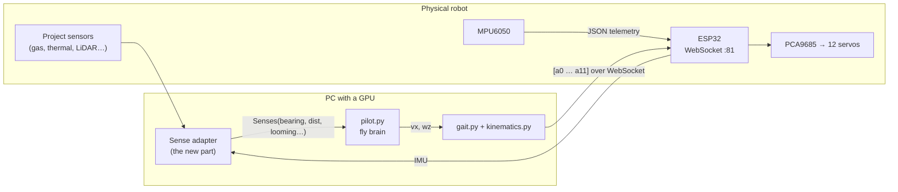

# 10 · From simulation to the real robot

> 🌐 **English** · [Español](../cerebro/10-del-simulador-al-robot-real.md)

[← Tools and glossary](09-tools-and-glossary.md) · [Index](README.md) · [Next: adding a new behaviour →](11-adding-a-behaviour.md)

---

## Where things stand today

The fly brain **only pilots the simulated Spot Micro** in the cave viewer
(`spot_brain.py`). The physical Spot Micro is driven from the desktop GUI
(`spotmicro_gui.py`), which sends angles to the ESP32 over WebSocket.

| | Simulation (`spot_brain.py`) | Physical robot |
|---|---|---|
| Who decides | The fly brain | A person, from the GUI |
| Gas | Virtual sensor (`sim_world.py`) | **Not integrated** |
| Temperature | Virtual sensor | **Not integrated** (the MPU6050 reports its own chip temperature, not the environment's) |
| LiDAR | Virtual 360° LiDAR on the arm's head | **Not integrated** |
| Arm | Simulated (`spot_arm.py`) | Not mounted |
| IMU | Tilt computed from the terrain | Real **MPU6050** (balance and telemetry) |
| Gait and kinematics | `gait.py` + `kinematics.py` | The same `gait.py` + `kinematics.py`, from the GUI |

## Sensors left out, on purpose

**No mission sensors (gas, ambient temperature, LiDAR) were integrated into the
physical robot, and that was a deliberate choice:** it keeps the platform
**adaptable to different projects** without redesigning it.

- The Spot Micro stays a **generic locomotion base**: 12 servos, an ESP32, an IMU and
  a documented WebSocket protocol.
- Each project mounts **the sensors it needs**: a gas detector for mine inspection, a
  thermal camera for search and rescue, a LiDAR for mapping, a humidity sensor for
  caves…
- The simulation demonstrates the full chain (senses → brain → gait) with **virtual**
  sensors, so no hardware has to be bought or wired to try the idea.
- The pilot doesn't depend on a specific sensor: it only needs four numbers (target
  bearing, distance, *looming* and its bearing). Any sensor that can be summarised that
  way will do.

---

## How it would be connected

All the pieces already exist. The chain to drive the real robot with the brain would
be:

1. **The brain runs on the PC**, not on the robot. The ESP32 has nowhere near the
   memory (~120 MB of weights) or the compute for 138,639 neurons. With an NVIDIA GPU
   it runs 8 times ahead of real time, leaving plenty of margin for WiFi latency.
2. **A sense adapter** (the only thing left to write) reads whatever sensors the
   project carries and fills in a `Senses`, just as `sim_world.senses()` does today.
3. **`pilot.step()`** returns `vx` and `wz`, exactly as in the simulation.
4. **`gait.py` and `kinematics.py`** turn that into 12 angles. They are the same
   modules the GUI already uses with the real robot.
5. **They are sent to the ESP32** with the existing protocol: a JSON `[a0, …, a11]`
   over WebSocket (port 81).

### Already solved in the firmware

- **Fail-safe:** if the ESP32 goes 1 s without receiving anything, the robot holds
  still in its last pose. If the PC hangs or the WiFi drops, it doesn't run off.
- **Low latency:** no per-packet acks, `WiFi.setSleep(false)`, I2C at 400 kHz.
- **IMU telemetry** at 10 Hz (`cmd:start_mpu_stream`), useful for the adapter to know
  whether the robot is tilting.

### What would need doing

| Task | Notes |
|---|---|
| Mount and read the project's sensors | On the ESP32 (adding them to the telemetry) or directly on the PC (e.g. a USB LiDAR) |
| Write the sense adapter | Turn real readings into `Senses`; see [adding a behaviour](11-adding-a-behaviour.md) |
| Control loop on the PC | Every ~40 ms: read senses → `pilot.step()` → `gait.step()` → send angles |
| Localization | In the simulation the robot knows its position; a real one would have to estimate it (odometry + IMU, or SLAM with the LiDAR) |
| Safety | An emergency stop in the GUI and lower speed limits to begin with |

---

[← Tools and glossary](09-tools-and-glossary.md) · [Index](README.md) · [Next: adding a new behaviour →](11-adding-a-behaviour.md)
