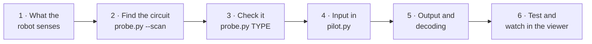

# 11 · Tutorial: adding a new behaviour

> 🌐 **English** · [Español](../cerebro/11-anadir-una-conducta.md)

[← From simulation to the real robot](10-from-simulation-to-the-real-robot.md) · [Index](README.md) · [Next: troubleshooting →](12-troubleshooting.md)

---

This tutorial shows how to give the robot a new behaviour **using a real circuit of
the fly brain**. The example: **backing away from a cliff edge**.

The idea is the same as with gas and heat ([the pilot](07-pilot.md)): we don't code
"if cliff, back up". We look for the fly neurons that lead to walking backwards and
present the cliff through them. The brain still makes the decision.



> Some names in the code are in Spanish (`objetivo_izq` = target left, `delante` =
> ahead, `precipicio` = cliff); they are kept as-is so the snippets match the code.

---

## 1. Decide what the robot senses

Add the new sense to `Senses` in [`pilot.py`](../../../desktop/fly_brain/pilot.py),
with a value between 0 and 1:

```python
@dataclass
class Senses:
    target_bearing: float | None = None
    target_dist: float = 1.0
    looming: float = 0.0
    looming_bearing: float = 0.0
    cliff: float = 0.0          # NEW: 0 = solid ground, 1 = cliff right ahead
```

In the simulation the world computes it (`sim_world.senses()`), e.g. by checking
whether the ground height drops sharply in front of the robot. On a real robot it
would come from a distance sensor aimed at the floor (see
[the real robot](10-from-simulation-to-the-real-robot.md)).

## 2. Find the circuit

Which neurons make the fly walk backwards? The sweep answers it:

```bash
cd desktop/fly_brain
python probe.py --scan          # ~45 s on the GPU: data/scan.csv
```

and filter by the descending neuron of interest (MDN, *moonwalker*):

```python
import pandas as pd
scan = pd.read_csv('data/scan.csv')
cols = [c for c in scan.columns if c.startswith('MDN')]
scan['MDN'] = scan[cols].mean(axis=1)
print(scan.sort_values('MDN', ascending=False)[['cell_type', 'side', 'n', 'MDN']].head(10))
```

The sweep found **LPC1, LC9 and LC6** as the strongest MDN drivers (15–32 Hz). LC9 is
already used for walking forward and LC6 also fires the Giant Fiber, so the best
candidate is **LPC1**.

> **Choosing well:** look for a type that drives the descending neuron you want
> **strongly** and the others **weakly**, that has several neurons (more stable) and,
> if the behaviour has a side, that responds **only on its side** (compare
> `--side left` and `--side right`).

## 3. Check it by hand

```bash
python probe.py LPC1                  # both sides
python probe.py LPC1 --side left      # is it lateralized?
python probe.py LPC1 --hz 75          # does it respond to a softer stimulus too?
```

Look at the motor descending table: MDN should go up and, if the Giant Fiber or P9 go
up too, the behaviour will come out mixed.

## 4. Add the input to the pilot

In `pilot.py`, a new group in `INPUTS` (`None` = both sides):

```python
INPUTS = {
    ...
    'precipicio': (('LPC1',), None),
}
```

And in `encode()`, from sense to rate:

```python
if s.cliff > 0:
    hz['precipicio'] = MAX_HZ * s.cliff
```

## 5. Output and decoding

In this case **nothing needs changing**: the pilot already reads MDN and turns it into
backing up:

```python
backward = math.tanh(rates['MDN'] / 30.0)
vx_target = forward - backward
```

If the new behaviour needed **another descending neuron**, add it to `OUTPUTS` and use
it in `step()`:

```python
OUTPUTS = {..., 'DNg11': ('DNg11', None)}         # e.g. front-leg grooming
...
grooming = rates['DNg11'] > 40.0                  # threshold by eye: measure it with probe.py
```

If the response is **asymmetric** between sides (common: the real connectome isn't
symmetric), add a gain in `calibrate()` like `turn_izq` / `turn_der`.

## 6. Test it

**Without graphics**, a few lines show whether the command changes:

```python
from connectome import Connectome
from pilot import FlyPilot, Senses

pilot = FlyPilot(Connectome.load())
pilot.calibrate()
for cliff in (0.0, 0.5, 1.0):
    pilot.reset()
    for _ in range(25):                                   # 1 s of brain
        cmd = pilot.step(Senses(target_bearing=0.0, target_dist=0.8, cliff=cliff), ms=40)
    print(f"cliff={cliff}: vx={cmd.vx:+.2f}  MDN={cmd.rates['MDN']:.0f} Hz")
```

Expected: `vx` drops (and goes negative) as `cliff` rises.

**In the viewer**, to see the new bar in the *Eyes* tab, add the key and label in
`_build_charts()` in [`spot_brain.py`](../../../desktop/spot_brain.py):

```python
self.in_keys = [..., "precipicio"]
chart, self.in_series = bar_chart(pv, "Eyes: stimulus (Hz)", [..., "LPC1"], [..., YELLOW], 160, **full)
```

And add a test under `tests/` (no FlyWire data, with small networks like
`test_pilot.py`) so the encoding doesn't break silently.

---

## Why not hard-code it

It would be easier to write `if cliff > 0.5: vx = -1`. But then the brain plays no
part: it doesn't compete with the other stimuli, it has none of the brain's latency or
noise, and the robot is no longer "piloted by a fly". Going through the connectome,
the decision comes from the real interaction between circuits: if there is also a very
salient target ahead, P9 and MDN compete as they would in the fly.

---

[← From simulation to the real robot](10-from-simulation-to-the-real-robot.md) · [Index](README.md) · [Next: troubleshooting →](12-troubleshooting.md)
