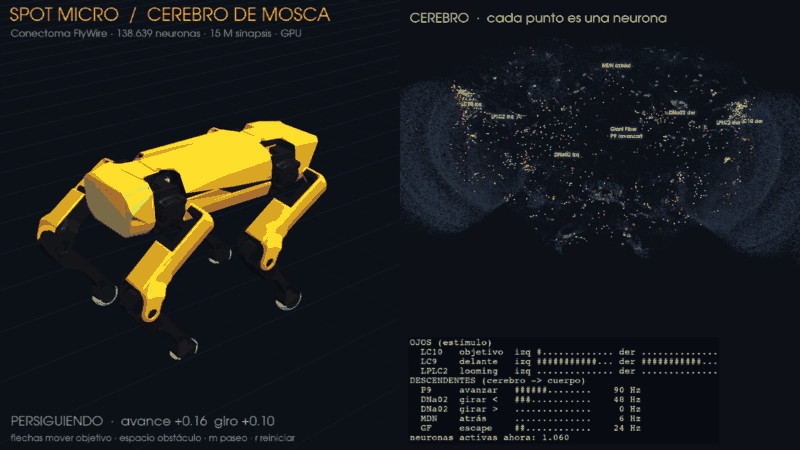
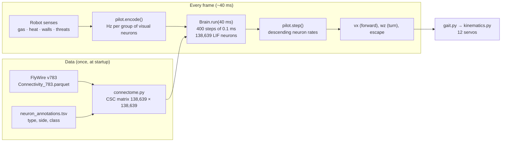

# Wiki · The Spot Micro's brain

> 🌐 **English** · [Español](../cerebro/README.md)

> The Spot Micro explores a cave piloted by the **complete brain of a fruit fly**
> (*Drosophila melanogaster*): the **138,639 neurons** and **~15 million
> connections** of the FlyWire v783 connectome, simulated neuron by neuron on the
> GPU **8.3 times faster than real time**.

This wiki explains the whole "brain" side of the project: where the data comes
from, which equations are simulated, how the CPU and GPU simulators are written,
**how we went from 740 s to 3.6 s** on the same experiment, how we know the result
is still correct, and how the fly's decisions end up moving the robot's legs.

> **Scope:** for now the fly brain pilots the **simulated** robot only (the cave
> viewer). The physical Spot Micro is driven from the GUI and **carries no mission
> sensors** (gas, temperature, LiDAR): they were left out on purpose so the platform
> can be adapted to different projects. See
> [from simulation to the real robot](10-from-simulation-to-the-real-robot.md).

---

## Pages

| # | Page | What it covers |
|---|---|---|
| 1 | [The connectome](01-connectome.md) | The FlyWire data, the weight matrix and how neurons are looked up |
| 2 | [The LIF model](02-lif-model.md) | Each neuron's equations, the parameters and why they were chosen |
| 3 | [The CPU simulator](03-cpu-simulator.md) | `lif.py`: numba, branch-free loop, event-driven propagation |
| 4 | [The GPU simulator](04-gpu-simulator.md) | `lif_gpu.py`: CUDA kernels, `atomicAdd`, CUDA Graphs |
| 5 | [**How we cut the time**](05-cutting-the-time.md) | Every optimization, one by one, with numbers |
| 6 | [Validation against the original](06-validation.md) | r = 0.999 against Shiu et al.'s Brian2 and the two details that had to match |
| 7 | [The pilot: from sense to muscle](07-pilot.md) | Which neurons are stimulated, which are read, and how that becomes forward speed and turning |
| 8 | [Watching the brain live](08-visualization.md) | The 3D panel: morphology, activity, synapses and its performance |
| 9 | [Tools, tests and glossary](09-tools-and-glossary.md) | `probe.py`, the 673-type sweep, `benchmark.py`, `figures.py`, the tests and vocabulary |
| 10 | [From simulation to the real robot](10-from-simulation-to-the-real-robot.md) | What it pilots today, why sensors were left out and how it would connect |
| 11 | [Tutorial: adding a new behaviour](11-adding-a-behaviour.md) | Step by step: backing away from a cliff using a real circuit |
| 12 | [Troubleshooting](12-troubleshooting.md) | GPU not detected, slow viewer, slow startup, memory, data |
| 13 | [Limitations and future work](13-limitations-and-future-work.md) | What the model and the integration don't do, and where to go next |

If you only read one, read **[5 · How we cut the time](05-cutting-the-time.md)**.

---

## The brain in one picture

The fly is the **brain** (it decides to walk forward, turn, flee or back up) and
`gait.py` is the **spinal cord** (it turns that decision into a four-legged gait).
Only two numbers pass between them: `vx` and `wz`.

---

## Key figures

| | |
|---|---|
| Simulated neurons | **138,639** (the whole central brain and optic lobes) |
| Connections | ~15 million neuron→neuron pairs, with sign and synapse count |
| Integration step | **0.1 ms** (as in the original paper) → 10,000 steps per simulated second |
| GPU speed (RTX 4060 Laptop) | **8.3× real time** (~12 µs per step) |
| CPU speed (i7-12650H) | 0.29× real time (~345 µs per step); without a GPU the pilot uses `dt = 0.5 ms` (~1×) |
| Same experiment as the original | **740 s → 3.6 s** (with almost 4× more trials) |
| Fidelity to the original | **r = 0.999** neuron by neuron, slope 1.003 |
| Brain time per viewer frame | ~5 ms of GPU for 40 ms of fly life |

---

## Files

| File | Role |
|---|---|
| [`desktop/fly_brain/connectome.py`](../../../desktop/fly_brain/connectome.py) | Loads the connectome and finds neurons by type and side |
| [`desktop/fly_brain/lif.py`](../../../desktop/fly_brain/lif.py) | LIF model + CPU simulator (numba) + `make_brain()` |
| [`desktop/fly_brain/lif_gpu.py`](../../../desktop/fly_brain/lif_gpu.py) | The same simulator on the GPU (CuPy + CUDA) |
| [`desktop/fly_brain/pilot.py`](../../../desktop/fly_brain/pilot.py) | Senses → neurons → descending neurons → gait command |
| [`desktop/fly_brain/probe.py`](../../../desktop/fly_brain/probe.py) | Experiments: stimulate a type and see which descending neurons respond |
| [`desktop/fly_brain/validate_brian2.py`](../../../desktop/fly_brain/validate_brian2.py) | Neuron-by-neuron comparison with the original `model.py` |
| [`desktop/fly_brain/download_data.py`](../../../desktop/fly_brain/download_data.py) | Downloads the connectome and annotations (~130 MB) |
| [`desktop/fly_brain/benchmark.py`](../../../desktop/fly_brain/benchmark.py) | Measures speed, spikes per step, CUDA Graphs and branches |
| [`desktop/fly_brain/figures.py`](../../../desktop/fly_brain/figures.py) | Generates the wiki's charts |
| [`desktop/fly_brain/download_skeletons.py`](../../../desktop/fly_brain/download_skeletons.py) | Downloads and simplifies each neuron's shape |
| [`desktop/spot_brain.py`](../../../desktop/spot_brain.py) | The viewer: robot, 3D brain, map and charts |

To install and run it, see the [fly_brain README](../../../desktop/fly_brain/README.md) (Spanish).
