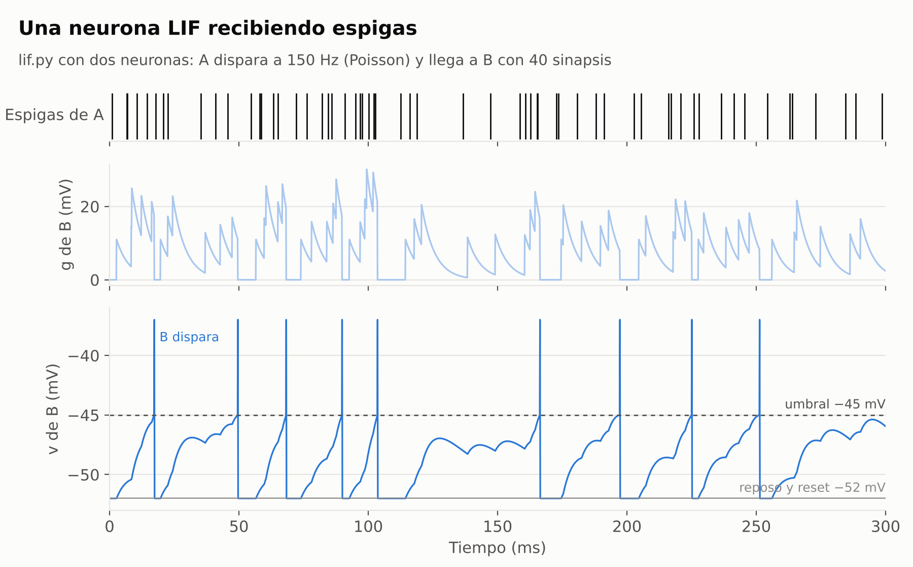
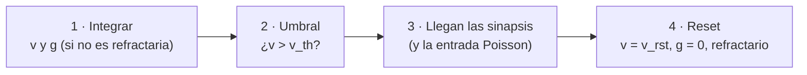

# 2 · El modelo LIF

> 🌐 [English](../brain/02-lif-model.md) · **Español**

[← El conectoma](01-conectoma.md) · [Índice](README.md) · [Siguiente: el simulador en CPU →](03-simulador-cpu.md)

---

El conectoma dice **quién habla con quién**. Para que "hable" hace falta un modelo
de cómo se comporta cada neurona. Usamos exactamente el del artículo de
**Shiu et al. 2024** (*Nature*, "A Drosophila computational brain model reveals
sensorimotor processing"), que demostró que este modelo tan simple, puesto sobre el
conectoma real, predice conductas medidas en moscas vivas.

## LIF: *Leaky Integrate-and-Fire*

Cada neurona es un condensador con fugas:

- **Integra** (*integrate*) la corriente que le llega de otras neuronas.
- **Pierde** carga hacia el reposo (*leaky*).
- Si el voltaje supera un umbral, **dispara** (*fire*) una espiga, vuelve al
  reposo y queda unos milisegundos **refractaria** (sorda).

### Las ecuaciones

Dos variables por neurona: el voltaje de membrana **v** y la conductancia
sináptica **g** (la entrada que va llegando y se desvanece).

```
dv/dt = (v₀ − v + g) / τ_mbr        (congeladas durante el refractario)
dg/dt = −g / τ
```

y las reglas discretas:

```
si v > v_th:   v ← v_rst,  g ← 0,  refractaria durante t_rfc
cada espiga de una presináptica suma  w = (signo × n_sinapsis) × w_syn  a g,
tras un retardo t_dly
```



*Las ecuaciones en acción, con el mismo `lif.py` y dos neuronas. Cada espiga de A
llega a B 1,8 ms después y sube `g` de golpe (40 sinapsis × 0,275 mV = 11 mV); `g`
cae con τ = 5 ms y empuja `v` hacia arriba. Una espiga sola no basta para cruzar los
7 mV hasta el umbral: B dispara cuando varias llegan juntas. Tras cada espiga, `v`
vuelve a −52 mV, `g` a 0, y las dos quedan congeladas 2,2 ms. Se regenera con `python figures.py neuron`.*

### Los parámetros

Todos en [`lif.py` · `Params`](../../../desktop/fly_brain/lif.py), idénticos al
original:

| Parámetro | Valor | Significado |
|---|---|---|
| `v_0` | −52 mV | Potencial de reposo |
| `v_rst` | −52 mV | Voltaje tras una espiga |
| `v_th` | −45 mV | Umbral de disparo (7 mV por encima del reposo) |
| `t_mbr` | 20 ms | Constante de tiempo de la membrana |
| `tau` | 5 ms | Constante de tiempo de la sinapsis |
| `t_rfc` | 2,2 ms | Periodo refractario |
| `t_dly` | 1,8 ms | Retardo sináptico |
| `w_syn` | 0,275 mV | Peso de **una** sinapsis |
| `f_poi` | 250 | Factor de la entrada Poisson (estimulación) |
| `dt` | 0,1 ms | Paso de integración |

**Intuición numérica:** como `τ` (5 ms) es mucho más rápida que `τ_mbr` (20 ms), el
pico de `v` es solo ~0,16 × `g`. Para subir los 7 mV hasta el umbral hacen falta
unos 44 mV de `g`, es decir **~160 sinapsis activas a la vez**. Una neurona solo
dispara si muchas presinápticas coinciden (lo comprueba un test,
`test_strong_synapse_relays_after_delay`).

---

## Integración exacta

La forma ingenua de avanzar un paso es Euler: `v += dt · dv/dt`. Pero el sistema es
**lineal** entre espigas, así que tiene solución analítica. Para un paso `dt`:

```
v − v₀  ←  a_vv · (v − v₀)  +  a_vg · g
g       ←  a_gg · g

a_vv = exp(−dt / τ_mbr)
a_gg = exp(−dt / τ)
a_vg = τ / (τ − τ_mbr) · (a_gg − a_vv)
```

`exact_coefficients()` calcula esos tres números **una sola vez**. Después, cada
paso de cada neurona son **tres multiplicaciones y dos sumas**.

Ventajas:

1. **Es lo que hace Brian2** con `method='linear'`, así que reproducimos el
   original bit a bit en la dinámica (ver [validación](06-validacion.md)).
2. **No hay error de integración** en la parte continua: el `dt` solo afecta a
   cuándo se detectan las espigas, no a la precisión de `v`.
3. **Es estable con cualquier `dt`**, lo que permite usar 0,5 ms en CPU cuando
   interesa ir más rápido (ver [reducción del tiempo](05-reduccion-del-tiempo.md#10-el-paso-de-tiempo-como-palanca)).

---

## La estimulación: optogenética virtual

En el artículo se "encienden" neuronas como en un experimento de optogenética
(luz que activa canales en neuronas concretas). En el modelo:

- Cada neurona estimulada recibe **eventos Poisson** a la frecuencia pedida (p. ej.
  150 Hz).
- Cada evento suma `w_syn × f_poi = 0,275 × 250 = 68,75 mV` directamente a `v`: muy
  por encima de los 7 mV del umbral, así que **cada evento produce una espiga**.
- Las neuronas estimuladas **no tienen periodo refractario**, para que disparen a
  la frecuencia pedida.

En código, la probabilidad de evento por paso es:

```
p = frecuencia_Hz × dt_ms × 1e-3        # 150 Hz con dt 0,1 ms → p = 0,015
```

---

## El orden dentro de un paso

Parece un detalle, pero cambia el resultado. Brian2 hace, en cada paso:



Nuestros dos simuladores siguen **exactamente** ese orden. Dos consecuencias:

- Lo que llega en el mismo paso en que la neurona dispara **se pierde** con el
  reset.
- Como `g` está marcada `(unless refractory)` en el modelo original, **la entrada
  que llega mientras la neurona es refractaria se descarta**. Este fue uno de los
  dos detalles que hubo que descubrir para cuadrar con el original
  ([validación](06-validacion.md#los-dos-detalles-de-brian2)).

---

## El retardo sináptico: un buffer circular

Una espiga emitida ahora debe llegar `t_dly = 1,8 ms` después, es decir **18 pasos**.
En vez de una cola de eventos, el simulador usa una matriz `pending` de
**18 filas × 138.639 columnas**:

```
paso s:  fila = pending[s % 18]
         1) la neurona i lee fila[i] (lo que emitieron hace 18 pasos) y la pone a 0
         2) quien dispara ahora suma sus pesos en esa MISMA fila
         → se leerá otra vez en el paso s + 18 = 1,8 ms después
```

Es memoria fija (18 × 138.639 × 4 B ≈ **10 MB**), sin listas que crezcan, sin
ordenar eventos, y el acceso es por índice directo. Perfecto para GPU.

---

[← El conectoma](01-conectoma.md) · [Índice](README.md) · [Siguiente: el simulador en CPU →](03-simulador-cpu.md)
