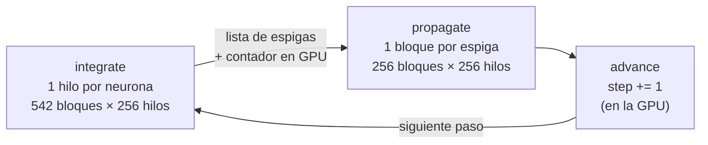

# 4 · El simulador en GPU (`lif_gpu.py`)

[← El simulador en CPU](03-simulador-cpu.md) · [Índice](README.md) · [Siguiente: cómo reducimos el tiempo →](05-reduccion-del-tiempo.md)

---

[`lif_gpu.py`](../../../desktop/fly_brain/lif_gpu.py) es **el mismo modelo** que
`lif.py`, con la **misma API** (`stimulate`, `run`, `rate`, `reset`, `t`), escrito
como kernels CUDA en C que CuPy compila al vuelo (`cp.RawModule`).

Se instala con un solo paquete, que trae CUDA desde pip sin necesidad de instalar
el *toolkit* de NVIDIA:

```bash
pip install "cupy-cuda12x[ctk]"
```

---

## Visión general

Por cada paso de 0,1 ms se lanzan **tres kernels**, y la CPU **nunca espera** a la
GPU entre ellos:



Y 100 pasos seguidos (300 lanzamientos) se graban **una vez** como un **CUDA
Graph** y se reproducen con una sola llamada.

---

## Kernel 1 · `integrate`

Un hilo por neurona (138.639 hilos en bloques de 256 → 542 bloques).

```c
int i = blockIdx.x * blockDim.x + threadIdx.x;
float vi = v[i], gi = g[i];
short r = ref_left[i];
bool fired = false;
if (r > 0) {
    r -= 1;                                   // refractaria: congelada, entrada descartada
} else {
    vi = v_0 + a_vv * (vi - v_0) + a_vg * gi; // solución exacta
    gi *= a_gg;
    if (fabsf(gi) < eps) gi = 0.0f;
    fired = vi > v_th;
    gi += row[i];                             // entrada sináptica que llega ahora
}
row[i] = 0.0f;
if (p > 0 && uniform(seed ^ (step * n + i)) < p)
    vi += w_poi;                              // Poisson (optogenética)
if (fired) {
    vi = v_rst; gi = 0; r = no_refractory[i] ? 0 : ref_steps;
    counts[i] += 1;
    spikes[atomicAdd(&n_spk[cur], 1)] = i;    // me apunto en la lista de espigas
}
```

Puntos clave:

- **Lecturas y escrituras coalescentes:** el hilo `i` toca `v[i]`, `g[i]`,
  `row[i]`… Hilos consecutivos leen direcciones consecutivas, y la GPU las sirve en
  una sola transacción de memoria.
- **Compactación de espigas con `atomicAdd`:** cada neurona que dispara reserva un
  hueco en `spikes[]` incrementando atómicamente un contador. Al terminar el kernel,
  `spikes[0 .. n_spk)` es la **lista compacta** de quién disparó, sin ordenar y sin
  ninguna pasada extra.
- Aquí sí hay un `if (r > 0)`, pero en GPU el coste es distinto que en CPU: los 32
  hilos de un *warp* ejecutan ambos lados y enmascaran, y los dos lados son tan
  cortos que no compensa reescribirlo.

### El generador aleatorio: sin estado

```c
__device__ float uniform(unsigned long long x) {   // splitmix64 → [0, 1)
    x += 0x9E3779B97F4A7C15ULL;
    x = (x ^ (x >> 30)) * 0xBF58476D1CE4E5B9ULL;
    x = (x ^ (x >> 27)) * 0x94D049BB133111EBULL;
    x ^= x >> 31;
    return (x >> 40) * (1.0f / 16777216.0f);
}
```

Es un generador **basado en contador**: el número aleatorio de la neurona `i` en el
paso `s` es un *hash* de `(semilla, s, i)`. Ventajas frente a cuRAND:

- **No hay estado** que guardar por neurona (cuRAND necesita ~48 B por hilo y un
  kernel de inicialización costoso).
- **Reproducible:** mismo `(semilla, paso, neurona)` → mismo número, se lance como se
  lance.
- **Compatible con CUDA Graphs:** el paso se lee de la memoria de la GPU, así que el
  grafo grabado genera números distintos en cada reproducción.

---

## Kernel 2 · `propagate`

```c
int n = n_spk[step & 1];                          // cuántas espigas hubo (leído en GPU)
for (int s = blockIdx.x; s < n; s += gridDim.x) { // cada bloque coge espigas
    int pre = spikes[s];
    for (k = indptr[pre] + threadIdx.x; k < indptr[pre+1]; k += blockDim.x)
        atomicAdd(&row[indices[k]], data[k]);    // sus 256 hilos recorren la columna
}
```

- **Un bloque por espiga** (en *grid-stride*: 256 bloques se reparten todas las que
  haya). Los 256 hilos del bloque recorren **la columna CSC de esa neurona**, que
  está contigua en memoria → lectura coalescente de `indices` y `data`.
- Varias neuronas pueden apuntar a la misma diana en el mismo paso, de ahí el
  `atomicAdd` sobre `row`. Los atómicos de `float` en memoria global son rápidos en
  GPUs modernas y, como las dianas están muy repartidas, apenas hay contención.
- **Solo se trabaja si hubo espigas.** Si en un paso no dispara nadie, el kernel
  sale casi al instante.

### El truco del contador doble

¿Cómo sabe `propagate` cuántas espigas hay **sin preguntar a la CPU**? Lo lee de
`n_spk`, en la GPU. Pero alguien tiene que ponerlo a cero cada paso, y no puede ser
la CPU (habría que sincronizar). Solución: **dos contadores alternos**.

```
paso par:    integrate escribe en n_spk[0] y pone a 0 n_spk[1]
             propagate lee n_spk[0]
paso impar:  integrate escribe en n_spk[1] y pone a 0 n_spk[0]
             propagate lee n_spk[1]
```

El hilo 0 de `integrate` pone a cero el contador del **paso siguiente**, que el
`propagate` anterior ya leyó. Ninguna carrera, ninguna sincronización.

---

## Kernel 3 · `advance` y el paso en la GPU

```c
extern "C" __global__ void advance(long long* step_dev) { *step_dev += 1; }
```

Un kernel de un solo hilo que suma 1. Parece absurdo, pero es lo que permite usar
CUDA Graphs: si el número de paso se pasara como argumento desde Python, quedaría
**congelado** dentro del grafo grabado. Al vivir en la memoria de la GPU, cada
reproducción del grafo ve el paso correcto (para el buffer circular, el contador
doble y el generador aleatorio).

---

## CUDA Graphs: 300 lanzamientos en una llamada

Un paso de 0,1 ms cuesta en la GPU **~12 µs**. Pero lanzar un kernel desde Python
(CuPy) tiene un coste fijo del orden de microsegundos a decenas de microsegundos,
**y hay tres por paso**. Lanzándolos uno a uno, la GPU se pasaba la mayor parte del
tiempo **esperando a que Python le diera trabajo**.

Un **CUDA Graph** graba una secuencia de lanzamientos y luego la reproduce entera
con una sola llamada, con el *driver* enviando todo de golpe:

```python
self._stream.begin_capture()
for _ in range(GRAPH_STEPS):        # 100 pasos = 300 kernels
    self._launch_step()
self._graph = self._stream.end_capture()
...
for _ in range(n_steps // 100):
    self._graph.launch(self._stream)   # 1 llamada = 10 ms de cerebro
for _ in range(n_steps % 100):
    self._launch_step()                # el resto, uno a uno
```

- El grafo se graba **una sola vez** (la primera `run()` de ≥ 100 pasos) y se
  reutiliza para siempre, incluso tras `reset()` o `stimulate()`, porque estos solo
  cambian **contenidos** de arrays, no direcciones.
- Un fotograma de 40 ms = 400 pasos = **4 reproducciones del grafo**, en vez de 1.200
  lanzamientos.

---

## Un solo viaje GPU → CPU por fotograma

Todo el estado vive en la GPU y no se mueve. Al final de `run()` solo se copia una
cosa a la CPU: el **número de espigas por neurona** en ese tramo (138.639 × 4 B ≈
**0,55 MB**), que es lo que necesitan el piloto (para leer las descendentes) y el
visor (para iluminar las neuronas activas).

```python
start = self.counts.copy()
... grafos ...
counts = cp.asnumpy(self.counts - start, stream=self._stream)
self._stream.synchronize()          # la ÚNICA espera de todo run()
```

`stimulate()` usa el **mismo stream** que la simulación, así que un cambio de
estímulo queda ordenado detrás de los pasos pendientes, sin carreras.

---

## Rendimiento

En una RTX 4060 Laptop, con *looming*:

| `dt` | Velocidad |
|---|---|
| 0,1 ms (original) | **8,3× tiempo real** (1 s de mosca en ~0,12 s) |
| 0,5 ms | 33× tiempo real |

Es **~29 veces más rápido que la CPU** con el mismo `dt`. El porqué de cada factor
está desglosado en [cómo reducimos el tiempo](05-reduccion-del-tiempo.md).

---

[← El simulador en CPU](03-simulador-cpu.md) · [Índice](README.md) · [Siguiente: cómo reducimos el tiempo →](05-reduccion-del-tiempo.md)
