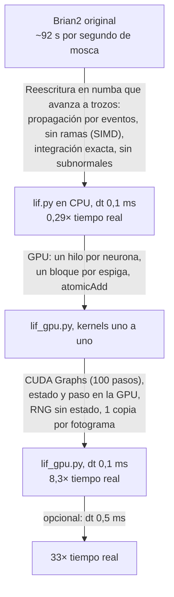

# 5 · Cómo reducimos el tiempo

[← El simulador en GPU](04-simulador-gpu.md) · [Índice](README.md) · [Siguiente: validación →](06-validacion.md)

---

Esta es la página central de la wiki. Aquí se cuenta **por qué el cerebro de una
mosca entera puede pilotar un robot en tiempo real** en un portátil, cuando el
modelo original tardaba minutos en simular un segundo.

## El punto de partida

El mismo experimento con el código original y con el nuestro
(`validate_brian2.py`: *looming*, LPLC2 + LC4 a 150 Hz, 1 s de mosca por ensayo):

| | Original (Brian2) | Nuestro (GPU) |
|---|---|---|
| Ensayos | 8 (en 8 procesos en paralelo) | 30 (uno detrás de otro) |
| Tiempo total | **740 s** | **3,6 s** |
| Tiempo por ensayo | ~92 s | **~0,12 s** |
| Resultado | — | r = 0,999 con el original |

En **trabajo útil** (segundos de mosca simulados por segundo de reloj):

```
Brian2:   8 s de mosca / 740 s   = 0,011 s/s
Nuestro: 30 s de mosca / 3,6 s   = 8,3   s/s
                                   ─────────
                                   ~770× más rendimiento
```

> **Honestidad con la cifra.** Los 740 s de Brian2 incluyen generar y compilar su
> código C++ y cargar el conectoma en cada proceso, un coste fijo que en
> experimentos más largos pesaría menos. Aun así, para lo que necesita el robot
> (avanzar 40 ms, 24 veces por segundo, para siempre) el modelo original no
> serviría ni de lejos, y el nuestro va con margen.

### El presupuesto que había que cumplir

El visor dibuja un fotograma cada ~40 ms. En ese tiempo hay que:

1. mover el mundo y disparar el LiDAR,
2. **simular 40 ms de cerebro = 400 pasos × 138.639 neuronas**,
3. calcular la marcha y la cinemática,
4. dibujar el robot, el cerebro, el mapa y las gráficas.

Para que el cerebro no se coma el fotograma, los 400 pasos tenían que caber en
unos pocos milisegundos. Hoy cuestan **~5 ms** (40 ms ÷ 8,3).

```
Un fotograma de ~40 ms
├── cerebro (GPU, 400 pasos) ███ ~5 ms
├── mundo + LiDAR + marcha    ██ 
└── dibujo                    ████████████████ (el resto)
```

A continuación, **todas las optimizaciones**, de la que más ahorra a la que menos.

---

## 1. Propagación dirigida por eventos

**La idea más importante.** La forma "de libro" de simular una red es, en cada paso:

```
entrada = W · espigas          (producto matriz-vector)
```

Con W densa son 138.639² ≈ **19.200 millones** de multiplicaciones por paso.
Imposible. Con W dispersa, ~**15 millones** por paso (una por conexión), que siguen
siendo 150.000 millones por segundo de mosca.

Pero la mayoría de esas multiplicaciones son **por cero**: en un paso de 0,1 ms
dispara una fracción pequeñísima de las neuronas. Así que en vez de recorrer W
entera, **solo se recorren las columnas de las neuronas que acaban de disparar**:

```python
for pre in neuronas_que_dispararon:
    for k in range(indptr[pre], indptr[pre + 1]):
        entrada[indices[k]] += data[k]
```

El coste pasa a ser **nº de espigas × conexiones medias por neurona**. Cada neurona
tiene de media ~108 dianas (15 M ÷ 138.639). Un ejemplo ilustrativo:

| Por paso | Producto completo | Por eventos (500 espigas) |
|---|---|---|
| Sumas | ~15.000.000 | ~54.000 |
| | | **~280× menos trabajo** |

Esto es posible gracias a dos decisiones previas:

- **Formato CSC** ([conectoma](01-conectoma.md#por-qué-csc-y-no-csr)): las dianas de
  cada neurona están contiguas en memoria.
- **Lista compacta de espigas** en GPU (`atomicAdd`,
  [kernel 1](04-simulador-gpu.md#kernel-1--integrate)): `propagate` sabe exactamente
  qué columnas recorrer sin mirar las 138.639 neuronas.

---

## 2. La GPU: 138.639 neuronas a la vez

La integración de cada neurona es **independiente** de las demás dentro de un paso.
Es el problema perfecto para una GPU:

- **Un hilo por neurona** → 138.639 hilos en 542 bloques de 256.
- **Un bloque por espiga** en la propagación, con sus 256 hilos recorriendo la
  columna.
- La RTX 4060 Laptop tiene **3.072 núcleos CUDA** frente a los 10 núcleos (16 hilos)
  del i7-12650H, y sobre todo un ancho de banda de memoria muy superior, que es lo
  que limita este tipo de simulación.

Resultado: con el mismo `dt` de 0,1 ms, **0,29× → 8,3× tiempo real (~29×)**.

### El estado cabe (casi) en caché

| Datos | Tamaño |
|---|---|
| Estado por neurona (`v`, `g`, refractario, estímulo, contadores…) | ~3 MB |
| Buffer de retardo (18 × 138.639 × 4 B) | ~10 MB |
| Matriz de pesos (solo se leen las columnas que disparan) | ~120 MB |

Lo que se toca en **cada** paso (~13 MB) es comparable a la caché L2 de la GPU, así
que buena parte de los accesos no llegan a la memoria principal. La matriz grande
solo se lee "a trozos", por columnas, cuando hay espigas.

---

## 3. CUDA Graphs: quitar a Python de en medio

Primera versión GPU: correcta, pero decepcionante. Un paso de cálculo cuesta ~12 µs
en la GPU, pero lanzar cada kernel desde Python tiene un coste fijo comparable o
mayor, y **hay tres kernels por paso**. La GPU pasaba buena parte del tiempo
ociosa, esperando a Python.

Solución: grabar **100 pasos (300 kernels) como un CUDA Graph** y reproducirlo con
una llamada. Un fotograma de 400 pasos son **4 llamadas** en vez de **1.200**.

Para que el grafo grabado funcione, todo lo que cambia de paso a paso tiene que
vivir **en la GPU**, no en argumentos:

- El número de paso (`step_dev`) y un kernel `advance` que lo incrementa.
- El número de espigas (`n_spk`), leído por `propagate` desde la memoria de la GPU.
- El generador aleatorio, basado en `(semilla, paso, neurona)`.

Detalles en [el simulador en GPU](04-simulador-gpu.md#cuda-graphs-300-lanzamientos-en-una-llamada).

---

## 4. Bucle sin ramas (SIMD) en CPU

En `lif.py` la integración no tiene ningún `if` por neurona: se calcula todo y se
**selecciona** el resultado. Así LLVM (vía numba) **vectoriza** el bucle con
instrucciones SIMD.

| Versión | Coste relativo |
|---|---|
| Con `if refractaria: continue` | ~7× |
| **Sin ramas** (`x = a if cond else b`) | **1×** |

¿Por qué tanta diferencia? Qué neuronas están refractarias es **aleatorio**, así que
el predictor de saltos de la CPU falla constantemente (cada fallo cuesta ~15–20
ciclos), y la rama impide además que el bucle use SIMD.

En cambio, en la segunda fase (`if fired[pre]`) **sí** se deja la rama, porque es
muy predecible: casi ninguna neurona dispara en un paso dado.

Ver [el simulador en CPU](03-simulador-cpu.md#fase-1--_integrate-todas-las-neuronas-sin-ramas).

---

## 5. Integración exacta: 3 multiplicaciones por neurona

En vez de resolver la ecuación diferencial con Euler o Runge-Kutta, se usa su
**solución analítica** para un paso `dt`, con tres coeficientes que se calculan una
sola vez al construir el cerebro:

```
v − v₀ ← a_vv · (v − v₀) + a_vg · g
g      ← a_gg · g
```

- Menos operaciones que cualquier integrador numérico de orden alto.
- **Sin error de integración**, así que no hace falta reducir `dt` para ganar
  precisión.
- Estable con cualquier `dt` (permite la [palanca 10](#10-el-paso-de-tiempo-como-palanca)).

---

## 6. Evitar los números subnormales

`g` decae exponencialmente (`g ← 0,98 · g` en cada paso). Una neurona que no recibe
nada ve su `g` encogerse hacia cero durante miles de pasos hasta llegar a números
**subnormales** (menores que ~10⁻³⁸ en `float32`). En muchas CPU, operar con
subnormales es **decenas de veces más lento** que con números normales, porque se
resuelve por microcódigo.

Solución: si `|g| < 10⁻⁴ mV`, se pone a 0 (`G_EPS`). Es despreciable frente a los
7 mV que separan el reposo del umbral, y elimina el problema de raíz. Se aplica
igual en CPU y en GPU para que los dos den lo mismo.

---

## 7. Memoria compacta y precálculo

Cada byte que no se lee es tiempo que se ahorra (la simulación está limitada por
memoria, no por cálculo):

| Decisión | Ahorro |
|---|---|
| `float32` en vez de `float64` para `v`, `g`, pesos | Mitad de tráfico |
| `int16` para el contador de refractario | ¼ de `int64` |
| `int32` para los índices de la matriz | Mitad que `int64` (15 M índices) |
| Pesos **premultiplicados por `w_syn`** al cargar | Una multiplicación menos por sinapsis entregada |
| Coeficientes `a_vv`, `a_vg`, `a_gg` precalculados | Ningún `exp()` en el bucle |
| Buffer circular fijo para el retardo | Sin colas de eventos, sin `malloc`, sin ordenar |

---

## 8. Un solo viaje de datos por fotograma

El estado entero del cerebro **vive en la GPU** desde que arranca. En cada fotograma
solo cruza el bus PCIe:

- **Hacia la GPU:** la estimulación, y solo cuando cambia (unos cientos de índices).
- **Hacia la CPU:** las espigas por neurona del tramo (~0,55 MB), con **una única
  sincronización** al final de `run()`.

Copiar el estado completo cada vez costaría más que simular.

---

## 9. Arranque rápido: cachés

- **Conectoma en caché** (`connectome_cache.npz`): la primera carga lee el parquet y
  construye la matriz CSC; las siguientes cargan tres arrays de NumPy directamente.
- **Numba con `cache=True`**: el código máquina se guarda en disco; no se recompila
  en cada arranque.
- **CUDA Graph grabado una vez** y reutilizado tras `reset()` y `stimulate()`.
- **`reset()` sin reconstruir**: experimentos repetidos (calibración, `probe.py
  --scan`, validación) reutilizan el mismo objeto sin volver a subir 120 MB de pesos
  a la GPU.
- **Calibración corta**: tres pruebas de 300 ms (~0,1 s de GPU) al arrancar el visor.

---

## 10. El paso de tiempo como palanca

`dt` es el gran botón de velocidad: con `dt = 0,5 ms` hay **5 veces menos pasos**.

| | dt 0,1 ms | dt 0,5 ms | Diferencia en frecuencias |
|---|---|---|---|
| GPU | 8,3× | **33×** | |
| CPU | 0,29× | **0,99×** | ~3 % |

Como la integración es exacta, el `dt` grueso solo afecta a cuándo se detectan las
espigas y al retardo/refractario redondeados, no a la estabilidad. El piloto y la
validación usan **0,1 ms** (fidelidad máxima, y la GPU va sobrada); `probe.py` en CPU
usa 0,5 ms para ir a tiempo real.

---

## 11. No esperar a quien no hace falta (visor)

El cerebro no es lo único que hay que hacer en un fotograma. Estas optimizaciones
del visor ([página 8](08-visualizacion.md)) hacen que el fotograma completo quepa
en ~28 ms de mediana:

| Cambio | Efecto medido |
|---|---|
| **Mallas actualizadas en sitio** (sin recrear actores de VTK) | **11,6 → 41 fps** |
| **Mapa LiDAR reconstruido en otro proceso** | Desaparece un parón de ~70 ms cada 1,5 s |
| **Solo se dibujan las pestañas visibles** | Las gráficas ocultas solo acumulan datos |
| **Morfología fija en la GPU**: solo cambia qué segmentos se encienden | No se resube la geometría |
| **Tope de 15.000 segmentos / 600 neuronas activas** dibujadas | Coste acotado aunque se active medio cerebro |
| **Dianas sinápticas precalculadas** (las 3 más fuertes, con numba) | Por fotograma solo se indexa |

---

## Resumen: de dónde sale cada factor



| Etapa | Velocidad (s de mosca / s de reloj) |
|---|---|
| Brian2 original (este experimento, todo incluido) | ~0,011 |
| `lif.py` CPU, dt 0,1 ms | 0,29 |
| `lif.py` CPU, dt 0,5 ms | 0,99 |
| `lif_gpu.py` GPU + CUDA Graphs, dt 0,1 ms | **8,3** |
| `lif_gpu.py` GPU + CUDA Graphs, dt 0,5 ms | 33 |

Y lo más importante: **ninguna de estas optimizaciones cambia el modelo**. La
validación neurona a neurona contra el original da **r = 0,999** →
[siguiente página](06-validacion.md).

---

## Qué más se podría hacer

Ideas que no se han necesitado (la GPU ya va 8 veces por delante del tiempo real),
por si algún día se quiere más:

- **Visor en CPU a tiempo real:** el piloto usa siempre `dt = 0,1 ms`; en una
  máquina sin GPU el visor va más lento que el tiempo real. Usar `dt = 0,5 ms` cuando
  el cerebro cae en CPU lo dejaría en ~1×.
- **Pesos en `float16`** o índices en 24 bits: menos tráfico en la propagación.
- **Reordenar las neuronas** (p. ej. por región o con Cuthill–McKee) para que las
  dianas de una columna queden más juntas en memoria y los `atomicAdd` peguen en las
  mismas líneas de caché.
- **Varios ensayos a la vez** en la misma GPU (*batching*) para barridos como
  `probe.py --scan`.

---

[← El simulador en GPU](04-simulador-gpu.md) · [Índice](README.md) · [Siguiente: validación →](06-validacion.md)
