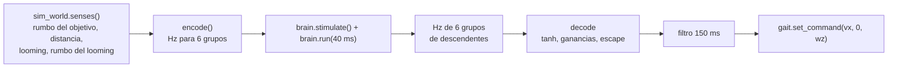
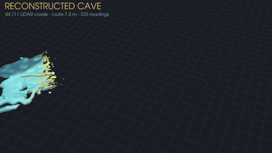

# 7 · El piloto: del sentido al músculo

> 🌐 [English](../brain/07-pilot.md) · **Español**

[← Validación](06-validacion.md) · [Índice](README.md) · [Siguiente: ver el cerebro en vivo →](08-visualizacion.md)

---

[`pilot.py`](../../../desktop/fly_brain/pilot.py) es el puente entre el robot y la
mosca. Tiene tres trabajos:

1. **Codificar** lo que percibe el robot como estímulos a neuronas sensoriales de la
   mosca.
2. **Correr el cerebro** el tiempo de un fotograma.
3. **Decodificar** las neuronas descendentes en un comando de marcha (`vx`, `wz`).

> Por ahora esto pilota el Spot Micro **simulado** del visor de la cueva. El robot
> físico no lleva los sensores de misión: ver
> [del simulador al robot real](10-del-simulador-al-robot-real.md).



---

## Por qué entrar por los ojos

Lo natural sería meter el **gas** por las neuronas olfativas y el **calor** por las
termosensoriales. Se probó, y en este modelo **no sirve**:

- **Saturan el cerebro.** Estimular solo 13 neuronas de calor a 5 Hz ya desata unas
  **150.000 espigas**. Con las olfativas pasa lo mismo a cualquier intensidad. El
  lóbulo antenal es muy recurrente y el modelo LIF no tiene adaptación ni
  inhibición suficiente para frenarlo.
- **No dan dirección.** La salida es siempre la misma (DNa02 izquierda), venga el
  estímulo de la izquierda o de la derecha. Con eso no se puede seguir un gradiente.

En cambio, los **circuitos visuales** están limpios, son lateralizados y están
validados en el modelo (ver [el barrido](09-herramientas-y-glosario.md#el-barrido-de-673-tipos)).
Así que se usa **sustitución sensorial**: el robot "le enseña" a la mosca cada
situación como la escena visual que la mosca ya sabe interpretar.

| Lo que pasa en la cueva | Cómo se lo presenta a la mosca | Circuito |
|---|---|---|
| Hay gas y viene de un lado | Un objeto pequeño en ese lado | Persecución (LC10) |
| El camino sigue delante | Algo delante | Avance (LC9, LC31a) |
| Calor fuerte u obstáculo que se acerca | Algo que crece rápido (*looming*) | Amenaza (LPLC2, LC4) |

El mundo (`sim_world.senses()`) resume todo en cuatro números: **rumbo** del
objetivo (gradiente de gas, o la galería si no hay gas, desviado por paredes y calor
moderado), **distancia** equivalente, **looming** (0–1) y su **rumbo**.

---

## Codificar: `encode()`

Seis grupos de entrada, cada uno con una frecuencia entre 0 y `MAX_HZ = 150` Hz (la
del artículo):

| Grupo | Neuronas | Cuándo se enciende |
|---|---|---|
| `objetivo_izq` / `objetivo_der` | LC10a, LC10c-1, LC10c-2, LC10d de ese lado | Objetivo a ese lado: `150 · saliencia · √max(0, ±sin rumbo)` |
| `delante_izq` / `delante_der` | LC9 + LC31a | Objetivo delante: `150 · saliencia · cos² rumbo` |
| `looming_izq` / `looming_der` | LPLC2 + LC4 | Algo se acerca, repartido según el lado |

La **saliencia** hace que el objetivo pese más de cerca y se apague al llegar, para
no chocar:

```python
sal = clip((dist - 0.15) / 0.25, 0, 1) * clip(0.9 / dist, 0, 1)
```

---

## Correr el cerebro: `step()`

```python
self.brain.stimulate(*[(self.inputs[k], hz) for k, hz in hz.items()])
counts = self.brain.run(ms)             # ms = duración real del fotograma (~40)
```

El cerebro avanza **exactamente el tiempo real del fotograma** (acotado entre 20 y
80 ms por el visor). Así la mosca vive al mismo ritmo que el robot: si el visor va a
25 fps, cada fotograma son 40 ms de vida neuronal (400 pasos).

El estado persiste entre fotogramas: la mosca no "reinicia" su cerebro, solo cambia
lo que ve.

> **Paso de integración según el hardware.** En GPU el piloto usa `dt = 0,1 ms` (el
> del artículo; la GPU va 8× por delante del tiempo real). En CPU, 0,1 ms iría a
> 0,29×: cada fotograma tardaría más que el tiempo que simula, el visor tocaría el
> tope de 80 ms y todo (mundo y cerebro, siempre sincronizados) iría a cámara lenta,
> a unos 3 fps. Por eso, **sin GPU, `FlyPilot` usa `dt = 0,5 ms` automáticamente**
> (~1× para el cerebro, frecuencias un 3 % distintas). Se puede forzar pasando
> `params=Params(dt=...)`.

---

## Decodificar

Se leen seis grupos de **descendentes** y se convierten en frecuencias (Hz):

| Grupo | Tipo | Se convierte en |
|---|---|---|
| `P9_izq`, `P9_der` | DNp09 | Avance |
| `DNa02_izq`, `DNa02_der` | DNa02 | Giro (diferencia izquierda − derecha) |
| `MDN` | *Moonwalker* | Retroceso |
| `GF` | DNp01, Giant Fiber | Escape |

```python
forward  = tanh(1.5 * (P9_izq + P9_der) / 2 / gain['forward'])
backward = tanh(MDN / 30)
turn     = tanh(1.5 * (DNa02_izq / gain['turn_izq'] - DNa02_der / gain['turn_der']))
if GF > 80 Hz:  escape durante 600 ms  →  vx = -1
```

- `tanh` acota a [−1, 1] y satura suavemente.
- **Escape:** si la Giant Fiber pasa de 80 Hz, el robot retrocede a fondo durante
  600 ms, como el salto de huida de la mosca.

### Calibración: el cerebro no es simétrico

El conectoma real **no es simétrico**. Por ejemplo, estimular LC10a izquierda lleva
DNa02 izquierda a **130 Hz**, y la derecha a solo **77 Hz**. Sin corregirlo, el
robot giraría siempre más hacia un lado.

Al arrancar, `calibrate()` mide la respuesta máxima de cada lado (300 ms de estímulo
a 150 Hz) y guarda las **ganancias** con las que se normaliza:

```
Brain on GPU · calibration {'turn_izq': 130, 'turn_der': 77, 'forward': ...}
```

### Suavizado

El cerebro es ruidoso (las entradas son Poisson). Para que los servos no den
tirones, el comando pasa por un filtro de primer orden con constante de **150 ms**:

```python
a = 1 - exp(-ms / 150)
vx += a * (vx_objetivo - vx)
wz += a * (wz_objetivo - wz)
```

---

## La misión, vista desde el cerebro

| Situación | Lo que ve la mosca | Descendente dominante | El robot |
|---|---|---|---|
| Nada detectado | Galería delante | P9 | Avanza siguiendo la galería |
| Pared cerca | Objetivo desplazado al lado libre | DNa02 de ese lado | Gira hacia lo despejado |
| Gas ≥ 20 ppm | Objetivo en la dirección del gradiente | DNa02 + P9 | Sigue el gas |
| Gas ≥ 450 ppm | Objetivo a 15 cm (saliencia 0) | — | Se para: **fuga localizada** |
| Calor ≥ 28 °C | Objetivo desplazado al lado contrario | DNa02 | Rodea la fuente (giro máximo a 42 °C) |
| Calor ≥ 48 °C u obstáculo | *Looming* | **Giant Fiber**, MDN | **Huye** hacia atrás |

En la galería de mina la fuga está a 14 m de la entrada. Sin gráficos, el cerebro
completo la encuentra en **unos 52 s**, en terreno plano y escarpado, sin chocar con
las paredes.

<p align="center">
  <a href="../../assets/spot-micro-cueva.mp4"></a>
</p>

---

## Cerebro y médula: el reparto

La mosca **no controla servos**. Decide a alto nivel (avanzar, girar, huir) y
[`gait.py`](../../../desktop/gait.py) hace de médula espinal: genera el patrón de
trote de las cuatro patas con ese comando, y
[`kinematics.py`](../../../desktop/kinematics.py) calcula los 12 ángulos. Es el
mismo reparto que en un animal: el cerebro elige la conducta; los generadores de
patrón del cordón nervioso coordinan las patas.

---

[← Validación](06-validacion.md) · [Índice](README.md) · [Siguiente: ver el cerebro en vivo →](08-visualizacion.md)
