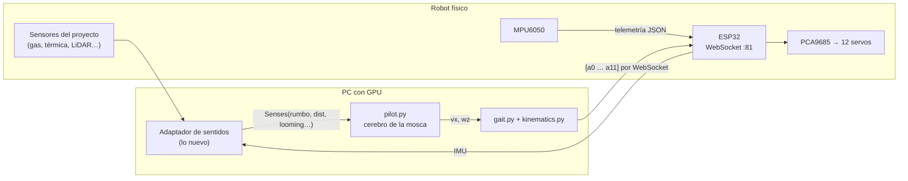

# 10 · Del simulador al robot real

> 🌐 [English](../brain/10-from-simulation-to-the-real-robot.md) · **Español**

[← Herramientas y glosario](09-herramientas-y-glosario.md) · [Índice](README.md) · [Siguiente: añadir una conducta nueva →](11-anadir-una-conducta.md)

---

## Dónde estamos hoy

El cerebro de la mosca **pilota solo el Spot Micro simulado** del visor de la cueva
(`spot_brain.py`). El Spot Micro físico se maneja desde la GUI de escritorio
(`spotmicro_gui.py`), que le manda ángulos por WebSocket al ESP32.

| | Simulación (`spot_brain.py`) | Robot físico |
|---|---|---|
| Quién decide | El cerebro de la mosca | La persona, desde la GUI |
| Gas | Sensor virtual (`sim_world.py`) | **No integrado** |
| Temperatura | Sensor virtual | **No integrado** (el MPU6050 mide su propia temperatura interna, no la del entorno) |
| LiDAR | LiDAR 360° virtual en la cabeza del brazo | **No integrado** |
| Brazo | Simulado (`spot_arm.py`) | No montado |
| IMU | Inclinación calculada del terreno | **MPU6050** real (equilibrio y telemetría) |
| Marcha y cinemática | `gait.py` + `kinematics.py` | Los mismos `gait.py` + `kinematics.py` desde la GUI |

## Sensores sin integrar, a propósito

**No se le integraron sensores de misión (gas, temperatura ambiente, LiDAR) al robot
físico, y fue una decisión deliberada:** así la plataforma se puede **adaptar a
distintos proyectos** sin rehacerla.

- El Spot Micro queda como una **base de locomoción genérica**: 12 servos, ESP32,
  IMU y un protocolo WebSocket documentado.
- Cada proyecto le monta **los sensores que necesite**: un detector de gas para
  inspección de minas, una cámara térmica para búsqueda y rescate, un LiDAR para
  mapeo, un sensor de humedad para cuevas…
- La simulación demuestra la cadena completa (sentidos → cerebro → marcha) con
  sensores **virtuales**, así que no hay que comprar ni cablear hardware para probar
  la idea.
- El piloto no depende de un sensor concreto: solo necesita cuatro números (rumbo del
  objetivo, distancia, *looming* y su rumbo). Cualquier sensor que se pueda resumir en
  eso le sirve.

---

## Cómo se conectaría

Todas las piezas ya existen. La cadena para pilotar el robot real con el cerebro
sería:

1. **El cerebro corre en el PC**, no en el robot. El ESP32 no tiene ni de lejos la
   memoria (~120 MB de pesos) ni la potencia para 138.639 neuronas. Con una GPU NVIDIA
   va 8 veces por delante del tiempo real, así que sobra margen para la latencia de la
   WiFi.
2. **Un adaptador de sentidos** (lo único que falta escribir) lee los sensores que
   lleve el proyecto y rellena un `Senses`, igual que hoy hace `sim_world.senses()`.
3. **`pilot.step()`** devuelve `vx` y `wz`, exactamente como en la simulación.
4. **`gait.py` y `kinematics.py`** convierten eso en 12 ángulos. Son los mismos
   módulos que ya usa la GUI con el robot real.
5. **Se envían al ESP32** con el protocolo que ya existe: un JSON `[a0, …, a11]` por
   WebSocket (puerto 81).

### Lo que ya está resuelto en el firmware

- **Fail-safe:** si el ESP32 pasa 1 s sin recibir nada, el robot se queda quieto en
  la última pose. Si el PC se cuelga o se corta la WiFi, no sale corriendo.
- **Latencia baja:** sin acuses por paquete, `WiFi.setSleep(false)`, I2C a 400 kHz.
- **Telemetría de la IMU** a 10 Hz (`cmd:start_mpu_stream`), útil para que el
  adaptador sepa si el robot se inclina.

### Lo que habría que hacer

| Tarea | Notas |
|---|---|
| Montar y leer los sensores del proyecto | En el ESP32 (añadiéndolos a la telemetría) o directamente en el PC (p. ej. un LiDAR USB) |
| Escribir el adaptador de sentidos | Traducir lecturas reales a `Senses`; ver [añadir una conducta](11-anadir-una-conducta.md) |
| Bucle de control en el PC | Cada ~40 ms: leer sentidos → `pilot.step()` → `gait.step()` → enviar ángulos |
| Localización | En la simulación el robot sabe su posición; en el real habría que estimarla (odometría + IMU, o SLAM con el LiDAR) |
| Seguridad | Una parada de emergencia en la GUI y límites de velocidad más bajos al principio |

---

[← Herramientas y glosario](09-herramientas-y-glosario.md) · [Índice](README.md) · [Siguiente: añadir una conducta nueva →](11-anadir-una-conducta.md)
