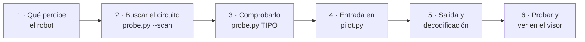

# 11 · Tutorial: añadir una conducta nueva

> 🌐 [English](../brain/11-adding-a-behaviour.md) · **Español**

[← Del simulador al robot real](10-del-simulador-al-robot-real.md) · [Índice](README.md) · [Siguiente: solución de problemas →](12-solucion-de-problemas.md)

---

Este tutorial enseña a darle al robot una conducta nueva **usando un circuito real
del cerebro de la mosca**. El ejemplo: **retroceder ante un precipicio**.

La idea es la misma que con el gas y el calor ([el piloto](07-piloto.md)): no
programamos "si hay precipicio, retrocede". Buscamos qué neuronas de la mosca llevan
a caminar hacia atrás y le presentamos el precipicio por ahí. La decisión la sigue
tomando el cerebro.



---

## 1. Decidir qué percibe el robot

Añade el nuevo sentido a `Senses` en
[`pilot.py`](../../../desktop/fly_brain/pilot.py), con un valor entre 0 y 1:

```python
@dataclass
class Senses:
    target_bearing: float | None = None
    target_dist: float = 1.0
    looming: float = 0.0
    looming_bearing: float = 0.0
    cliff: float = 0.0          # NUEVO: 0 = suelo firme, 1 = precipicio justo delante
```

En la simulación lo calcula el mundo (`sim_world.senses()`), por ejemplo mirando si
la altura del suelo cae de golpe delante del robot. En un robot real vendría de un
sensor de distancia apuntando al suelo (ver [robot real](10-del-simulador-al-robot-real.md)).

## 2. Buscar el circuito

¿Qué neuronas hacen caminar hacia atrás a la mosca? El barrido responde:

```bash
cd desktop/fly_brain
python probe.py --scan          # ~45 s en GPU: data/scan.csv
```

y se filtra por la descendente que interesa (MDN, *moonwalker*):

```python
import pandas as pd
scan = pd.read_csv('data/scan.csv')
cols = [c for c in scan.columns if c.startswith('MDN')]
scan['MDN'] = scan[cols].mean(axis=1)
print(scan.sort_values('MDN', ascending=False)[['cell_type', 'side', 'n', 'MDN']].head(10))
```

En el barrido salieron **LPC1, LC9 y LC6** como los que más activan MDN (15–32 Hz). LC9
ya se usa para avanzar y LC6 también dispara la Giant Fiber, así que el mejor
candidato es **LPC1**.

> **Cómo elegir bien:** busca un tipo que active **mucho** la descendente que
> quieres y **poco** las demás, que tenga varias neuronas (más estable) y, si la
> conducta tiene lado, que responda **solo en su lado** (compara `--side left` y
> `--side right`).

## 3. Comprobarlo a mano

```bash
python probe.py LPC1                  # ambos lados
python probe.py LPC1 --side left      # ¿es lateralizado?
python probe.py LPC1 --hz 75          # ¿responde también con estímulo más suave?
```

Mira la tabla de descendentes motoras: MDN tiene que subir y, si sube también la
Giant Fiber o P9, la conducta saldrá mezclada.

## 4. Añadir la entrada en el piloto

En `pilot.py`, un grupo nuevo en `INPUTS` (`None` = ambos lados):

```python
INPUTS = {
    ...
    'precipicio': (('LPC1',), None),
}
```

Y en `encode()`, de sentido a frecuencia:

```python
if s.cliff > 0:
    hz['precipicio'] = MAX_HZ * s.cliff
```

## 5. La salida y la decodificación

En este caso **no hay que tocar nada**: el piloto ya lee MDN y lo convierte en
retroceso:

```python
backward = math.tanh(rates['MDN'] / 30.0)
vx_target = forward - backward
```

Si la conducta nueva necesitara **otra descendente**, se añade a `OUTPUTS` y se usa
en `step()`:

```python
OUTPUTS = {..., 'DNg11': ('DNg11', None)}         # p. ej. aseo de patas delanteras
...
grooming = rates['DNg11'] > 40.0                  # umbral a ojo: mídelo con probe.py
```

Si la respuesta es **asimétrica** entre lados (pasa a menudo: el conectoma real no es
simétrico), añade una ganancia en `calibrate()` como las de `turn_izq` / `turn_der`.

## 6. Probarlo

**Sin gráficos**, unas líneas bastan para ver si el comando cambia:

```python
from connectome import Connectome
from pilot import FlyPilot, Senses

pilot = FlyPilot(Connectome.load())
pilot.calibrate()
for cliff in (0.0, 0.5, 1.0):
    pilot.reset()
    for _ in range(25):                                   # 1 s de cerebro
        cmd = pilot.step(Senses(target_bearing=0.0, target_dist=0.8, cliff=cliff), ms=40)
    print(f"cliff={cliff}: vx={cmd.vx:+.2f}  MDN={cmd.rates['MDN']:.0f} Hz")
```

Esperado: `vx` baja (y llega a negativo) a medida que sube `cliff`.

**En el visor**, para ver la barra nueva en la pestaña *Eyes*, añade la clave y la
etiqueta en `_build_charts()` de [`spot_brain.py`](../../../desktop/spot_brain.py):

```python
self.in_keys = [..., "precipicio"]
chart, self.in_series = bar_chart(pv, "Eyes: stimulus (Hz)", [..., "LPC1"], [..., YELLOW], 160, **full)
```

Y añade un test en `tests/` (sin datos de FlyWire, con redes pequeñas como
`test_pilot.py`) para que la codificación no se rompa sin avisar.

---

## Por qué no meterlo "a mano"

Sería más fácil escribir `if cliff > 0.5: vx = -1`. Pero entonces el cerebro no
participa: no compite con el resto de estímulos, no tiene su latencia ni su ruido, y el
robot deja de ser "pilotado por una mosca". Pasándolo por el conectoma, la decisión
sale de la interacción real entre circuitos: si a la vez hay un objetivo muy
saliente delante, P9 y MDN compiten como en la mosca.

---

[← Del simulador al robot real](10-del-simulador-al-robot-real.md) · [Índice](README.md) · [Siguiente: solución de problemas →](12-solucion-de-problemas.md)
