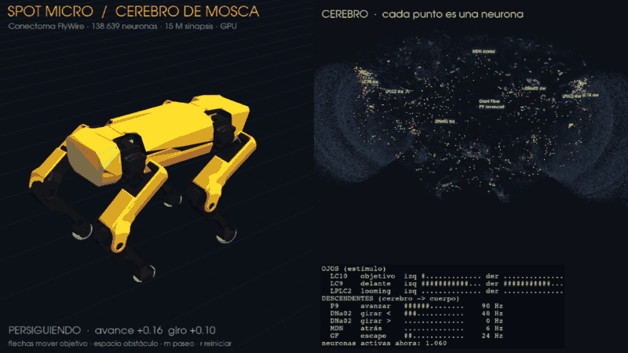
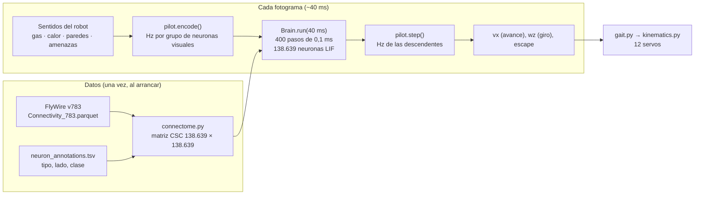

# Wiki · El cerebro del Spot Micro

> El Spot Micro explora una cueva pilotado por el **cerebro completo de una mosca de
> la fruta** (*Drosophila melanogaster*): las **138.639 neuronas** y los **~15
> millones de conexiones** del conectoma FlyWire v783, simuladas neurona a neurona
> en la GPU **8,3 veces más rápido que el tiempo real**.

Esta wiki explica toda la parte "cerebral" del proyecto: de dónde salen los datos,
qué ecuaciones se simulan, cómo está escrito el simulador en CPU y en GPU, **cómo
pasamos de 740 s a 3,6 s** en el mismo experimento, cómo sabemos que el resultado
sigue siendo correcto y cómo las decisiones de la mosca acaban moviendo las patas
del robot.

---

## Páginas

| # | Página | De qué trata |
|---|---|---|
| 1 | [El conectoma](01-conectoma.md) | Los datos de FlyWire, la matriz de pesos y cómo se buscan neuronas |
| 2 | [El modelo LIF](02-modelo-lif.md) | Las ecuaciones de cada neurona, los parámetros y por qué se eligieron |
| 3 | [El simulador en CPU](03-simulador-cpu.md) | `lif.py`: numba, bucle sin ramas, propagación por eventos |
| 4 | [El simulador en GPU](04-simulador-gpu.md) | `lif_gpu.py`: kernels CUDA, `atomicAdd`, CUDA Graphs |
| 5 | [**Cómo reducimos el tiempo**](05-reduccion-del-tiempo.md) | Todas las optimizaciones, una por una, con números |
| 6 | [Validación contra el original](06-validacion.md) | r = 0,999 frente al Brian2 de Shiu et al. y los dos detalles que hubo que igualar |
| 7 | [El piloto: del sentido al músculo](07-piloto.md) | Qué neuronas se estimulan, cuáles se leen y cómo se vuelve avance y giro |
| 8 | [Ver el cerebro en vivo](08-visualizacion.md) | El panel 3D: morfología, actividad, sinapsis y su rendimiento |
| 9 | [Herramientas, pruebas y glosario](09-herramientas-y-glosario.md) | `probe.py`, el barrido de 673 tipos, los tests y vocabulario |

Si solo vas a leer una, lee la **[5 · Cómo reducimos el tiempo](05-reduccion-del-tiempo.md)**.

---

## El cerebro en una imagen

La mosca hace de **cerebro** (decide avanzar, girar, huir o retroceder) y
`gait.py` hace de **médula espinal** (convierte la decisión en una marcha de cuatro
patas). Entre los dos solo pasan dos números: `vx` y `wz`.

---

## Cifras clave

| | |
|---|---|
| Neuronas simuladas | **138.639** (todas las del cerebro central y los lóbulos ópticos) |
| Conexiones | ~15 millones de pares neurona→neurona, con signo y nº de sinapsis |
| Paso de integración | **0,1 ms** (el del artículo original) → 10.000 pasos por segundo simulado |
| Velocidad en GPU (RTX 4060 Laptop) | **8,3× tiempo real** (~12 µs por paso) |
| Velocidad en CPU (i7-12650H) | 0,29× tiempo real (~345 µs por paso) |
| Mismo experimento que el original | **740 s → 3,6 s** (y con casi 4× más ensayos) |
| Fidelidad frente al original | **r = 0,999** neurona a neurona, pendiente 1,003 |
| Tiempo de cerebro por fotograma del visor | ~5 ms de GPU para 40 ms de vida de la mosca |

---

## Archivos

| Archivo | Papel |
|---|---|
| [`desktop/fly_brain/connectome.py`](../../../desktop/fly_brain/connectome.py) | Carga el conectoma y busca neuronas por tipo y lado |
| [`desktop/fly_brain/lif.py`](../../../desktop/fly_brain/lif.py) | Modelo LIF + simulador en CPU (numba) + `make_brain()` |
| [`desktop/fly_brain/lif_gpu.py`](../../../desktop/fly_brain/lif_gpu.py) | El mismo simulador en GPU (CuPy + CUDA) |
| [`desktop/fly_brain/pilot.py`](../../../desktop/fly_brain/pilot.py) | Sentidos → neuronas → descendentes → comando de marcha |
| [`desktop/fly_brain/probe.py`](../../../desktop/fly_brain/probe.py) | Experimentos: estimular un tipo y ver qué descendentes responden |
| [`desktop/fly_brain/validate_brian2.py`](../../../desktop/fly_brain/validate_brian2.py) | Comparación neurona a neurona con el `model.py` original |
| [`desktop/fly_brain/download_data.py`](../../../desktop/fly_brain/download_data.py) | Descarga conectoma y anotaciones (~130 MB) |
| [`desktop/fly_brain/download_skeletons.py`](../../../desktop/fly_brain/download_skeletons.py) | Descarga y simplifica la forma de cada neurona |
| [`desktop/spot_brain.py`](../../../desktop/spot_brain.py) | El visor: robot, cerebro en 3D, mapa y gráficas |

Para instalar y ejecutar, ver el [README de fly_brain](../../../desktop/fly_brain/README.md).
